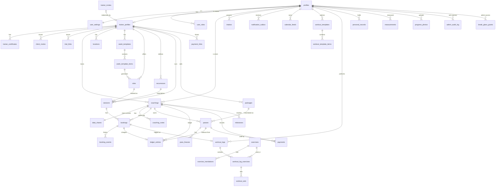

# DaFit — модель данных

- Статус: проект (до первой миграции схемы домена)
- Дата: 2026-10-13
- Источники: [`docs/decisions.md`](../decisions.md) (первоисточник), [`CONTEXT.md`](../../CONTEXT.md) (словарь и имена в коде), [`docs/prd/README.md`](../prd/README.md) (волны), [`docs/prd/wave-2.md`](../prd/wave-2.md), ADR [0001](../adr/0001-supabase-backend.md), [0002](../adr/0002-secrets-handling.md), [0004](../adr/0004-telegram-auth.md), миграция `supabase/migrations/20261012204303_profiles.sql`.

Документ — основа для миграций. Блоки SQL ниже — **спецификация**, а не готовые миграции: порядок создания, `comment on`, триггеры `set_updated_at` и гранты дописываются при переносе в `supabase/migrations/`. Если документ расходится с `decisions.md`, прав журнал. Решения, которых в журнале нет, собраны в разделе «Допущения» в конце.

Имена таблиц — английские, во множественном числе, от имён из `CONTEXT.md`: `coaching` → `coachings`, `pass` → `passes`, `set` → `workout_sets` (`set` — ключевое слово SQL), `charge`/`waiver` → строки `ledger_entries`.

---

## 1. Принципы

### 1.1. Платформа и RLS

- Supabase Postgres (ADR 0001). PostgREST открывает схемы `public` и `graphql_public`. Всё, что клиент не должен вызывать или читать напрямую, живёт в **неэкспонированных** схемах:
  - `private` — вспомогательные функции для RLS, триггерные функции, внутренние таблицы (outbox-курсоры и т. п.);
  - `analytics` — материализованные представления для админ-аналитики.
- **RLS включён на каждой таблице в `public`**, политики явные; по умолчанию запрещено всё. Таблица без политик на запись — значит, писать в неё может только серверный код или SECURITY DEFINER-функция (так уже сделано для `profiles`).
- В политиках `auth.uid()` всегда пишется как `(select auth.uid())`, а функции-помощники — как `(select private.fn(...))`, где это возможно: Postgres вычисляет их один раз на запрос (initPlan), а не на каждую строку.
- Каждый столбец, на который ссылается политика (`trainer_id`, `client_id`, `coaching_id`, `session_id`, `user_id`), проиндексирован.
- Анонимной роли (`anon`) доступны только SECURITY DEFINER-функции витрины (`get_trainer_showcase`, `get_trial_link`), не таблицы.
- После каждой DDL-миграции — Supabase security advisors (CLAUDE.md).

### 1.2. Идентификаторы и общие столбцы

- Первичный ключ — `uuid default gen_random_uuid()`. Исключение — объёмные журналы, где нужен только порядок (`admin_audit_log`, `notification_outbox`, `booking_events`, `product_events`): `bigint generated always as identity`.
- `created_at timestamptz not null default now()`; изменяемым таблицам — `updated_at timestamptz not null default now()` + триггер `public.set_updated_at()` (уже есть в миграции profiles).
- Внешние ключи на пользователя указывают на `public.profiles(id)` (а он — на `auth.users(id) on delete cascade`). Поэтому удаление пользователя из `auth.users` каскадно удаляет его личные данные; учётные таблицы тренера (`coachings`, `bookings`, `passes`, `ledger_entries`, `payments`) ссылаются на клиента с `on delete restrict` и до удаления переназначаются на «Удалённого клиента» (см. 1.6).

### 1.3. Время

- Все моменты времени — `timestamptz` (хранится в UTC). `timestamp without time zone` не используется нигде, кроме локального времени правила повтора (`recurrences.dtstart_local`), где это и есть смысл значения.
- **Часовой пояс IANA** хранится:
  - у пользователя — `user_settings.time_zone` (отображение, «день» клиента для дневника и активности, тихие часы, время утренней сводки, напоминания домашних заданий);
  - у правил расписания — `week_templates.time_zone`, `recurrences.time_zone` (копируется из пояса тренера при создании), чтобы разворачивание «пн/ср/пт 8:00» давало 8:00 местного времени и через переход на летнее/зимнее время;
  - аналитика тренера считает календарные периоды в поясе тренера (`user_settings.time_zone` тренера).
- Валидация пояса: домен `public.iana_tz` (`text`, проверка через `private.is_valid_tz(text)`, которая ищет имя в `pg_timezone_names`; функция объявлена `immutable` осознанно — список поясов меняется только при обновлении Postgres).
- «Дни» (дневник питания, активность, замеры, домашние задания) хранятся как `date` — дата **в поясе клиента на момент записи** (wave-2). Рядом, где нужно, — точный момент `timestamptz`.
- Длительности — `integer` в минутах/секундах с суффиксом (`duration_min`, `duration_s`), не `interval`: проще для API и типов.

### 1.4. Деньги и единицы

- Сумма — `bigint` в минимальных единицах (`*_minor`: копейки/центы) + `currency public.currency_code` (`char(3)`, проверка `^[A-Z]{3}$`, ISO 4217). Плавающая точка и `numeric` для денег не используются.
- Суммы разных валют никогда не складываются в БД: агрегаты группируются по `currency` (wave-2, мультивалютность без конвертации).
- Физические величины хранятся в метрике: вес — `numeric(6,2)` кг, длины — `numeric(6,1)` см, вода — мл (`integer`), сон — минуты, расстояние — метры. Имперские единицы — только в интерфейсе (`user_settings.unit_system`).

### 1.5. Удаление: soft vs hard

| Класс данных | Политика | Почему |
|---|---|---|
| Личные данные клиента (замеры, фото, дневник, активность, анкета, цель, свои продукты) | **Hard delete** владельцем в любой момент | Данные принадлежат клиенту; история не нужна никому, кроме него |
| Деньги и учёт: `ledger_entries`, `payments`, `bookings`, `booking_events`, `sessions` | **Никогда не удаляются** пользователем. Отмена — статусом (`cancelled`, `voided`), исправление — новой строкой (сторно) | Журнал, на котором держатся остаток, долг и выручка; «История с причинами» (Q21) |
| Справочники, на которые ссылается история: `packages`, `locations`, `exercises` (свои), `workout_templates`, `groups`, `payment_links`, `client_invites`, `trial_links`, `referral_offers` | **Soft delete**: `archived_at timestamptz` | Старые абонементы/занятия/логи должны продолжать показывать название пакета, локации, упражнения |
| Пара `coachings` | Не удаляется; `status = 'ended'` | История занятий и оплат остаётся видна обеим сторонам |
| Модерируемый контент (`reviews`, W4 `posts`) | Soft delete (`deleted_at`), окончательно стирается при удалении аккаунта автора | Нужен для разбора споров админом |
| Объекты Storage | Hard delete вместе со строкой (серверная задача, т. к. Storage не каскадится от FK) | — |

### 1.6. Удаление аккаунта (30 дней, Q44)

1. Пользователь вызывает `request_account_deletion()` → строка в `account_deletions` (`scheduled_for = now() + interval '30 days'`).
2. Сразу: будущие записи пользователя отменяются бесплатно (`cancelled`, `cancelled_by_role = 'system'`); уведомления ему больше не отправляются; тренеры видят метку «клиент удаляет аккаунт». Если он тренер — его будущие занятия отменяются, клиенты получают уведомление.
3. В течение 30 дней вход разрешён только для отмены удаления (`cancel_account_deletion()`); экспорт данных доступен.
4. Через 30 дней cron (серверный код с секретным ключом) выполняет **обезличивание**, а не полный каскад (решение владельца продукта):
   - удаляются объекты Storage пользователя и все личные данные: `user_settings`, `body_profiles`, `client_goals`, `intakes`, `measurements`, `progress_photos`, `food_diary_entries`, свои продукты, `activity_entries`, `nutrition_targets`, свои `workout_logs` (без `coaching_id`), `coaching_notes` о нём, `data_shares`, токены, `calendar_feeds`, `reviews`, участие в W3/W4;
   - учётные строки, принадлежащие тренеру, **сохраняются**: `coachings` (статус `ended`), `sessions`, `bookings`, `booking_events`, `passes`, `ledger_entries`, `payments` — ссылка на клиента переводится на системный профиль-заглушку «Удалённый клиент» (`private.deleted_client_id()`, один на всю БД; `coachings.client_alias` обнуляется). Поскольку на заглушку может указывать несколько пар одного тренера, `unique (trainer_id, client_id)` у `coachings` проверяется только для `client_id <> deleted_client_id()` (частичный уникальный индекс вместо ограничения);
   - затем `auth.admin.deleteUser(id)`; FK на `profiles` у сохраняемых учётных таблиц — `on delete restrict`, поэтому удаление без предварительного переназначения падает, а не стирает учёт тренера.
   Аналитика тренера продолжает учитывать эти занятия и деньги как «Удалённый клиент».
5. В `admin_audit_log` остаётся запись о факте удаления (идентификатор без FK, без персональных данных).

### 1.7. Журнал действий админа

`admin_audit_log` — append-only (триггер запрещает `update`/`delete` всем, включая `service_role`; очистка — только миграцией). Пишется **в той же транзакции**, что и действие: все админские действия идут через SECURITY DEFINER-функции `admin_*`, вызываемые с сессией самого админа, поэтому `actor_id = auth.uid()` нельзя подделать. Логируются: выдача/отзыв инвайтов, решения по верификации, решения по жалобам и отзывам, выдача/снятие роли, аварийный доступ, открытие карточки конкретного тренера в аналитике (wave-2 §8).

### 1.8. Как `auth.uid()` связан с профилем

- Вход — ADR 0004: сервер создаёт пользователя Supabase Auth (`app_metadata.telegram_id`) и делает upsert в `public.profiles`. `profiles.id = auth.users.id = auth.uid()`.
- Значит, в политиках «я» = `(select auth.uid())`, и любой `user_id`/`client_id`/`trainer_id` сравнивается с ним напрямую — без join на profiles.
- «Я тренер» = существует `trainer_profiles` с `user_id = auth.uid()`. «Я админ» = строка в `user_roles` с `role = 'admin'`. «Я клиент тренера X» = существует `coachings(trainer_id = X, client_id = auth.uid())`.
- `profiles` по-прежнему пишет только сервер при входе. Всё, что пользователь меняет сам, вынесено в `user_settings` (1:1).

### 1.9. Кто пишет: RLS, RPC или сервер

Три пути записи, по убыванию предпочтения:

1. **Напрямую через RLS** (клиент Supabase с сессией пользователя, `lib/supabase/server.ts`) — когда запись затрагивает одну таблицу и инвариант выражается политикой `with check`: настройки, свои замеры, дневник, логи тренировок, справочники тренера (локации, пакеты, шаблоны), заметки, группы.
2. **Доменные RPC** — `security definer` функции в `public` с `set search_path = ''`, `revoke execute ... from public, anon`, `grant execute ... to authenticated`. Первая строка тела определяет `v_uid := auth.uid()` и проверяет права явно. Используются, когда операция трогает несколько таблиц или требует блокировок: запись на занятие, отмена/перенос, отметка посещения, списание/прощение, создание абонемента, присоединение по ссылке, лист ожидания, выпуск токенов, все `admin_*`. Таблицы, в которые пишут только RPC (`bookings`, `ledger_entries`, `booking_events`), не имеют политик insert/update/delete вовсе.
3. **Сервер с секретным ключом** (`lib/supabase/admin.ts`) — только там, где нет пользовательской сессии или нужно обойти RLS ради системной работы (ADR 0002 п. 6):
   - вход через Telegram: upsert `profiles`, создание `auth.users`;
   - диспетчер уведомлений (outbox → Telegram) и обработчик webhook бота;
   - cron-задачи: материализация повторов и шаблонов недели, автозавершение занятий, утренняя сводка, дневные сводки питания, флаги оттока, обновление MV, очистка удалённых аккаунтов;
   - приём шагов от iOS Shortcuts (личный токен → пользователь);
   - отдача ICS-ленты календаря (токен → пользователь);
   - кеш Open Food Facts и импорт wger;
   - генерация архива экспорта данных.
   Сервер с секретным ключом **никогда** не отдаёт данные пользователю, прочитанные в обход RLS, кроме ICS-ленты (данные владельца токена, тот же набор, что он видит сам) и ответа iOS Shortcuts (только статус).

### 1.10. Storage

| Bucket | Доступ | Путь | Правила |
|---|---|---|---|
| `avatars` | public read (неугадываемый путь) | `{user_id}/{uuid}.webp` | Запись/удаление — только владелец (`(storage.foldername(name))[1] = auth.uid()::text`). ≤ 2 МБ, `image/webp`, `image/jpeg`, `image/png` |
| `certificates` | private | `{trainer_id}/{certificate_id}.{ext}` | Запись — владелец-тренер; чтение — владелец и админ (через signed URL). ≤ 10 МБ, изображения и PDF |
| `progress-photos` | private | `{client_id}/{photo_id}.webp` | Загружается **только уже размытая** на устройстве версия (Q24/Q30); оригинал не покидает устройство. Запись/удаление — только клиент-владелец. Чтение — политика `storage.objects` через `private.can_view(owner, 'photos')`; клиент приложения получает **signed URL на 5 минут**. ≤ 5 МБ, `image/webp`, `image/jpeg` |
| `exercise-media` | public read | `wger/{wger_id}/…`, `custom/{owner_id}/{uuid}.webp` | Запись wger — сервер; custom — владелец |
| `feedback` | private | `{user_id}/{feedback_id}/{n}.webp` | Запись — автор; чтение — автор и админ |
| `exports` | private | `{user_id}/{export_id}.zip` | Запись — сервер; чтение — владелец, signed URL на 15 мин; объект удаляется через 7 дней |
| W4 `post-media` | public read | `{user_id}/{post_id}/{n}.webp` | Запись — автор; модерация — админ |

---

## 2. Схема по волнам

Обозначения: `PK`, `FK`, `UQ`, `IX` (индекс), `CK` (check). Если nullability не указана — `not null`. Общие столбцы `created_at`/`updated_at` опущены, где они стандартные.

### 2.0. Расширения, домены, общие enum

```sql
create schema if not exists private;
create schema if not exists analytics;
create extension if not exists btree_gist with schema extensions;   -- exclusion по времени
create extension if not exists pg_trgm with schema extensions;      -- поиск упражнений и продуктов
-- Порядок в миграциях: enum (session_mode и др.) создаются до таблиц, которые на них ссылаются.
create extension if not exists pg_cron;                              -- планировщик (Supabase)
create extension if not exists pg_net with schema extensions;        -- HTTP-вызов диспетчера
-- W4: create extension if not exists postgis with schema extensions;

create function private.is_valid_tz(tz text) returns boolean
  language sql immutable set search_path = '' as
  $$ select exists (select 1 from pg_catalog.pg_timezone_names where name = tz) $$;

create domain public.iana_tz as text check (private.is_valid_tz(value));
create domain public.currency_code as char(3) check (value ~ '^[A-Z]{3}$');

create type public.app_role as enum ('admin');
create type public.app_locale as enum ('ru', 'en');
create type public.app_theme as enum ('system', 'light', 'dark');
create type public.unit_system as enum ('metric', 'imperial');
create type public.app_zone as enum ('trainer', 'client');
create type public.share_category as enum ('nutrition', 'measurements', 'photos', 'steps', 'intake', 'workouts');
```

Остальные enum определены рядом с таблицами. Новые значения добавляются `alter type ... add value` (не переписывает данные).

---

### 2.1. Волна 1 — «Тренер ведёт клиентов» (полностью)

#### Люди и доступ

**`profiles`** (существует; дополняется миграцией)

```sql
alter table public.profiles
  add column last_seen_at   timestamptz,          -- обновляет сервер при входе; для админки «последний вход»
  add column bot_started_at timestamptz,          -- пользователь нажал /start; без этого бот не может писать
  add column bot_blocked_at timestamptz;          -- Telegram вернул 403 при отправке; сброс при /start
-- Столбец telegram_id скрывается от всех клиентов: колоночные гранты
revoke select on public.profiles from authenticated;
grant select (id, username, first_name, last_name, photo_url, language_code, created_at, updated_at, last_seen_at)
  on public.profiles to authenticated;
```

**`user_settings`** — всё, что пользователь меняет сам (1:1, создаётся сервером при первом входе).

```sql
create table public.user_settings (
  user_id              uuid primary key references public.profiles(id) on delete cascade,
  display_name         text check (char_length(display_name) between 1 and 64),  -- null = имя из Telegram
  avatar_path          text,                       -- объект в bucket avatars; null = photo_url Telegram
  locale               public.app_locale not null default 'ru',   -- автоопределение из language_code при создании
  theme                public.app_theme not null default 'system',
  unit_system          public.unit_system,         -- null = по локали (en-US → imperial)
  time_zone            public.iana_tz not null default 'Europe/Moscow',  -- уточняется клиентом при первом входе
  last_zone            public.app_zone not null default 'client',
  quiet_hours_start    time,                       -- оба null = тихие часы выключены
  quiet_hours_end      time,
  morning_summary_time time not null default '08:00',  -- используется, если пользователь — тренер
  leaderboard_opt_in   boolean not null default false,  -- W3, глобальное согласие на лидерборды
  updated_at           timestamptz not null default now(),
  check ((quiet_hours_start is null) = (quiet_hours_end is null))
);
```

**`notification_preferences`** — только переопределения; отсутствие строки = значение по умолчанию из кода.

```sql
create type public.notification_type as enum (
  'booking_created','booking_requested','booking_confirmed','booking_declined',
  'booking_cancelled','booking_rescheduled','session_reminder','session_changed',
  'pass_ending','pass_expired','debt','payment_reported','morning_summary',
  'contact_request','verification_result','milestone',
  -- W2
  'trainer_comment','trainer_broadcast','homework_reminder','homework_done',
  'waitlist_offer','waitlist_closed','review_prompt','review_reply','goal_changed',
  -- W3
  'delegation','challenge','badge','referral_bonus',
  -- служебные
  'report_resolution','account_deletion','break_glass'
);

create table public.notification_preferences (
  user_id  uuid references public.profiles(id) on delete cascade,
  type     public.notification_type,
  enabled  boolean not null,
  primary key (user_id, type)
);
```

**`user_roles`**

```sql
create table public.user_roles (
  user_id    uuid references public.profiles(id) on delete cascade,
  role       public.app_role,
  granted_by uuid references public.profiles(id) on delete set null,
  granted_at timestamptz not null default now(),
  primary key (user_id, role)
);
```

Тренер — это не роль, а наличие `trainer_profiles` (одна учётная запись, две зоны, Q13).

**`consents`** — бета-согласие при первом входе (Q44), append-only.

```sql
create type public.consent_kind as enum ('beta_terms', 'privacy_policy', 'contact_share');
create table public.consents (
  id          uuid primary key default gen_random_uuid(),
  user_id     uuid not null references public.profiles(id) on delete cascade,
  kind        public.consent_kind not null,
  version     text not null,                 -- версия текста, например '2026-11-beta'
  accepted_at timestamptz not null default now(),
  revoked_at  timestamptz
);
create index on public.consents (user_id, kind);
```

**`account_deletions`**, **`data_exports`**

```sql
create table public.account_deletions (
  user_id       uuid primary key references public.profiles(id) on delete cascade,
  requested_at  timestamptz not null default now(),
  scheduled_for timestamptz not null,
  cancelled_at  timestamptz
);
create index on public.account_deletions (scheduled_for) where cancelled_at is null;

create type public.export_status as enum ('queued', 'processing', 'ready', 'failed', 'expired');
create table public.data_exports (
  id           uuid primary key default gen_random_uuid(),
  user_id      uuid not null references public.profiles(id) on delete cascade,
  status       public.export_status not null default 'queued',
  storage_path text,
  requested_at timestamptz not null default now(),
  ready_at     timestamptz,
  expires_at   timestamptz
);
create index on public.data_exports (user_id, requested_at desc);
```

#### Тренер, инвайты, верификация

```sql
create type public.verification_status as enum ('pending', 'verified', 'rejected');

create table public.trainer_profiles (
  user_id                     uuid primary key references public.profiles(id) on delete cascade,
  slug                        text not null unique check (slug ~ '^[a-z0-9][a-z0-9-]{2,31}$'),  -- адрес витрины
  headline                    text check (char_length(headline) <= 120),
  bio                         text check (char_length(bio) <= 2000),
  specialties                 text[] not null default '{}',
  city                        text,
  works_offline               boolean not null default true,
  works_online                boolean not null default false,
  is_public                   boolean not null default true,      -- витрина доступна по ссылке/QR (не отдаётся при verification_status = 'rejected', Q15)
  referred_by_trainer_id      uuid references public.profiles(id) on delete set null,
  verification_status         public.verification_status not null default 'pending',
  verified_at                 timestamptz,
  default_currency            public.currency_code not null default 'RUB',
  cancellation_deadline_hours smallint not null default 24 check (cancellation_deadline_hours between 0 and 168),
  default_client_reminder_offsets smallint[] not null default '{1440,60}',  -- минуты до занятия; для новых пар
  own_reminder_offsets        smallint[] not null default '{60}',           -- напоминания самому тренеру
  trainer_invite_id           uuid unique,                                  -- FK ниже; каким инвайтом пришёл
  -- зарезервировано (later): studio_id uuid — добавляется со студиями
  updated_at                  timestamptz not null default now(),
  check (cardinality(default_client_reminder_offsets) <= 3
         and 5 <= all(default_client_reminder_offsets) and 10080 >= all(default_client_reminder_offsets)),
  check (cardinality(own_reminder_offsets) <= 3
         and 5 <= all(own_reminder_offsets) and 10080 >= all(own_reminder_offsets))
);

create table public.trainer_certificates (
  id           uuid primary key default gen_random_uuid(),
  trainer_id   uuid not null references public.trainer_profiles(user_id) on delete cascade,
  title        text not null,
  issuer       text,
  issued_on    date,
  storage_path text not null,                 -- bucket certificates
  created_at   timestamptz not null default now()
);
create index on public.trainer_certificates (trainer_id);

create table public.trainer_verifications (    -- история решений; текущий статус — в trainer_profiles
  id          uuid primary key default gen_random_uuid(),
  trainer_id  uuid not null references public.trainer_profiles(user_id) on delete cascade,
  decision    public.verification_status not null,   -- pending = повторная подача
  reason      text,                                  -- обязательна при rejected
  decided_by  uuid references public.profiles(id) on delete set null,
  created_at  timestamptz not null default now(),
  check (decision <> 'rejected' or reason is not null)
);
create index on public.trainer_verifications (trainer_id, created_at desc);

create table public.trainer_invites (
  id          uuid primary key default gen_random_uuid(),
  code_hash   bytea not null unique,           -- sha256 кода; сам код показывается админу один раз
  code_hint   text not null,                   -- последние 4 символа для поиска в админке
  note        text,                            -- кому выдан
  created_by  uuid references public.profiles(id) on delete set null,
  expires_at  timestamptz,
  redeemed_by uuid unique references public.profiles(id) on delete set null,
  redeemed_at timestamptz,
  revoked_at  timestamptz,
  created_at  timestamptz not null default now(),
  check ((redeemed_by is null) = (redeemed_at is null))
);
alter table public.trainer_profiles
  add foreign key (trainer_invite_id) references public.trainer_invites(id) on delete set null;
```

Ссылки клиента и на пробное:

```sql
create table public.client_invites (
  id          uuid primary key default gen_random_uuid(),
  trainer_id  uuid not null references public.trainer_profiles(user_id) on delete cascade,
  token       text not null unique,            -- в ссылке/QR (startapp-параметр), 22 симв. base64url
  code        text not null unique check (code ~ '^[A-Z0-9]{6}$'),  -- «Введите код тренера»
  label       text,                            -- «Основная», «Зал на Ленина»
  max_uses    integer check (max_uses > 0),
  uses_count  integer not null default 0,
  expires_at  timestamptz,
  archived_at timestamptz,
  created_at  timestamptz not null default now()
);
create index on public.client_invites (trainer_id);

create table public.trial_links (
  id           uuid primary key default gen_random_uuid(),
  trainer_id   uuid not null references public.trainer_profiles(user_id) on delete cascade,
  token        text not null unique,
  title        text not null,
  description  text,
  duration_min smallint not null default 60 check (duration_min between 15 and 240),
  price_minor  bigint not null default 0 check (price_minor >= 0),   -- 0 = бесплатное пробное
  currency     public.currency_code not null,
  location_id  uuid,                           -- FK ниже; null = любая из слотов
  mode         public.session_mode,            -- null = как в слоте
  max_uses     integer check (max_uses > 0),
  uses_count   integer not null default 0,
  expires_at   timestamptz,
  archived_at  timestamptz,
  created_at   timestamptz not null default now()
);
create index on public.trial_links (trainer_id);
```

Токены клиентских ссылок хранятся открыто: это не секрет, а адрес (их печатают в QR и показывают многократно); раскрытие токена даёт только возможность стать клиентом этого тренера — это и есть назначение ссылки. Код инвайта тренера, наоборот, даёт привилегию и хранится хешем.

#### Пара, разрешения, заметки, анкета, связь

```sql
create type public.coaching_status as enum ('trial', 'active', 'ended');
create type public.coaching_source as enum ('client_invite', 'trainer_code', 'trial_link', 'referral', 'manual'); -- 'manual' = карточка клиента без аккаунта (managed_client), см. ниже

create table public.coachings (
  id                        uuid primary key default gen_random_uuid(),
  trainer_id                uuid not null references public.trainer_profiles(user_id) on delete cascade,
  client_id                 uuid not null references public.profiles(id) on delete restrict,  -- restrict: при удалении аккаунта переназначается на «Удалённого клиента» (§1.6)
  status                    public.coaching_status not null default 'active',
  source                    public.coaching_source not null,
  client_invite_id          uuid references public.client_invites(id) on delete set null,
  trial_link_id             uuid references public.trial_links(id) on delete set null,
  started_at                timestamptz not null default now(),   -- «вместе с …»
  ended_at                  timestamptz,
  ended_by                  uuid references public.profiles(id) on delete set null,
  end_reason                text,
  client_alias              text,          -- как тренер подписал клиента у себя; клиенту не видно
  cancellation_deadline_hours smallint check (cancellation_deadline_hours between 0 and 168), -- null = из trainer_profiles
  self_book_on_debt         boolean not null default false,       -- «Разрешить запись в долг» этому клиенту (Q22); долг при списании возникает всегда
  debt_limit_sessions       smallint check (debt_limit_sessions > 0),  -- null = без лимита при self_book_on_debt
  client_reminder_offsets   smallint[] not null,                  -- копия default_client_reminder_offsets при создании; меняет клиент
  broadcasts_muted          boolean not null default false,       -- W2: клиент отключил рассылки этого тренера
  primary_nutrition_group_id uuid,                                -- W2, FK добавляется с groups
  churn_hidden_until        date,                                 -- W2: тренер скрыл из «угрозы ухода»
  -- зарезервировано (later): studio_id uuid
  updated_at                timestamptz not null default now(),
  check (trainer_id <> client_id),
  check ((status = 'ended') = (ended_at is not null)),
  check (cardinality(client_reminder_offsets) <= 3
         and 5 <= all(client_reminder_offsets) and 10080 >= all(client_reminder_offsets))
);
create index on public.coachings (client_id);
create index on public.coachings (trainer_id, status);
-- одна пара на (тренер, клиент), кроме обезличенных пар «Удалённого клиента» (§1.6)
create unique index coachings_trainer_client_uniq on public.coachings (trainer_id, client_id)
  where client_id <> private.deleted_client_id();
```

Повторное присоединение к тому же тренеру после `ended` реактивирует ту же строку (`coachings_trainer_client_uniq`), история сохраняется.

**Карточка клиента без аккаунта** (`managed_client`, журнал решений §4, было O1). Чтобы не делать `client_id` nullable в десятке таблиц (`bookings`, `passes`, `ledger_entries`, `payments`, `measurements`, `workout_logs` …), карточка — это обычная строка `profiles` без возможности входа:

```sql
alter table public.profiles
  add column managed_by_trainer_id uuid references public.trainer_profiles(user_id) on delete cascade,  -- не null = карточка без аккаунта
  add column claimed_by            uuid references public.profiles(id) on delete set null;              -- в кого слита карточка (до удаления)

create table public.managed_client_claims (       -- запрос тренеру «Это <Имя>?» при приходе человека по ссылке
  id                uuid primary key default gen_random_uuid(),
  trainer_id        uuid not null references public.trainer_profiles(user_id) on delete cascade,
  claimant_id       uuid not null references public.profiles(id) on delete cascade,   -- реальный пользователь
  new_coaching_id   uuid not null references public.coachings(id) on delete cascade,  -- его новая пара
  managed_client_id uuid references public.profiles(id) on delete cascade,            -- выбранная тренером карточка
  status            text not null default 'pending' check (status in ('pending', 'merged', 'rejected')),
  decided_at        timestamptz,
  created_at        timestamptz not null default now()
);
create index on public.managed_client_claims (trainer_id) where status = 'pending';
```

- Создание: RPC `create_managed_client(display_name, note)` (тренер) — серверный код создаёт пользователя Supabase Auth **без** `telegram_id` (синтетический email `managed-<uuid>@users.fit.invalid`, `banned_until = 'infinity'`), строку `profiles` с `managed_by_trainer_id = uid`, пару `coachings(source = 'manual')` и `data_shares` со всеми категориями `true` (данные вносит тренер; разрешения клиента не применимы, пока клиента нет). Войти под карточкой невозможно: `signInWithTelegram()` ищет только по `app_metadata.telegram_id` (ADR 0004).
- Уведомления: `private.enqueue_notification()` пропускает получателей с `managed_by_trainer_id is not null`; запись на слоты и напоминания для пары-карточки недоступны.
- RLS: карточку видят только её тренер и его делегаты (политика `profiles` через `managed_by_trainer_id = uid` / `is_coaching_trainer`); в остальном работают обычные политики пары.
- Переход (claim): `join_by_invite` / `join_by_code` создают пару как обычно и, если у тренера есть карточки без аккаунта, — строку `managed_client_claims (pending)` и уведомление тренеру. RPC `resolve_managed_client_claim(claim_id, managed_client_id | null)` (тренер) в одной транзакции: переносит все строки карточки на `claimant_id` (`update … set client_id = claimant` в `coachings`, `sessions`/`bookings`, `passes`, `ledger_entries`, `payments`, `coaching_notes`, `measurements`, `workout_logs`, `personal_records` …), объединяет пару карточки с новой парой (история переносится в пару карточки, новая пара удаляется, `coachings.source` остаётся `manual`, сохраняется `started_at` карточки), сбрасывает `data_shares` на умолчания клиента (`intake = false`, `intake_decided_at = null` → клиенту показывается шаг согласия), ставит `profiles.claimed_by`, пишет `booking_events`/журнал пары и удаляет пользователя Auth карточки. `null` → `rejected`, карточка остаётся. Слияние необратимо.


```sql
create table public.data_shares (              -- одна строка на пару, создаётся вместе с парой
  coaching_id  uuid primary key references public.coachings(id) on delete cascade,
  nutrition    boolean not null default true,  -- дневник, норма, вода, цель, параметры калькулятора
  measurements boolean not null default true,  -- вес и замеры
  photos       boolean not null default false, -- фото прогресса — только явным разрешением (Q38)
  steps        boolean not null default true,  -- шаги и сон
  intake       boolean not null default false, -- анкета: только по явному согласию при создании пары (Q38)
  intake_decided_at timestamptz,               -- когда клиент ответил на шаг согласия; null = ещё не ответил (анкета скрыта)
  workouts     boolean not null default true,  -- самостоятельные тренировки клиента (Q38)
  updated_at   timestamptz not null default now()
);

create table public.coaching_notes (
  id                uuid primary key default gen_random_uuid(),
  coaching_id       uuid not null references public.coachings(id) on delete cascade,
  author_id         uuid references public.profiles(id) on delete set null,  -- тренер или делегат
  session_id        uuid,                       -- FK на sessions; заметка к занятию
  body              text not null check (char_length(body) between 1 and 5000),
  visible_to_client boolean not null default false,   -- скрыто от клиента по умолчанию (Q38)
  created_at        timestamptz not null default now(),
  updated_at        timestamptz not null default now()
);
create index on public.coaching_notes (coaching_id, created_at desc);

create table public.intakes (                  -- версии анкеты клиента; актуальна последняя
  id            uuid primary key default gen_random_uuid(),
  user_id       uuid not null references public.profiles(id) on delete cascade,
  form_version  text not null,                -- версия набора вопросов в коде
  answers       jsonb not null,               -- цели, здоровье, травмы, противопоказания
  parq_answers  jsonb not null,               -- PAR-Q: {q1: bool, ...}
  parq_flagged  boolean not null,             -- хотя бы один «да» — тренер видит предупреждение
  submitted_at  timestamptz not null default now()
);
create index on public.intakes (user_id, submitted_at desc);

create type public.contact_request_status as enum ('pending', 'accepted', 'declined', 'expired');
create table public.contact_requests (          -- «Попросить связаться», Q39
  id           uuid primary key default gen_random_uuid(),
  coaching_id  uuid not null references public.coachings(id) on delete cascade,
  requester_id uuid not null references public.profiles(id) on delete cascade,
  recipient_id uuid not null references public.profiles(id) on delete cascade,
  status       public.contact_request_status not null default 'pending',
  created_at   timestamptz not null default now(),
  responded_at timestamptz
);
create index on public.contact_requests (recipient_id, status);
```

#### Расписание

```sql
create type public.session_mode as enum ('offline', 'online');
create type public.session_kind as enum ('personal', 'group', 'trial');
create type public.session_status as enum ('scheduled', 'completed', 'cancelled');
create type public.slot_status as enum ('open', 'booked', 'closed');

create table public.locations (
  id          uuid primary key default gen_random_uuid(),
  trainer_id  uuid not null references public.trainer_profiles(user_id) on delete cascade,
  name        text not null,
  address     text,
  lat         numeric(9,6),
  lng         numeric(9,6),
  notes       text,                            -- «вход со двора», парковка
  club_id     uuid,                            -- W4: FK на clubs добавляется в волне 4
  archived_at timestamptz,
  created_at  timestamptz not null default now(),
  updated_at  timestamptz not null default now()
);
create index on public.locations (trainer_id);
alter table public.trial_links add foreign key (location_id) references public.locations(id) on delete set null;

create table public.week_templates (
  id            uuid primary key default gen_random_uuid(),
  trainer_id    uuid not null references public.trainer_profiles(user_id) on delete cascade,
  name          text not null,
  time_zone     public.iana_tz not null,
  is_active     boolean not null default false,
  horizon_weeks smallint not null default 4 check (horizon_weeks between 1 and 12),
  generated_until date,                         -- до какой даты (вкл.) слоты уже созданы
  created_at    timestamptz not null default now(),
  updated_at    timestamptz not null default now()
);
create unique index on public.week_templates (trainer_id) where is_active;   -- один активный шаблон

create table public.week_template_items (
  id           uuid primary key default gen_random_uuid(),
  template_id  uuid not null references public.week_templates(id) on delete cascade,
  iso_weekday  smallint not null check (iso_weekday between 1 and 7),
  start_time   time not null,
  duration_min smallint not null check (duration_min between 15 and 480),
  kind         public.session_kind not null default 'personal' check (kind <> 'trial'),
  capacity     smallint not null default 1 check (capacity between 1 and 100),
  location_id  uuid references public.locations(id) on delete set null,
  mode         public.session_mode not null default 'offline',
  allow_trial  boolean not null default false
);
create index on public.week_template_items (template_id);

create table public.slots (
  id                uuid primary key default gen_random_uuid(),
  trainer_id        uuid not null references public.trainer_profiles(user_id) on delete cascade,
  starts_at         timestamptz not null,
  ends_at           timestamptz not null,
  location_id       uuid references public.locations(id) on delete set null,
  mode              public.session_mode not null default 'offline',
  status            public.slot_status not null default 'open',
  allow_trial       boolean not null default false,
  template_item_id  uuid references public.week_template_items(id) on delete set null,
  created_at        timestamptz not null default now(),
  updated_at        timestamptz not null default now(),
  check (ends_at > starts_at),
  exclude using gist (trainer_id with =, tstzrange(starts_at, ends_at) with &&) where (status <> 'closed')
);
create index on public.slots (trainer_id, starts_at);
create index on public.slots (starts_at) where status = 'open';

create table public.recurrences (
  id                uuid primary key default gen_random_uuid(),
  trainer_id        uuid not null references public.trainer_profiles(user_id) on delete cascade,
  coaching_id       uuid references public.coachings(id) on delete cascade,  -- персональный повтор с клиентом
  rrule             text not null,             -- подмножество RFC 5545: FREQ=WEEKLY;INTERVAL=n;BYDAY=MO,WE,FR
  dtstart_local     timestamp not null,        -- локальная дата-время первого занятия
  time_zone         public.iana_tz not null,
  until_date        date,                      -- включительно; null + count null = бессрочно (горизонт)
  occurrence_count  smallint check (occurrence_count between 1 and 500),
  duration_min      smallint not null check (duration_min between 15 and 480),
  kind              public.session_kind not null check (kind <> 'trial'),
  title             text,
  capacity          smallint not null default 1 check (capacity between 1 and 100),
  location_id       uuid references public.locations(id) on delete set null,
  mode              public.session_mode not null default 'offline',
  meeting_url       text check (meeting_url ~ '^https://'),
  open_for_booking  boolean not null default false,   -- групповой повтор, на который клиенты записываются сами
  materialized_until date,                     -- до какой локальной даты созданы sessions
  ended_at          timestamptz,               -- «больше не повторять» (будущие экземпляры отменены)
  created_by        uuid references public.profiles(id) on delete set null,
  created_at        timestamptz not null default now(),
  updated_at        timestamptz not null default now(),
  check (kind = 'group' or capacity = 1),
  check (kind = 'personal' or coaching_id is null)
);
create index on public.recurrences (trainer_id);
create index on public.recurrences (coaching_id);

create table public.sessions (
  id                 uuid primary key default gen_random_uuid(),
  trainer_id         uuid not null references public.trainer_profiles(user_id) on delete cascade,
  kind               public.session_kind not null,
  title              text,
  starts_at          timestamptz not null,
  ends_at            timestamptz not null,
  location_id        uuid references public.locations(id) on delete set null,
  mode               public.session_mode not null,
  meeting_url        text check (meeting_url ~ '^https://'),
  capacity           smallint not null default 1 check (capacity between 1 and 100),
  open_for_booking   boolean not null default false,   -- клиенты тренера видят и записываются сами
  status             public.session_status not null default 'scheduled',
  cancelled_at       timestamptz,
  cancelled_by       uuid references public.profiles(id) on delete set null,
  cancel_reason      text,
  slot_id            uuid references public.slots(id) on delete set null,
  recurrence_id      uuid references public.recurrences(id) on delete set null,
  original_starts_at timestamptz,               -- для экземпляров повтора: исходное время (ключ исключения)
  is_exception       boolean not null default false,   -- экземпляр повтора изменён вручную
  trial_link_id      uuid references public.trial_links(id) on delete set null,
  conducted_by       uuid references public.profiles(id) on delete set null,  -- W3: подмена
  created_by         uuid references public.profiles(id) on delete set null,
  manually_adjusted_at timestamptz,             -- метрика беты «занятия без ручных правок» (Q26)
  completed_at       timestamptz,
  created_at         timestamptz not null default now(),
  updated_at         timestamptz not null default now(),
  check (ends_at > starts_at),
  check (kind = 'group' or capacity = 1),
  check (mode = 'offline' or location_id is null),
  check ((status = 'cancelled') = (cancelled_at is not null))
);
create index on public.sessions (trainer_id, starts_at);
create index on public.sessions (starts_at) where status = 'scheduled';
create unique index on public.sessions (slot_id) where status <> 'cancelled';
create unique index on public.sessions (recurrence_id, original_starts_at) where recurrence_id is not null;
alter table public.coaching_notes add foreign key (session_id) references public.sessions(id) on delete set null;
```

Пересечение занятий тренера не запрещено ограничением (тренер может сознательно поставить два занятия подряд с наложением); RPC и интерфейс предупреждают. Слоты пересекаться не могут.

**Записи**

```sql
create type public.booking_status as enum (
  'requested',       -- запрос на запись (нет подходящего абонемента), ждёт тренера
  'confirmed',
  'declined',        -- тренер отклонил запрос
  'expired',         -- запрос не подтверждён до начала занятия
  'cancelled',       -- бесплатная отмена (клиент до дедлайна, тренер, система)
  'late_cancelled',  -- клиент отменил после дедлайна → списание
  'rescheduled',     -- заменена новой записью (rescheduled_to_id)
  'attended',
  'no_show'
);
create type public.booking_source as enum ('trainer', 'client_slot', 'client_session', 'waitlist', 'recurrence', 'trial');
create type public.actor_role as enum ('client', 'trainer', 'delegate', 'system', 'admin');

create table public.bookings (
  id                    uuid primary key default gen_random_uuid(),
  session_id            uuid not null references public.sessions(id) on delete cascade,
  coaching_id           uuid not null references public.coachings(id) on delete cascade,
  client_id             uuid not null references public.profiles(id) on delete restrict,     -- денормализация для RLS
  trainer_id            uuid not null references public.trainer_profiles(user_id) on delete cascade,
  status                public.booking_status not null,
  source                public.booking_source not null,
  reserved_pass_id      uuid,                   -- FK на passes; абонемент, под который запись автоподтверждена (подсказка)
  cancel_deadline_hours smallint not null,      -- снимок правила на момент записи
  requested_at          timestamptz,
  confirmed_at          timestamptz,
  decided_by            uuid references public.profiles(id) on delete set null,
  cancelled_at          timestamptz,
  cancelled_by          uuid references public.profiles(id) on delete set null,
  cancelled_by_role     public.actor_role,
  cancel_reason         text check (char_length(cancel_reason) <= 500),
  rescheduled_to_id     uuid references public.bookings(id) on delete set null,
  attendance_marked_by  uuid references public.profiles(id) on delete set null,  -- null = автоотметка
  attendance_marked_at  timestamptz,
  created_at            timestamptz not null default now(),
  updated_at            timestamptz not null default now()
);
create unique index bookings_one_live_per_client on public.bookings (session_id, client_id)
  where status in ('requested', 'confirmed', 'attended', 'no_show', 'late_cancelled');
create index on public.bookings (session_id, status);
create index on public.bookings (client_id, status);
create index on public.bookings (coaching_id, created_at desc);
create index on public.bookings (trainer_id, status) where status = 'requested';

create table public.booking_events (            -- история с причинами (Q21), append-only
  id          bigint generated always as identity primary key,
  booking_id  uuid not null references public.bookings(id) on delete cascade,
  from_status public.booking_status,
  to_status   public.booking_status not null,
  actor_id    uuid references public.profiles(id) on delete set null,
  actor_role  public.actor_role not null,
  reason      text,
  payload     jsonb not null default '{}',      -- напр. {old_starts_at, new_starts_at}
  created_at  timestamptz not null default now()
);
create index on public.booking_events (booking_id, id);
```

«Запрос на запись» (`booking_request` в словаре) — это `bookings.status = 'requested'`, отдельной таблицы нет: подтверждённый запрос становится той же записью, история — в `booking_events`.

Вместимость: RPC записи берёт `select ... from sessions where id = $1 for update`, считает живые записи (`requested` не занимают место; `confirmed` занимают) и отказывает при `count >= capacity`. Это же правило — у листа ожидания (W2), отсюда тест конкурентности wave-2 9.5.

#### Деньги

```sql
create type public.package_applies_to as enum ('any', 'personal', 'group');

create table public.packages (                  -- то, что тренер продаёт; набор = ценовая сетка
  id                uuid primary key default gen_random_uuid(),
  trainer_id        uuid not null references public.trainer_profiles(user_id) on delete cascade,
  title             text not null,
  sessions_count    smallint not null check (sessions_count between 1 and 200),  -- 1 = разовое занятие
  price_minor       bigint not null check (price_minor >= 0),
  currency          public.currency_code not null,
  validity_days     smallint check (validity_days between 1 and 730),   -- null = бессрочно
  applies_to        public.package_applies_to not null default 'any',
  is_public         boolean not null default true,     -- в сетке на витрине
  sort_order        smallint not null default 0,
  price_updated_at  timestamptz not null default now(),  -- подсказка «цены не менялись 12 мес.» (W2)
  archived_at       timestamptz,
  created_at        timestamptz not null default now(),
  updated_at        timestamptz not null default now()
);
create index on public.packages (trainer_id) where archived_at is null;
create unique index packages_one_drop_in on public.packages (trainer_id, currency, applies_to)
  where sessions_count = 1 and archived_at is null;   -- одна цена разового на валюту и тип

create type public.pass_status as enum ('active', 'cancelled');   -- exhausted/expired/frozen — производные

create table public.passes (                    -- абонемент: экземпляр пакета на клиента в паре
  id             uuid primary key default gen_random_uuid(),
  coaching_id    uuid not null references public.coachings(id) on delete cascade,
  client_id      uuid not null references public.profiles(id) on delete restrict,  -- restrict: при удалении аккаунта переназначается на «Удалённого клиента» (§1.6)
  trainer_id     uuid not null references public.trainer_profiles(user_id) on delete cascade,
  package_id     uuid references public.packages(id) on delete set null,
  title          text not null,                  -- снимок
  sessions_total smallint not null check (sessions_total between 1 and 200),  -- снимок; сам остаток — в журнале
  price_minor    bigint not null check (price_minor >= 0),
  currency       public.currency_code not null,
  applies_to     public.package_applies_to not null default 'any',
  is_drop_in     boolean not null default false, -- разовое занятие = абонемент на 1
  is_bonus       boolean not null default false, -- W3: начислен рефералкой, цена 0
  starts_on      date not null,                  -- дата продажи в поясе тренера
  expires_at     timestamptz,                    -- базовый срок без учёта заморозок; null = бессрочно
  status         public.pass_status not null default 'active',
  cancelled_at   timestamptz,
  cancel_reason  text,
  note           text,
  sold_by        uuid references public.profiles(id) on delete set null,
  created_at     timestamptz not null default now(),
  updated_at     timestamptz not null default now(),
  check ((status = 'cancelled') = (cancelled_at is not null)),
  check (not is_bonus or price_minor = 0)
);
create index on public.passes (coaching_id);
create index on public.passes (client_id);
create index on public.passes (trainer_id, created_at);
alter table public.bookings add foreign key (reserved_pass_id) references public.passes(id) on delete set null;

create table public.pass_freezes (
  id         uuid primary key default gen_random_uuid(),
  pass_id    uuid not null references public.passes(id) on delete cascade,
  period     daterange not null check (not isempty(period) and lower_inc(period) and not upper_inf(period)),
  reason     text,
  created_by uuid references public.profiles(id) on delete set null,
  created_at timestamptz not null default now(),
  exclude using gist (pass_id with =, period with &&)
);
```

**Журнал списаний** — см. раздел 3 (точные правила).

```sql
create type public.ledger_entry_type as enum (
  'grant',               -- +N: абонемент оформлен (или бонус)
  'charge',              -- −1: проведённое / поздняя отмена / неявка
  'waiver',              -- +1: прощение конкретного charge
  'settlement',          -- −1 с абонемента: покрытие долгового charge из нового абонемента
  'settlement_reversal', -- +1: откат settlement при прощении покрытого charge
  'refund',              -- −k: закрытие неиспользованного остатка при возврате денег/отмене абонемента
  'adjustment'           -- ±k: ручная корректировка тренера с обязательным комментарием
);
create type public.charge_reason as enum ('attended', 'late_cancel', 'no_show', 'manual');

create table public.ledger_entries (
  id               uuid primary key default gen_random_uuid(),
  coaching_id      uuid not null references public.coachings(id) on delete cascade,
  client_id        uuid not null references public.profiles(id) on delete restrict,  -- restrict: при удалении аккаунта переназначается на «Удалённого клиента» (§1.6)
  trainer_id       uuid not null references public.trainer_profiles(user_id) on delete cascade,
  entry_type       public.ledger_entry_type not null,
  pass_id          uuid references public.passes(id) on delete cascade,   -- null у долгового charge
  booking_id       uuid references public.bookings(id) on delete cascade,
  related_entry_id uuid references public.ledger_entries(id),             -- waiver/settlement/reversal → charge
  sessions_delta   integer not null,
  amount_minor     bigint not null default 0,    -- стоимость, приписанная записи (знак как у выручки: charge > 0, waiver < 0)
  currency         public.currency_code,
  charge_reason    public.charge_reason,
  occurred_at      timestamptz not null,         -- для charge — начало занятия; иначе = created_at
  note             text,
  created_by       uuid references public.profiles(id) on delete set null,  -- null = система
  created_at       timestamptz not null default now(),
  check (case entry_type
           when 'grant' then sessions_delta > 0 and pass_id is not null
           when 'charge' then sessions_delta = -1 and charge_reason is not null
           when 'waiver' then sessions_delta = 1 and related_entry_id is not null
           when 'settlement' then sessions_delta = -1 and pass_id is not null and related_entry_id is not null
           when 'settlement_reversal' then sessions_delta = 1 and pass_id is not null and related_entry_id is not null
           when 'refund' then sessions_delta < 0 and pass_id is not null
           when 'adjustment' then sessions_delta <> 0 and note is not null
         end),
  check (charge_reason is null or entry_type = 'charge'),
  check ((amount_minor = 0) or currency is not null)
);
create unique index ledger_one_charge_per_booking on public.ledger_entries (booking_id) where entry_type = 'charge';
create unique index ledger_one_waiver_per_charge on public.ledger_entries (related_entry_id) where entry_type = 'waiver';
create unique index ledger_one_settlement_per_charge on public.ledger_entries (related_entry_id)
  where entry_type = 'settlement';   -- повторное покрытие возможно только после reversal: см. 3.4
create index on public.ledger_entries (pass_id);
create index on public.ledger_entries (coaching_id, occurred_at);
create index on public.ledger_entries (trainer_id, occurred_at);
-- Триггер private.ledger_immutable(): запрет update/delete (кроме каскада при удалении пары/аккаунта).
```

```sql
create type public.payment_method as enum ('cash', 'bank_transfer', 'sbp', 'card', 'payment_link', 'other');
create type public.payment_status as enum ('reported', 'confirmed', 'voided');
create type public.payment_direction as enum ('in', 'refund');

create table public.payments (
  id           uuid primary key default gen_random_uuid(),
  coaching_id  uuid not null references public.coachings(id) on delete cascade,
  client_id    uuid not null references public.profiles(id) on delete restrict,  -- restrict: при удалении аккаунта переназначается на «Удалённого клиента» (§1.6)
  trainer_id   uuid not null references public.trainer_profiles(user_id) on delete cascade,
  pass_id      uuid references public.passes(id) on delete set null,   -- за какой абонемент; null = «на счёт»
  direction    public.payment_direction not null default 'in',
  amount_minor bigint not null check (amount_minor > 0),
  currency     public.currency_code not null,
  method       public.payment_method not null,
  paid_at      timestamptz not null,           -- поступления (wave-2) считаются по этой дате
  status       public.payment_status not null,
  reported_by  uuid references public.profiles(id) on delete set null,  -- клиент «я оплатил»
  confirmed_by uuid references public.profiles(id) on delete set null,
  confirmed_at timestamptz,
  voided_at    timestamptz,
  void_reason  text,
  note         text check (char_length(note) <= 500),
  -- later: provider text, provider_payment_id text unique — эквайринг
  created_at   timestamptz not null default now(),
  updated_at   timestamptz not null default now(),
  check ((status = 'voided') = (voided_at is not null)),
  check (status <> 'confirmed' or confirmed_at is not null)
);
create index on public.payments (coaching_id, paid_at);
create index on public.payments (trainer_id, paid_at) where status = 'confirmed';
create index on public.payments (pass_id);

create type public.payment_link_kind as enum ('sbp', 'self_employed', 'bank', 'other');
create table public.payment_links (
  id          uuid primary key default gen_random_uuid(),
  trainer_id  uuid not null references public.trainer_profiles(user_id) on delete cascade,
  title       text not null,
  url         text not null check (url ~ '^https://'),
  kind        public.payment_link_kind not null default 'other',
  sort_order  smallint not null default 0,
  archived_at timestamptz,
  created_at  timestamptz not null default now(),
  updated_at  timestamptz not null default now()
);
create index on public.payment_links (trainer_id) where archived_at is null;
```

#### Уведомления, напоминания, календарь

Отдельной таблицы «напоминаний» нет: **настройки** — в `coachings.client_reminder_offsets` (клиент, на пару), `trainer_profiles.default_client_reminder_offsets` (значения по умолчанию для новых пар) и `trainer_profiles.own_reminder_offsets` (самому тренеру); **запланированные** напоминания — строки outbox с типом `session_reminder`.

```sql
create type public.outbox_status as enum ('pending', 'processing', 'sent', 'failed', 'skipped', 'cancelled');

create table public.notification_outbox (
  id               bigint generated always as identity primary key,
  user_id          uuid not null references public.profiles(id) on delete cascade,
  type             public.notification_type not null,
  dedupe_key       text not null unique,       -- 'reminder:{booking_id}:{offset}', 'summary:{trainer_id}:{date}' …
  payload          jsonb not null,             -- ключи шаблона и deep link, без лишних персональных данных
  booking_id       uuid references public.bookings(id) on delete cascade,
  session_id       uuid references public.sessions(id) on delete cascade,
  broadcast_id     uuid,                       -- W2: FK на broadcasts
  scheduled_for    timestamptz not null,       -- когда должно уйти по смыслу
  deliver_after    timestamptz not null,       -- с учётом тихих часов (см. ниже)
  status           public.outbox_status not null default 'pending',
  attempts         smallint not null default 0,
  locked_until     timestamptz,                -- аренда воркером
  last_error       text,                       -- код ошибки Telegram, без токенов и URL с секретами
  telegram_message_id bigint,
  sent_at          timestamptz,
  created_at       timestamptz not null default now()
);
create index on public.notification_outbox (deliver_after) where status = 'pending';
create index on public.notification_outbox (booking_id) where status = 'pending';
create index on public.notification_outbox (broadcast_id);
```

Механика (бот serverless, Q11):

- Постановка в очередь — внутри доменных RPC и триггеров, в той же транзакции, что и изменение (transactional outbox): подтверждение записи создаёт строки напоминаний по `client_reminder_offsets` и `own_reminder_offsets`; отмена/перенос переводит их в `cancelled` (по `booking_id`) и ставит новые.
- Проверка `notification_preferences` и `profiles.bot_blocked_at` — при отправке (строка уходит в `skipped`), чтобы смена настроек действовала и на уже запланированное.
- Тихие часы (ADR 0006): если `scheduled_for` попадает в тихие часы получателя — напоминание о занятии (`session_reminder`) уходит **в своё время** (`deliver_after = scheduled_for`), но беззвучно: диспетчер при отправке передаёт `disable_notification = true`; остальные (несрочные) типы — `deliver_after` = конец тихих часов.
- Диспетчер: `pg_cron` раз в минуту вызывает через `pg_net` защищённый маршрут Vercel `POST /api/cron/notifications` (секрет в заголовке; секрет хранится в Supabase Vault и в env Vercel). Маршрут с секретным ключом забирает пачку `private.claim_outbox(limit 50)` (`for update skip locked`, ставит `processing` и `locked_until`), отправляет через Bot API с учётом лимитов Telegram, фиксирует результат. Ошибка 403 → `profiles.bot_blocked_at`, `skipped`. Повтор с экспоненциальной задержкой до 5 попыток, затем `failed`.
- Утренняя сводка: cron раз в 15 минут ставит строки `morning_summary` тренерам, у которых `morning_summary_time` в их поясе попадает в текущее окно (`dedupe_key` по дате защищает от дублей).
- Хранение: `sent/skipped/cancelled` старше 90 дней удаляются cron-задачей.

```sql
create table public.calendar_feeds (            -- календарный фид (ICS), CONTEXT `calendar_feed`
  id               uuid primary key default gen_random_uuid(),
  user_id          uuid not null references public.profiles(id) on delete cascade,
  zone             public.app_zone not null,   -- лента тренера или клиента
  token_hash       bytea not null unique,      -- sha256; сам токен показывается один раз
  created_at       timestamptz not null default now(),
  revoked_at       timestamptz,
  last_accessed_at timestamptz
);
create unique index on public.calendar_feeds (user_id, zone) where revoked_at is null;
```

ICS-маршрут `GET /api/calendar/{token}.ics`: хеш → `user_id` (секретный ключ), затем выборка ровно того, что этот пользователь видит в своей зоне; в событии — время, тип, локация/ссылка, имя второй стороны; без заметок и данных тела.

#### Тренировки

```sql
create type public.exercise_source as enum ('wger', 'custom');

create table public.exercises (
  id               uuid primary key default gen_random_uuid(),
  source           public.exercise_source not null,
  wger_id          integer unique,
  wger_uuid        uuid unique,
  owner_id         uuid references public.profiles(id) on delete cascade,  -- автор своего упражнения (тренер)
  name             text not null,              -- имя на языке автора / англ. имя wger (запасное)
  category         text,                       -- wger category или своя
  muscles_primary  text[] not null default '{}',
  muscles_secondary text[] not null default '{}',
  equipment        text[] not null default '{}',
  video_url        text check (video_url ~ '^https://'),   -- видео ссылкой (Q25)
  image_path       text,                       -- bucket exercise-media
  license          text,                       -- 'CC-BY-SA-4.0' для wger
  license_author   text,                       -- авторы из wger, показываются в карточке
  source_url       text,
  archived_at      timestamptz,
  created_at       timestamptz not null default now(),
  updated_at       timestamptz not null default now(),
  check ((source = 'wger') = (wger_id is not null)),
  check ((source = 'custom') = (owner_id is not null)),
  check (source <> 'wger' or license is not null)
);
create index on public.exercises (owner_id);
create index exercises_name_trgm on public.exercises using gin (name extensions.gin_trgm_ops);  -- pg_trgm

create table public.exercise_translations (
  exercise_id uuid references public.exercises(id) on delete cascade,
  locale      public.app_locale,
  name        text not null,
  description text,
  primary key (exercise_id, locale)
);
create index exercise_translations_name_trgm on public.exercise_translations using gin (name extensions.gin_trgm_ops);

create table public.workout_templates (
  id          uuid primary key default gen_random_uuid(),
  owner_id    uuid not null references public.profiles(id) on delete cascade,   -- тренер
  title       text not null,
  notes       text,
  archived_at timestamptz,
  created_at  timestamptz not null default now(),
  updated_at  timestamptz not null default now()
);
create index on public.workout_templates (owner_id);

create table public.workout_template_items (
  id                uuid primary key default gen_random_uuid(),
  template_id       uuid not null references public.workout_templates(id) on delete cascade,
  position          smallint not null,
  exercise_id       uuid not null references public.exercises(id),
  target_sets       smallint check (target_sets between 1 and 50),
  target_reps       smallint check (target_reps between 1 and 1000),
  target_weight_kg  numeric(6,2) check (target_weight_kg >= 0),
  target_duration_s integer check (target_duration_s > 0),
  rest_s            smallint check (rest_s >= 0),
  notes             text,
  unique (template_id, position)
);

create table public.workout_logs (
  id               uuid primary key default gen_random_uuid(),
  client_id        uuid not null references public.profiles(id) on delete cascade,
  coaching_id      uuid references public.coachings(id) on delete set null,  -- null = самостоятельная тренировка
  booking_id       uuid unique references public.bookings(id) on delete set null,
  homework_occurrence_id uuid,                -- W2: FK на homework_occurrences
  template_id      uuid references public.workout_templates(id) on delete set null,
  title            text,
  performed_at     timestamptz not null,
  local_date       date not null,
  duration_min     smallint check (duration_min between 1 and 600),
  notes            text,
  created_by       uuid references public.profiles(id) on delete set null,
  created_at       timestamptz not null default now(),
  updated_at       timestamptz not null default now()
);
create index on public.workout_logs (client_id, performed_at desc);
create index on public.workout_logs (coaching_id, performed_at desc);

create table public.workout_log_exercises (
  id          uuid primary key default gen_random_uuid(),
  log_id      uuid not null references public.workout_logs(id) on delete cascade,
  position    smallint not null,
  exercise_id uuid not null references public.exercises(id),
  notes       text,
  unique (log_id, position)
);
create index on public.workout_log_exercises (exercise_id);

create table public.workout_sets (               -- «подход» (set)
  id              uuid primary key default gen_random_uuid(),
  log_exercise_id uuid not null references public.workout_log_exercises(id) on delete cascade,
  position        smallint not null,
  reps            smallint check (reps between 0 and 1000),
  weight_kg       numeric(6,2) check (weight_kg between 0 and 1000),
  duration_s      integer check (duration_s between 0 and 86400),
  distance_m      integer check (distance_m between 0 and 1000000),
  rpe             numeric(3,1) check (rpe between 1 and 10),
  is_warmup       boolean not null default false,
  unique (log_exercise_id, position),
  check (coalesce(reps, duration_s, distance_m) is not null)
);

create type public.pr_type as enum ('max_weight', 'max_reps', 'est_1rm', 'max_duration', 'max_distance');
create table public.personal_records (            -- поддерживается триггером по workout_sets
  client_id   uuid references public.profiles(id) on delete cascade,
  exercise_id uuid references public.exercises(id) on delete cascade,
  record_type public.pr_type,
  value       numeric(10,2) not null,           -- кг / повторы / с / м
  set_id      uuid references public.workout_sets(id) on delete set null,
  achieved_at timestamptz not null,
  primary key (client_id, exercise_id, record_type)
);
```

`personal_records` — кеш: SECURITY DEFINER-триггер `private.refresh_personal_records()` после insert/update/delete подхода пересчитывает рекорды для пары (клиент, упражнение) по разминочным-исключённым подходам. `est_1rm` — формула Эпли `w × (1 + reps/30)` для `reps ≤ 12`. «Прошлые результаты» — обычный запрос к последним `workout_log_exercises` по упражнению.

#### Прогресс

```sql
create type public.measurement_kind as enum (
  'weight', 'body_fat_pct', 'neck', 'chest', 'waist', 'hips', 'biceps', 'forearm', 'thigh', 'calf', 'custom'
);

create table public.measurements (
  id           uuid primary key default gen_random_uuid(),
  client_id    uuid not null references public.profiles(id) on delete cascade,
  kind         public.measurement_kind not null,
  custom_label text,
  value        numeric(7,2) not null check (value > 0),   -- кг / см / %
  measured_at  timestamptz not null,
  local_date   date not null,
  entered_by   uuid references public.profiles(id) on delete set null,  -- клиент или тренер (Q24)
  note         text,
  created_at   timestamptz not null default now(),
  updated_at   timestamptz not null default now(),
  check ((kind = 'custom') = (custom_label is not null))
);
create index on public.measurements (client_id, kind, measured_at desc);

create type public.photo_angle as enum ('front', 'back', 'left', 'right', 'other');
create table public.progress_photos (
  id            uuid primary key default gen_random_uuid(),
  client_id     uuid not null references public.profiles(id) on delete cascade,
  angle         public.photo_angle not null,
  taken_on      date not null,
  storage_path  text not null unique,           -- progress-photos/{client_id}/{id}.webp — только размытая версия
  face_blurred  boolean not null check (face_blurred),   -- клиент подтверждает обработку на устройстве
  blur_method   text not null,                  -- 'auto', 'auto+brush', 'brush', 'none_no_face'
  width         smallint not null,
  height        smallint not null,
  note          text,
  created_at    timestamptz not null default now()
);
create index on public.progress_photos (client_id, taken_on desc);

create type public.milestone_kind as enum ('first_session', 'sessions_10', 'sessions_25', 'sessions_50', 'sessions_100');
create table public.milestones (                 -- зафиксированные вехи пары (для уведомления и ленты прогресса)
  id          uuid primary key default gen_random_uuid(),
  coaching_id uuid not null references public.coachings(id) on delete cascade,
  kind        public.milestone_kind not null,
  booking_id  uuid references public.bookings(id) on delete set null,
  achieved_at timestamptz not null,
  unique (coaching_id, kind)
);
```

«До/после» — выбор двух фото одного ракурса в интерфейсе, отдельной таблицы нет. «Вместе с …» считается из `coachings.started_at`, «проведено N» — из `coaching_stats` (раздел 5). Веха создаётся триггером при переходе записи в `attended`; при откате (`attended → no_show`) веха не удаляется.

#### Обратная связь, жалобы, аудит, аварийный доступ

```sql
create type public.feedback_kind as enum ('bug', 'idea', 'question', 'other');
create type public.feedback_status as enum ('new', 'triaged', 'issue_created', 'closed');
create table public.feedback (
  id               uuid primary key default gen_random_uuid(),
  user_id          uuid references public.profiles(id) on delete set null,
  zone             public.app_zone,
  kind             public.feedback_kind not null,
  body             text not null check (char_length(body) between 1 and 5000),
  route            text,
  platform         text,                       -- 'tma-android', 'web-desktop' …
  app_version      text,
  attachment_paths text[] not null default '{}',
  status           public.feedback_status not null default 'new',
  github_issue_url text,
  created_at       timestamptz not null default now()
);

create type public.report_target as enum ('review', 'user', 'trainer_profile', 'club', 'post', 'buddy_profile');
create type public.report_status as enum ('open', 'kept', 'hidden', 'dismissed');
create table public.reports (                    -- жалобы и споры (в т. ч. «Оспорить» отзыв, W2)
  id              uuid primary key default gen_random_uuid(),
  reporter_id     uuid references public.profiles(id) on delete set null,
  target_type     public.report_target not null,
  target_id       uuid not null,               -- без FK: полиморфная ссылка
  reason          text not null,               -- 'insult', 'false_facts', 'not_my_client', 'spam', 'other' …
  body            text check (char_length(body) <= 2000),
  status          public.report_status not null default 'open',
  resolved_by     uuid references public.profiles(id) on delete set null,
  resolved_at     timestamptz,
  resolution_note text,
  created_at      timestamptz not null default now()
);
create index on public.reports (status, created_at);
create index on public.reports (target_type, target_id);

create table public.admin_audit_log (
  id          bigint generated always as identity primary key,
  actor_id    uuid references public.profiles(id) on delete set null,
  action      text not null,                   -- 'trainer_invite.create', 'verification.decide', 'break_glass.open' …
  target_type text,
  target_id   uuid,
  reason      text,
  metadata    jsonb not null default '{}',     -- без персональных данных клиента
  created_at  timestamptz not null default now()
);
create index on public.admin_audit_log (created_at desc);
create index on public.admin_audit_log (target_type, target_id);

create table public.break_glass_grants (         -- логируемый аварийный доступ админа (Q41)
  id             uuid primary key default gen_random_uuid(),
  admin_id       uuid not null references public.profiles(id) on delete cascade,
  target_user_id uuid not null references public.profiles(id) on delete cascade,
  categories     public.share_category[] not null check (cardinality(categories) > 0),
  reason         text not null check (char_length(reason) >= 20),
  expires_at     timestamptz not null,         -- ≤ now() + 1 hour, проверяет функция выдачи
  revoked_at     timestamptz,
  created_at     timestamptz not null default now()
);
create index on public.break_glass_grants (admin_id, target_user_id) where revoked_at is null;
```

`admin_open_break_glass(target_user, categories, reason)` — единственный путь создания гранта: проверяет `is_admin()`, пишет `admin_audit_log` и ставит пользователю уведомление о факте доступа (новый тип `break_glass` в `notification_type`, см. Допущения, п. 26). Пока грант действует, `private.can_view()` возвращает `true` для этого админа и этих категорий.

---

### 2.1a. Тарифы и права на функции (волна 1; Q55–Q59, ADR 0014)

Тарифы работают с первого дня; в бете выдачи создаёт только админ, покупок нет.

```sql
create type public.plan_side as enum ('trainer', 'client');
create table public.plans (
  code        text primary key,               -- 'trainer_free', 'trainer_pro', 'client_free', 'client_premium'
  side        public.plan_side not null,
  rank        smallint not null,              -- 0 = free, 1 = платный; выше ранг — шире права
  title       jsonb not null,                 -- {ru, en}
  limits      jsonb not null default '{}',    -- trainer_free: {"max_active_clients": 3}; client_free: {"progress_photo_sets_per_month": 1}
  features    text[] not null default '{}',   -- коды функций, см. ниже
  price_minor bigint,                         -- null в бете
  currency    public.currency_code
);

create type public.plan_grant_source as enum ('admin', 'purchase', 'referral_bonus');
create table public.plan_grants (
  id          uuid primary key default gen_random_uuid(),
  user_id     uuid not null references public.profiles(id) on delete cascade,
  plan_code   text not null references public.plans(code),
  source      public.plan_grant_source not null default 'admin',
  granted_by  uuid references public.profiles(id) on delete set null,   -- админ
  reason      text not null check (length(reason) between 3 and 500),
  starts_at   timestamptz not null default now(),
  expires_at  timestamptz,                                              -- null = бессрочно
  revoked_at  timestamptz,
  revoked_by  uuid references public.profiles(id) on delete set null,
  revoke_reason text,
  created_at  timestamptz not null default now()
);
create index plan_grants_active_idx on public.plan_grants (user_id, plan_code) where revoked_at is null;

create table public.access_requests (               -- «Запросить доступ»
  id          uuid primary key default gen_random_uuid(),
  user_id     uuid not null references public.profiles(id) on delete cascade,
  plan_code   text not null references public.plans(code),
  feature     text,
  status      text not null default 'open' check (status in ('open', 'granted', 'declined')),
  created_at  timestamptz not null default now(),
  decided_by  uuid references public.profiles(id) on delete set null,
  decided_at  timestamptz
);
create unique index access_requests_one_open_per_day on public.access_requests (user_id, plan_code, (created_at::date)) where status = 'open';
```

**Коды функций** (фиксированный справочник в коде и в `plans.features`):
- тренер Pro: `trainer.unlimited_clients`, `trainer.analytics`, `trainer.finance`, `trainer.groups`, `trainer.broadcasts`, `trainer.client_nutrition`, `trainer.delegation`, `trainer.referral_offers`, `trainer.showcase_custom`, `trainer.export`;
- клиент Premium: `client.trends`, `client.nutrition_advanced`, `client.progress_photos_unlimited`, `client.self_training`, позже `client.ai`, `client.community_perks`.

**Проверка прав** — одна функция, используется в RLS/RPC и сервером для интерфейса:

```sql
-- SECURITY DEFINER, search_path = ''. true, если:
--  1) у пользователя действует выдача тарифа (не отозвана, starts_at <= now() < coalesce(expires_at, 'infinity')),
--     в features которого есть p_feature; или
--  2) p_pair задан, функция наследуемая (client.nutrition_advanced, client.progress_photos_unlimited, client.trends),
--     пара активна, тренер пары имеет действующий trainer_pro и (для питания) ведёт питание клиента (Q58).
create function public.has_entitlement(p_user uuid, p_feature text, p_pair uuid default null) returns boolean ...;
create function public.effective_plan(p_user uuid, p_side public.plan_side) returns text ...;   -- для «Мой тариф»
```

- **Лимит Free-тренера** проверяется внутри `redeem_client_invite`, `create_managed_client`, `accept_trial_booking` и любых функций, создающих активную пару: если `effective_plan(trainer,'trainer') = 'trainer_free'` и активных пар ≥ `limits.max_active_clients` — ошибка `plan_limit_reached`. Запись в `coachings` напрямую через RLS запрещена.
- **Понижение тарифа:** данные не удаляются; функции Pro проверяют `has_entitlement` на запись, чтение ранее созданных данных остаётся (группы, отчёты — «только чтение»).
- **RLS:** `plans` — читают все аутентифицированные; `plan_grants` — пользователь видит свои, админ — все через `admin_grant_plan()` / `admin_revoke_plan()` (SECURITY DEFINER, проверка `is_admin()`, запись в `admin_audit_log`, постановка уведомления в outbox); `access_requests` — пользователь создаёт и видит свои, админ решает через RPC.
- Истечение — по времени в `has_entitlement`, без cron; уведомление «тариф заканчивается через 3 дня» ставит ежедневный cron в outbox.

### 2.2. Волна 2 — «Питание и аналитика»

```sql
create type public.goal_type as enum ('lose', 'gain', 'maintain');
create type public.activity_level as enum ('minimal', 'low', 'moderate', 'high', 'very_high');
create type public.calc_sex as enum ('male', 'female');

create table public.client_goals (               -- история; актуальна последняя строка
  id         uuid primary key default gen_random_uuid(),
  user_id    uuid not null references public.profiles(id) on delete cascade,
  goal       public.goal_type not null,
  set_at     timestamptz not null default now()
);
create index on public.client_goals (user_id, set_at desc);

create table public.body_profiles (               -- входные данные калькулятора (1:1)
  user_id                   uuid primary key references public.profiles(id) on delete cascade,
  calc_sex                  public.calc_sex,
  birth_date                date,                -- также 18+ для калькулятора и W4 бадди
  height_cm                 numeric(5,1) check (height_cm between 80 and 260),
  activity_level            public.activity_level,
  preferred_target_coaching_id uuid references public.coachings(id) on delete set null, -- чья норма активна (wave-2 §2.13)
  updated_at                timestamptz not null default now()
);

create type public.target_source as enum ('trainer', 'group', 'calculator');
create table public.nutrition_targets (          -- неизменяемые версии нормы с периодом действия
  id                   uuid primary key default gen_random_uuid(),
  source               public.target_source not null,
  client_id            uuid references public.profiles(id) on delete cascade,   -- trainer/calculator
  coaching_id          uuid references public.coachings(id) on delete cascade,  -- trainer
  group_id             uuid,                                                     -- group; FK ниже
  kcal                 smallint not null check (kcal between 500 and 10000),
  protein_g            smallint check (protein_g between 0 and 1000),
  fat_g                smallint check (fat_g between 0 and 1000),
  carbs_g              smallint check (carbs_g between 0 and 2000),
  water_ml             integer check (water_ml between 0 and 10000),
  steps_target         integer check (steps_target between 0 and 100000),
  calc_inputs          jsonb,                  -- снимок входов калькулятора (вес, рост, возраст, активность, цель)
  effective_from       date not null,          -- день клиента/группы
  effective_to         date,                   -- исключительно; null = действует
  low_kcal_confirmed_at timestamptz,           -- тренер подтвердил предупреждение < 1200/1500
  set_by               uuid references public.profiles(id) on delete set null,
  created_at           timestamptz not null default now(),
  check (case source
           when 'trainer'    then coaching_id is not null and client_id is not null and group_id is null
           when 'group'      then group_id is not null and client_id is null and coaching_id is null
           when 'calculator' then client_id is not null and coaching_id is null and group_id is null
         end),
  check (effective_to is null or effective_to > effective_from)
);
create unique index on public.nutrition_targets (coaching_id) where source = 'trainer' and effective_to is null;
create unique index on public.nutrition_targets (group_id) where source = 'group' and effective_to is null;
create unique index on public.nutrition_targets (client_id) where source = 'calculator' and effective_to is null;
create index on public.nutrition_targets (client_id, effective_from);
```

Активная норма клиента на дату — функция `private.active_nutrition_target(client, date)` по приоритету wave-2 §2.10: индивидуальная норма тренера (из пары `preferred_target_coaching_id`, иначе последняя заданная, только при активной паре и разрешении `nutrition`) → норма основной группы по питанию → калькулятор. Итог дня фиксируется в `nutrition_daily_summaries.target_id`, поэтому «попадание в норму» за прошлые дни не меняется при смене нормы.

```sql
create type public.food_source as enum ('off', 'custom');
create type public.food_kind as enum ('product', 'dish');

create table public.foods (
  id              uuid primary key default gen_random_uuid(),
  source          public.food_source not null,
  kind            public.food_kind not null default 'product',
  owner_id        uuid references public.profiles(id) on delete cascade,   -- custom: приватно для владельца
  barcode         text check (barcode ~ '^[0-9]{8,14}$'),
  off_code        text,                          -- код продукта OFF
  name            text not null,
  names           jsonb not null default '{}',   -- {'ru': ..., 'en': ...} из OFF
  brand           text,
  kcal_100g       numeric(6,1) check (kcal_100g between 0 and 900),
  protein_100g    numeric(5,1) check (protein_100g between 0 and 100),
  fat_100g        numeric(5,1) check (fat_100g between 0 and 100),
  carbs_100g      numeric(5,1) check (carbs_100g between 0 and 100),
  serving_g       numeric(7,1) check (serving_g > 0),
  serving_label   text,
  nutriments_missing boolean not null default false,
  image_url       text,
  off_fetched_at  timestamptz,                   -- кеш OFF; обновление старше 30 дней
  archived_at     timestamptz,
  created_at      timestamptz not null default now(),
  updated_at      timestamptz not null default now(),
  check ((source = 'custom') = (owner_id is not null)),
  check ((source = 'off') = (off_code is not null)),
  check (coalesce(protein_100g,0) + coalesce(fat_100g,0) + coalesce(carbs_100g,0) <= 100),
  check (kind = 'product' or source = 'custom')
);
create unique index on public.foods (off_code) where source = 'off';
create index on public.foods (barcode) where source = 'off';
create unique index on public.foods (owner_id, barcode) where source = 'custom' and barcode is not null;
create index on public.foods (owner_id) where source = 'custom';
create index foods_name_trgm on public.foods using gin (name extensions.gin_trgm_ops);

create table public.food_dish_items (            -- блюдо = набор продуктов с граммовками
  dish_id   uuid references public.foods(id) on delete cascade,
  food_id   uuid references public.foods(id),
  grams     numeric(7,1) not null check (grams > 0 and grams <= 5000),
  position  smallint not null,
  primary key (dish_id, position)
);

create table public.food_favorites (
  user_id uuid references public.profiles(id) on delete cascade,
  food_id uuid references public.foods(id) on delete cascade,
  created_at timestamptz not null default now(),
  primary key (user_id, food_id)
);

create type public.meal_type as enum ('breakfast', 'lunch', 'dinner', 'snack');
create table public.food_diary_entries (
  id          uuid primary key default gen_random_uuid(),
  client_id   uuid not null references public.profiles(id) on delete cascade,
  local_date  date not null,
  meal        public.meal_type not null,
  food_id     uuid references public.foods(id) on delete set null,  -- null = быстрый ввод ккал
  title       text,
  grams       numeric(7,1) check (grams > 0 and grams <= 5000),
  servings    numeric(5,2) check (servings > 0),
  kcal        numeric(6,1) not null check (kcal between 0 and 5000),   -- снимок на момент записи
  protein_g   numeric(6,1) check (protein_g >= 0),
  fat_g       numeric(6,1) check (fat_g >= 0),
  carbs_g     numeric(6,1) check (carbs_g >= 0),
  logged_at   timestamptz not null default now(),
  updated_at  timestamptz not null default now()
);
create index on public.food_diary_entries (client_id, local_date);

create table public.food_day_comments (          -- комментарий тренера к дню
  id                  uuid primary key default gen_random_uuid(),
  client_id           uuid not null references public.profiles(id) on delete cascade,
  coaching_id         uuid not null references public.coachings(id) on delete cascade,
  author_id           uuid references public.profiles(id) on delete set null,
  local_date          date not null,
  body                text not null check (char_length(body) between 1 and 1000),
  hidden_by_client_at timestamptz,
  created_at          timestamptz not null default now(),
  updated_at          timestamptz not null default now()
);
create index on public.food_day_comments (client_id, local_date);

create table public.nutrition_daily_summaries (  -- закрытые дни; пишет cron после конца дня клиента
  client_id      uuid references public.profiles(id) on delete cascade,
  local_date     date,
  entries_count  smallint not null,
  kcal           numeric(7,1) not null,
  protein_g      numeric(6,1) not null,
  fat_g          numeric(6,1) not null,
  carbs_g        numeric(6,1) not null,
  water_ml       integer not null default 0,
  target_id      uuid references public.nutrition_targets(id) on delete set null,
  target_kcal    smallint,
  in_range       boolean,                     -- |kcal − target| ≤ 10% (вкл.); null — нет нормы или нет записей
  computed_at    timestamptz not null default now(),
  primary key (client_id, local_date)
);
```

Правка дневника за закрытый день помечает сводку устаревшей (триггер ставит строку в очередь пересчёта `private.summary_recalc_queue`), cron пересчитывает.

```sql
create type public.activity_metric as enum ('steps', 'water', 'sleep');
create type public.activity_source as enum ('manual', 'ios_shortcut');

create table public.activity_entries (
  id            uuid primary key default gen_random_uuid(),
  client_id     uuid not null references public.profiles(id) on delete cascade,
  local_date    date not null,                 -- сон — дата пробуждения
  metric        public.activity_metric not null,
  value         integer not null,              -- шаги / мл / минуты
  sleep_quality smallint check (sleep_quality between 1 and 5),
  source        public.activity_source not null default 'manual',
  recorded_at   timestamptz not null default now(),
  check (case metric
           when 'steps' then value between 0 and 100000
           when 'water' then value between 1 and 5000
           when 'sleep' then value between 0 and 1440 end),
  check (metric = 'sleep' or sleep_quality is null)
);
create unique index on public.activity_entries (client_id, local_date, metric, source) where metric in ('steps', 'sleep');
create index on public.activity_entries (client_id, metric, local_date);
```

Шаги за день: значение `manual`, если есть, иначе `ios_shortcut` (ручной ввод приоритетнее, wave-2 §4.3). Вода: сумма строк дня (каждое нажатие «+250 мл» — строка). Одна таблица с полем `metric`, а не три столбца в одной строке, потому что разные метрики закрыты разными разрешениями (вода — `nutrition`, шаги и сон — `steps`), а RLS работает по строкам.

```sql
create table public.ingest_tokens (              -- личный токен iOS Shortcuts (Q37)
  id            uuid primary key default gen_random_uuid(),
  user_id       uuid not null references public.profiles(id) on delete cascade,
  token_hash    bytea not null unique,         -- sha256; токен показывается один раз
  scope         text not null default 'steps:write' check (scope = 'steps:write'),
  created_at    timestamptz not null default now(),
  revoked_at    timestamptz,
  last_used_at  timestamptz,
  window_start  timestamptz,                   -- лимит 60 запросов/ч
  window_count  smallint not null default 0
);
create unique index on public.ingest_tokens (user_id) where revoked_at is null;
```

Группы, рассылки:

```sql
create table public.groups (
  id          uuid primary key default gen_random_uuid(),
  trainer_id  uuid not null references public.trainer_profiles(user_id) on delete cascade,
  name        text not null,
  goal        public.goal_type,
  description text,
  color       text check (color ~ '^#[0-9a-fA-F]{6}$'),
  archived_at timestamptz,
  created_at  timestamptz not null default now(),
  updated_at  timestamptz not null default now()
);
create index on public.groups (trainer_id);
alter table public.nutrition_targets add foreign key (group_id) references public.groups(id) on delete cascade;

create table public.group_members (
  group_id    uuid references public.groups(id) on delete cascade,
  coaching_id uuid references public.coachings(id) on delete cascade,
  client_id   uuid not null references public.profiles(id) on delete cascade,
  added_at    timestamptz not null default now(),
  primary key (group_id, coaching_id)
);
create index on public.group_members (coaching_id);
alter table public.coachings add foreign key (primary_nutrition_group_id) references public.groups(id) on delete set null;
-- триггер: группа и пара принадлежат одному тренеру

create table public.broadcasts (
  id          uuid primary key default gen_random_uuid(),
  trainer_id  uuid not null references public.trainer_profiles(user_id) on delete cascade,
  group_id    uuid not null references public.groups(id) on delete cascade,
  body        text not null check (char_length(body) between 1 and 2000),
  button_kind text check (button_kind in ('deep_link', 'url')),
  button_url  text,
  deleted_at  timestamptz,                    -- удалено из истории; отправленное не редактируется
  created_by  uuid references public.profiles(id) on delete set null,
  created_at  timestamptz not null default now()
);
create index on public.broadcasts (trainer_id, created_at);
alter table public.notification_outbox add foreign key (broadcast_id) references public.broadcasts(id) on delete set null;
```

Статистика рассылки — агрегат `notification_outbox` по `broadcast_id` и `status`. Лимит 5 в сутки проверяет RPC `send_broadcast`.

Лист ожидания, домашние задания, отзывы, флаги оттока, события продукта:

```sql
create type public.waitlist_status as enum ('waiting', 'offered', 'accepted', 'declined', 'expired', 'left', 'closed');
create table public.waitlist_entries (
  id               uuid primary key default gen_random_uuid(),
  session_id       uuid not null references public.sessions(id) on delete cascade,
  coaching_id      uuid not null references public.coachings(id) on delete cascade,
  client_id        uuid not null references public.profiles(id) on delete cascade,
  status           public.waitlist_status not null default 'waiting',
  joined_at        timestamptz not null default now(),   -- порядок очереди
  offered_at       timestamptz,
  offer_expires_at timestamptz,
  resolved_at      timestamptz,
  booking_id       uuid references public.bookings(id) on delete set null
);
create unique index on public.waitlist_entries (session_id, client_id) where status in ('waiting', 'offered');
create index on public.waitlist_entries (session_id, joined_at) where status = 'waiting';
create index on public.waitlist_entries (offer_expires_at) where status = 'offered';

create table public.homework (
  id                  uuid primary key default gen_random_uuid(),
  coaching_id         uuid not null references public.coachings(id) on delete cascade,
  title               text not null,
  description         text,
  video_url           text check (video_url ~ '^https://'),
  workout_template_id uuid references public.workout_templates(id) on delete set null,
  due_date            date not null,            -- первый (или единственный) срок, день клиента
  repeat_weekdays     smallint[] check (repeat_weekdays <@ '{1,2,3,4,5,6,7}'),
  repeat_until        date,
  archived_at         timestamptz,
  created_by          uuid references public.profiles(id) on delete set null,
  created_at          timestamptz not null default now(),
  updated_at          timestamptz not null default now(),
  check ((repeat_weekdays is null) = (repeat_until is null))
);
create index on public.homework (coaching_id);

create table public.homework_exercises (
  homework_id  uuid references public.homework(id) on delete cascade,
  position     smallint,
  exercise_id  uuid not null references public.exercises(id),
  prescription text,                            -- «3×12, 20 кг»
  primary key (homework_id, position)
);

create table public.homework_occurrences (       -- каждая отметка; «просрочено» — производное
  id             uuid primary key default gen_random_uuid(),
  homework_id    uuid not null references public.homework(id) on delete cascade,
  due_on         date not null,
  done_at        timestamptz,
  comment        text check (char_length(comment) <= 1000),
  workout_log_id uuid references public.workout_logs(id) on delete set null,
  unique (homework_id, due_on)
);
alter table public.workout_logs add foreign key (homework_occurrence_id) references public.homework_occurrences(id) on delete set null;

create type public.review_status as enum ('published', 'disputed', 'hidden');
create table public.reviews (
  id                uuid primary key default gen_random_uuid(),
  coaching_id       uuid not null unique references public.coachings(id) on delete cascade,  -- один отзыв на пару
  client_id         uuid not null references public.profiles(id) on delete cascade,
  trainer_id        uuid not null references public.trainer_profiles(user_id) on delete cascade,
  rating            smallint not null check (rating between 1 and 5),
  body              text check (char_length(body) <= 2000),
  status            public.review_status not null default 'published',
  publish_consent   boolean,                 -- W4: согласие автора на публичный показ; null = ещё не спрошен (отзывы W2), false = отказ (Q53)
  publish_asked_at  timestamptz,             -- вопрос задаётся один раз
  hidden_reason     text,
  trainer_reply     text check (char_length(trainer_reply) <= 2000),
  trainer_replied_at timestamptz,
  deleted_at        timestamptz,
  created_at        timestamptz not null default now(),
  updated_at        timestamptz not null default now()
);
create index on public.reviews (trainer_id) where deleted_at is null;

create table public.review_revisions (           -- история правок для админа
  id         uuid primary key default gen_random_uuid(),
  review_id  uuid not null references public.reviews(id) on delete cascade,
  rating     smallint not null,
  body       text,
  created_at timestamptz not null default now()
);

create table public.churn_flags (                -- «под угрозой ухода», пишет ночной cron
  coaching_id uuid primary key references public.coachings(id) on delete cascade,
  trainer_id  uuid not null references public.trainer_profiles(user_id) on delete cascade,
  reasons     jsonb not null,                  -- [{code:'no_sessions', days:15}, …]
  computed_at timestamptz not null default now()
);
create index on public.churn_flags (trainer_id);

create table public.product_events (             -- продуктовая телеметрия для метрик беты, без значений данных
  id          bigint generated always as identity primary key,
  user_id     uuid references public.profiles(id) on delete cascade,
  name        text not null,                   -- 'app_open', 'diary_entry_created', 'feature_used' …
  zone        public.app_zone,
  entry       text,                            -- 'reminder', 'broadcast', 'direct', 'deep_link'
  props       jsonb not null default '{}',     -- только whitelisted ключи (feature, screen)
  occurred_at timestamptz not null default now()
);
create index on public.product_events (occurred_at);
create index on public.product_events (user_id, occurred_at);
```

---

### 2.3. Волна 3 — «Команда и вовлечение»

```sql
create type public.delegation_kind as enum ('assistant', 'substitute');
create type public.delegation_status as enum ('pending', 'active', 'declined', 'revoked', 'expired');
create type public.delegation_scope as enum (
  'schedule',     -- создавать/менять/отменять занятия, подтверждать запросы
  'attendance',   -- отмечать посещение, прощать списания
  'workouts',     -- вести логи тренировок клиента
  'homework',
  'notes',        -- читать/писать заметки тренера
  'progress',     -- видеть замеры/фото (в пределах data_shares клиента)
  'nutrition',    -- видеть питание/активность (в пределах data_shares клиента)
  'passes',       -- оформлять абонементы
  'payments'      -- отмечать оплаты
);

create table public.delegations (
  id                  uuid primary key default gen_random_uuid(),
  owner_trainer_id    uuid not null references public.trainer_profiles(user_id) on delete cascade,
  delegate_trainer_id uuid not null references public.trainer_profiles(user_id) on delete cascade,
  kind                public.delegation_kind not null,
  session_id          uuid references public.sessions(id) on delete cascade,  -- подмена: ровно одно занятие
  scopes              public.delegation_scope[] not null check (cardinality(scopes) > 0),
  all_clients         boolean not null default false,  -- помощник на всех клиентов
  starts_at           timestamptz not null default now(),
  ends_at             timestamptz,
  status              public.delegation_status not null default 'pending',
  accepted_at         timestamptz,
  revoked_at          timestamptz,
  created_at          timestamptz not null default now(),
  check (owner_trainer_id <> delegate_trainer_id),
  check ((kind = 'substitute') = (session_id is not null)),
  check (kind = 'assistant' or not all_clients)
);
create index on public.delegations (delegate_trainer_id) where status = 'active';
create index on public.delegations (owner_trainer_id);

create table public.delegation_clients (          -- помощник на конкретных клиентов
  delegation_id uuid references public.delegations(id) on delete cascade,
  coaching_id   uuid references public.coachings(id) on delete cascade,
  primary key (delegation_id, coaching_id)
);
create index on public.delegation_clients (coaching_id);
```

Подмена покрывает пары всех записей своего занятия; при принятии `sessions.conducted_by` = делегат.

Геймификация:

```sql
create table public.badges (                      -- справочник (сидится миграцией)
  code        text primary key,                  -- 'streak_4w', 'sessions_50', 'diary_30d'
  title       jsonb not null,                    -- {'ru':…, 'en':…}
  description jsonb not null,
  icon        text not null,
  criteria    jsonb not null                     -- описание правила для кода, не исполняется в БД
);

create table public.user_badges (
  user_id     uuid references public.profiles(id) on delete cascade,
  badge_code  text references public.badges(code),
  coaching_id uuid references public.coachings(id) on delete set null,
  awarded_at  timestamptz not null default now(),
  primary key (user_id, badge_code)
);

create type public.streak_kind as enum ('weekly_sessions', 'food_diary', 'steps_goal', 'homework');
create table public.streaks (                     -- поддерживает сервер/триггеры
  user_id           uuid references public.profiles(id) on delete cascade,
  kind              public.streak_kind,
  current_count     integer not null default 0,
  best_count        integer not null default 0,
  last_period_start date,                         -- день или понедельник недели в поясе пользователя
  updated_at        timestamptz not null default now(),
  primary key (user_id, kind)
);

create type public.challenge_metric as enum ('sessions', 'steps', 'food_diary_days', 'homework_done', 'nutrition_adherence');
create type public.challenge_status as enum ('draft', 'active', 'finished', 'cancelled');
create table public.challenges (
  id          uuid primary key default gen_random_uuid(),
  trainer_id  uuid not null references public.trainer_profiles(user_id) on delete cascade,
  group_id    uuid references public.groups(id) on delete cascade,   -- челлендж группы (марафон)
  title       text not null,
  description text,
  metric      public.challenge_metric not null,
  starts_on   date not null,
  ends_on     date not null check (ends_on >= starts_on),
  status      public.challenge_status not null default 'draft',
  created_at  timestamptz not null default now(),
  updated_at  timestamptz not null default now()
);
create index on public.challenges (trainer_id);

create table public.challenge_participants (
  challenge_id         uuid references public.challenges(id) on delete cascade,
  coaching_id          uuid references public.coachings(id) on delete cascade,
  user_id              uuid not null references public.profiles(id) on delete cascade,
  show_on_leaderboard  boolean not null default false,   -- участие в лидерборде по желанию (Q40)
  score                numeric(12,2) not null default 0,  -- пересчитывает cron
  score_updated_at     timestamptz,
  joined_at            timestamptz not null default now(),
  primary key (challenge_id, coaching_id)
);
create index on public.challenge_participants (user_id);
```

Лидерборд — не таблица: SECURITY DEFINER-функция `get_challenge_leaderboard(challenge_id)` возвращает имя (`display_name`), аватар и `score` только участников с `show_on_leaderboard`; вызвать могут участники и тренер челленджа. Счёт — агрегат, сырых данных (шагов по дням, питания) функция не отдаёт.

Рефералка:

```sql
create table public.referral_codes (
  user_id uuid primary key references public.profiles(id) on delete cascade,
  code    text not null unique check (code ~ '^[a-z0-9]{6,12}$')
);

create type public.referral_reward_side as enum ('referrer', 'referee', 'both');
create table public.referral_offers (              -- акция тренера «приведи друга → +1 занятие»
  id                uuid primary key default gen_random_uuid(),
  trainer_id        uuid not null references public.trainer_profiles(user_id) on delete cascade,
  title             text not null,
  reward_sessions   smallint not null check (reward_sessions between 1 and 10),
  reward_side       public.referral_reward_side not null default 'referrer',
  active_from       date not null,
  active_to         date,
  archived_at       timestamptz,
  created_at        timestamptz not null default now()
);

create type public.referral_kind as enum ('client_to_client', 'trainer_to_trainer');
-- trainer_to_trainer (Q15, Q55): приглашённый по реферальной ссылке тренера сразу получает trainer_profiles
-- и зону «Тренер» на тарифе trainer_free; верификация — отдельно.
create type public.referral_status as enum ('pending', 'qualified', 'void');
create table public.referrals (
  id                    uuid primary key default gen_random_uuid(),
  kind                  public.referral_kind not null,
  offer_id              uuid references public.referral_offers(id) on delete set null,
  referrer_id           uuid not null references public.profiles(id) on delete cascade,
  referee_id            uuid not null references public.profiles(id) on delete cascade,
  coaching_id           uuid references public.coachings(id) on delete cascade,   -- пара приглашённого
  status                public.referral_status not null default 'pending',
  qualifying_payment_id uuid references public.payments(id) on delete set null,   -- client_to_client
  qualifying_subscription_id uuid,                                               -- trainer_to_trainer (later)
  qualified_at          timestamptz,
  created_at            timestamptz not null default now(),
  unique (kind, referee_id, offer_id),
  check (referrer_id <> referee_id),
  check (status <> 'qualified' or qualifying_payment_id is not null or qualifying_subscription_id is not null)
);

create type public.bonus_kind as enum ('sessions', 'plan_month', 'plan_discount');
create type public.bonus_status as enum ('pending', 'granted', 'void');
create table public.bonuses (
  id              uuid primary key default gen_random_uuid(),
  referral_id     uuid not null references public.referrals(id) on delete cascade,
  beneficiary_id  uuid not null references public.profiles(id) on delete cascade,
  kind            public.bonus_kind not null,
  sessions        smallint check (sessions > 0),
  percent_off     smallint check (percent_off between 1 and 100),
  pass_id         uuid references public.passes(id) on delete set null,   -- бонусный абонемент
  status          public.bonus_status not null default 'pending',
  granted_at      timestamptz,
  created_at      timestamptz not null default now(),
  check ((kind = 'sessions') = (sessions is not null)),
  check (status <> 'granted' or granted_at is not null)
);
```

«Только после факта оплаты» (Q50) кодируется так: бонус переходит в `granted` только функцией `private.qualify_referral(referral_id)`, которую вызывает триггер `after insert or update of status on payments` при первом `confirmed`-платеже `direction = 'in'` в паре приглашённого; функция ставит `referrals.status = 'qualified'` с `qualifying_payment_id` (CHECK не даёт квалифицировать без платежа) и создаёт бонусный абонемент (`passes.is_bonus`, `grant` в журнале). Если квалифицирующий платёж переведён в `voided` в течение 14 дней после `qualified_at` **и** бонусный абонемент не использован (нет списаний), триггер на `payments` вызывает `private.revoke_referral_bonus()`: `bonuses.status = 'void'`, бонусный абонемент отменяется (`refund −remaining`), `referrals.status = 'void'`. Иначе бонус сохраняется (wave-3 §3.1-7).

```sql
create type public.check_in_method as enum ('qr', 'trainer');
create table public.check_ins (                    -- QR-чек-ин
  booking_id    uuid primary key references public.bookings(id) on delete cascade,
  method        public.check_in_method not null,
  checked_in_at timestamptz not null default now(),
  recorded_by   uuid references public.profiles(id) on delete set null
);
```

QR в зале — ротируемый токен `HMAC(secret, location_id, 5-минутное окно)`, генерируется сервером, в БД не хранится. Чек-ин ставит `bookings.status = 'attended'` досрочно (с обычным списанием при завершении занятия).

Месячный отчёт клиента и карточки для сторис строятся на лету из существующих таблиц; кеш при необходимости — `monthly_reports(user_id, coaching_id, month date, payload jsonb, generated_at)`, без новых источников данных.

---

### 2.4. Волна 4 — зарезервировано (создаётся в январе 2027, модель фиксируется сейчас)

Требования к ядру W1–W3, которые уже соблюдены, чтобы W4 ничего не переписывал: пользователь один (`profiles`), публичные поля профиля отделены колоночными грантами, витрина тренера (`slug`, `is_public`), `locations.club_id`, `reviews` уже собираются, `reports.target_type` включает `post`/`club`/`buddy_profile`, `birth_date` уже есть в `body_profiles`.

```sql
create extension if not exists postgis with schema extensions;

create type public.post_visibility as enum ('public', 'followers', 'private');
create type public.post_kind as enum ('manual', 'achievement');
create table public.posts (
  id              uuid primary key default gen_random_uuid(),
  author_id       uuid not null references public.profiles(id) on delete cascade,
  kind            public.post_kind not null default 'manual',
  body            text check (char_length(body) <= 4000),
  visibility      public.post_visibility not null default 'followers',
  achievement_ref jsonb,                   -- {type:'badge', code:…}; данные тела/питания/фото — никогда (Q48)
  confirmed_at    timestamptz,             -- авто-пост публикуется только после подтверждения автором
  moderation_status text not null default 'visible' check (moderation_status in ('visible', 'hidden')),
  deleted_at      timestamptz,
  created_at      timestamptz not null default now(),
  check (kind = 'manual' or confirmed_at is not null or visibility = 'private')
);
create table public.post_media (post_id uuid references public.posts(id) on delete cascade, position smallint, storage_path text not null, primary key (post_id, position));
create table public.follows (
  follower_id uuid references public.profiles(id) on delete cascade,
  followee_id uuid references public.profiles(id) on delete cascade,
  created_at  timestamptz not null default now(),
  primary key (follower_id, followee_id),
  check (follower_id <> followee_id)
);
create table public.user_blocks (
  user_id         uuid references public.profiles(id) on delete cascade,
  blocked_user_id uuid references public.profiles(id) on delete cascade,
  created_at      timestamptz not null default now(),
  primary key (user_id, blocked_user_id)
);

create table public.buddy_profiles (
  user_id      uuid primary key references public.profiles(id) on delete cascade,
  is_visible   boolean not null default false,
  sports       text[] not null,
  level        text not null check (level in ('beginner', 'intermediate', 'advanced')),
  gender       text check (gender in ('male', 'female')),      -- по желанию
  gender_pref  text check (gender_pref in ('male', 'female', 'any')),
  availability jsonb not null default '{}',                    -- {mon:['morning','evening'], …}
  approx_area  extensions.geography(point, 4326) not null,     -- центр ячейки сетки ~2 км, не точная позиция (Q49)
  radius_km    smallint not null default 10 check (radius_km between 1 and 100),
  updated_at   timestamptz not null default now()
);
create index on public.buddy_profiles using gist (approx_area) where is_visible;
create table public.buddy_interests (
  from_user_id uuid references public.profiles(id) on delete cascade,
  to_user_id   uuid references public.profiles(id) on delete cascade,
  created_at   timestamptz not null default now(),
  primary key (from_user_id, to_user_id)
);   -- матч = взаимная пара строк; контакт открывает функция только при взаимности; 18+ проверяет RPC по birth_date

create table public.clubs (
  id                uuid primary key default gen_random_uuid(),
  name              text not null,
  address           text not null,
  location          extensions.geography(point, 4326) not null,   -- адрес публичного места, точная точка допустима
  website           text,
  created_by        uuid references public.profiles(id) on delete set null,
  moderation_status text not null default 'pending' check (moderation_status in ('pending', 'approved', 'rejected')),
  created_at        timestamptz not null default now()
);
create index on public.clubs using gist (location);
create table public.club_trainers (club_id uuid references public.clubs(id) on delete cascade, trainer_id uuid references public.trainer_profiles(user_id) on delete cascade, primary key (club_id, trainer_id));
alter table public.locations add foreign key (club_id) references public.clubs(id) on delete set null;
```

Точная позиция пользователя не хранится нигде: «тренеры рядом» и бадди считаются по координате, которую клиент присылает в запросе, а в БД попадает только ячейка сетки.

### 2.5. После беты — зарезервировано

```sql
-- Студии (Q18: в модели, без реализации)
create table public.studios (
  id         uuid primary key default gen_random_uuid(),
  name       text not null,
  owner_id   uuid not null references public.profiles(id) on delete restrict,
  created_at timestamptz not null default now()
);
create type public.studio_role as enum ('owner', 'manager', 'trainer');
create table public.studio_members (
  studio_id uuid references public.studios(id) on delete cascade,
  user_id   uuid references public.profiles(id) on delete cascade,
  role      public.studio_role not null,
  primary key (studio_id, user_id)
);
-- при запуске: add column studio_id uuid null references studios(id) в trainer_profiles, coachings,
-- packages, locations, sessions; private.is_coaching_trainer() дополняется ролью manager.

-- Покупки тарифов (после беты, Q59): ещё один источник выдач — plan_grants.source = 'purchase'.
create table public.plan_subscriptions (
  id                  uuid primary key default gen_random_uuid(),
  user_id             uuid not null references public.profiles(id) on delete cascade,
  plan_code           text not null references public.plans(code),
  status              text not null check (status in ('trialing', 'active', 'past_due', 'cancelled')),
  current_period_end  timestamptz not null,
  provider            text,
  provider_ref        text unique,
  created_at          timestamptz not null default now()
);
alter table public.referrals add foreign key (qualifying_subscription_id) references public.plan_subscriptions(id) on delete set null;
-- Эквайринг: payments.provider / provider_payment_id + таблица payouts.
-- Подарочные сертификаты: gift_certificates(trainer_id, code_hash, package_id, redeemed_by, …).
-- Контур данных РФ: отдельный проект с той же схемой; маршрутизация по региону пользователя.
```

---

## 3. Остаток абонемента, списания и долг

### 3.1. Почему журнал, а не счётчики

Остаток и долг **не хранятся** в изменяемых полях. Есть один append-only журнал `ledger_entries`; остаток абонемента = сумма `sessions_delta` его строк, долг = непокрытые списания. Причины:

- **История с причинами** (Q21) получается бесплатно: каждая единица остатка объяснена строкой с занятием, автором и временем.
- **Прощение** — это не «вернуть +1 в счётчик», а строка, ссылающаяся на конкретное списание: видно, что именно прощено, и нельзя простить дважды (уникальный индекс).
- **Гонки**: два параллельных изменения счётчика теряют обновление; две вставки в журнал — нет. Уникальный индекс «одно списание на запись» делает автозавершение и ручную отметку идемпотентными.
- **Выручка** (wave-2: «заработано») — та же сумма `amount_minor` по журналу за период; не нужно восстанавливать её из истории изменений счётчика.
- Исправление ошибки — сторно, а не правка: сверка и аудит не ломаются.

Объём мал (≈ десятки строк на клиента в месяц), поэтому производные считаются представлениями без кеша. Если понадобится, кеш-столбец `passes.remaining_cached` поддерживается триггером и сверяется ночным cron — журнал остаётся источником истины.

### 3.2. Производные величины

```sql
-- Остаток абонемента
remaining(pass)       = sum(sessions_delta) over ledger_entries where pass_id = pass
-- Эффективный срок: базовый срок + дни заморозок, начавшихся до него
effective_expires_at  = expires_at + (sum of days in pass_freezes.period, начатых до expires_at) * interval '1 day'
-- Статус (вью pass_balances)
status = case
  when passes.status = 'cancelled'                       then 'cancelled'
  when remaining = 0                                     then 'exhausted'
  when effective_expires_at <= now()                     then 'expired'   -- остаток сгорает, строк не пишем
  when today ∈ any pass_freezes.period                   then 'frozen'
  else 'active' end
-- Доступно для новых записей (автоподтверждение)
available(pass) = remaining − count(bookings: reserved_pass_id = pass, status = 'confirmed', session.starts_at > now())
-- Долговое списание: charge с pass_id is null, не прощённое (нет waiver) и не покрытое (нет settlement без reversal)
debt_sessions(coaching) = count(таких charge)
debt_amount(coaching)   = sum(amount_minor) этих charge, по валюте
-- Неоплаченное (деньги, а не занятия)
unpaid_minor(pass) = price_minor − sum(payments.amount_minor where pass_id = pass, status = 'confirmed', direction = 'in')
                                 + sum(… direction = 'refund')
```

«Оплачен» абонемент или нет, и долг по занятиям — две разные вещи: тренер может продать абонемент в долг по деньгам (оплата позже), а долг по занятиям возникает, когда занятия проведены сверх остатка (Q22, CONTEXT `debt`).

### 3.3. Какое событие пишет какую строку

Все записи делают доменные RPC под блокировкой строки записи (`select … from bookings where id = $1 for update`).

| Событие | Запись `bookings` | Строка журнала |
|---|---|---|
| Оформлен абонемент (`create_pass`) | — | `grant +N` (`amount_minor = 0`), затем погашение долга (3.4) |
| Разовое занятие | создаётся абонемент `is_drop_in`, `sessions_total = 1`, цена из пакета на 1 | `grant +1` |
| Клиент отменил ≥ дедлайна до начала | `cancelled`, `cancelled_by_role = 'client'` | нет |
| Клиент отменил < дедлайна | `late_cancelled` | `charge −1`, `charge_reason = 'late_cancel'` |
| Перенос клиентом ≥ дедлайна | старая `rescheduled` → новая `confirmed`/`requested` | нет |
| Перенос клиентом < дедлайна | запрещён RPC; доступна отмена со списанием или просьба тренеру | — |
| Тренер отменил/перенёс | `cancelled`/`rescheduled`, роль `trainer` | нет; если по записи уже был charge — автоматический `waiver` |
| Занятие завершилось (cron в `ends_at`) | `confirmed → attended` (кто не отмечен иначе) | `charge −1`, `'attended'` |
| Тренер отметил неявку | `no_show` | `charge −1`, `'no_show'` (если был `attended`-charge — строка не меняется, см. ниже) |
| Тренер исправил `attended ↔ no_show` | статус меняется, событие в `booking_events` | **нет** — сумма та же; разбивка «проведено/неявка» в аналитике берётся из `bookings.status` |
| Тренер «простил» (`waive_charge`) | статус не меняется | `waiver +1` → `related_entry_id` = charge, `amount_minor = −charge.amount_minor`; если charge был покрыт settlement — ещё `settlement_reversal +1` на тот абонемент |
| Запрос (`requested`) отменён, отклонён, истёк | `cancelled`/`declined`/`expired` | никогда |
| Бесплатное пробное (`trial_links.price_minor = 0`) | `attended` | нет (у пробного нет списания) |
| Платное пробное | абонемент `is_drop_in` с ценой ссылки | `grant +1`, затем `charge` как обычно |
| Отмена абонемента тренером | `passes.status = 'cancelled'` | `refund −remaining` (остаток обнуляется; деньги возвращаются отдельной `payments.direction = 'refund'`) |
| Ручная корректировка | — | `adjustment ±k` с обязательным `note` |

Правило дедлайна: `deadline_at = session.starts_at − bookings.cancel_deadline_hours * interval '1 hour'`; отмена бесплатна, если `now() <= deadline_at` (граница — бесплатно). Снимок часов берётся при создании записи: `coalesce(coachings.cancellation_deadline_hours, trainer_profiles.cancellation_deadline_hours)`. Если тренер переносит занятие, дедлайн считается от нового начала, снимок часов не меняется. Принятие места из листа ожидания позже дедлайна — запись создаётся, но отмена сразу будет поздней (wave-2 9.4, предупреждение в интерфейсе).

Частичных списаний нет (Q21): `sessions_delta` у charge всегда −1.

### 3.4. Выбор абонемента и погашение долга

При `charge` функция `private.post_charge(booking_id, reason)` выбирает абонемент:

1. Кандидаты: абонементы пары с `status = 'active'` (производный — не исчерпан, не истёк на момент **начала занятия**, не заморожен в дату занятия), `applies_to` совпадает с `sessions.kind` (`any` подходит всем; `trial` считается `personal`).
2. Сначала `bookings.reserved_pass_id`, если он ещё подходит; иначе — ближайший `effective_expires_at` (бессрочные последними), затем самый ранний `starts_on`.
3. Нашёлся — `charge` с этим `pass_id`. Нет — **долговое** `charge` с `pass_id = null` — **всегда** (Q22, было O2); автоматического превращения в разовое «не оплачено» нет.

`amount_minor` для charge по абонементу — справедливая доля с распределением остатка копеек: для k-го нетто-списания абонемента (k = 1 + число непрощённых charge/settlement этого абонемента) `amount = floor(price·k/N) − floor(price·(k−1)/N)`; сумма по всем N занятиям ровно равна цене. Для долгового charge — цена разового занятия тренера в валюте пары (пакет `sessions_count = 1`, `applies_to` по типу занятия); нет такого пакета — `amount_minor = 0` и долг показывается только в занятиях.

Погашение: при `grant` нового абонемента функция проходит долговые charge пары по возрастанию `occurred_at` и для каждого, пока остаток > 0 и тип подходит, пишет `settlement −1` (`pass_id` = новый, `related_entry_id` = charge, `amount_minor` = доля абонемента по той же формуле, а у исходного charge сумма не меняется). Выручка за такое занятие в аналитике = `amount_minor` settlement (если он есть), иначе charge — так долговое занятие, оплаченное позже абонементом, учитывается по цене абонемента, а не разового.

### 3.5. Автоподтверждение и долг

При записи клиента на слот или занятие (`book_slot`, `book_session`) RPC решает статус:

- `confirmed`, если у пары есть подходящий абонемент с `available ≥ 1` (ставится `reserved_pass_id`);
- иначе `confirmed`, если тренер разрешил этому клиенту запись в долг (`coachings.self_book_on_debt`) и `debt_sessions < coalesce(debt_limit_sessions, ∞)`;
- иначе `requested` — тренер подтверждает (занятие при списании уйдёт в долг, либо тренер сразу оформляет разовое или абонемент) или отклоняет.

Для пары-карточки без аккаунта самостоятельной записи нет — занятия создаёт тренер.

Тренер, назначающий занятие сам, всегда создаёт `confirmed` (Q20) — наличие абонемента ему лишь показывается.

---

## 4. Политики RLS

### 4.1. Функции-помощники

Все — в схеме `private` (не экспонируется PostgREST, их нельзя вызвать как RPC), `language sql stable security definer set search_path = ''`, все имена схемно-квалифицированы, владелец — `postgres`, `revoke execute on function … from public, anon; grant execute … to authenticated`.

| Функция | Возвращает `true`, если текущий пользователь… |
|---|---|
| `private.is_admin()` | имеет `user_roles.role = 'admin'` |
| `private.is_trainer()` | имеет `trainer_profiles` |
| `private.is_coaching_client(coaching_id)` | клиент этой пары (любой статус) |
| `private.is_coaching_trainer(coaching_id, scope delegation_scope default null)` | тренер-владелец пары; **или** активный делегат (`status = 'active'`, `now()` в `[starts_at, ends_at)`), у которого пара покрыта (`all_clients`, `delegation_clients` или подмена на занятие с записью этой пары) и `scope = any(scopes)` (при `scope is null` — любое делегирование) |
| `private.is_coaching_member(coaching_id)` | клиент или тренер/делегат пары |
| `private.is_trainer_of(client_id, scope default null)` | тренер/делегат хотя бы одной пары с этим клиентом в статусе `trial`/`active` |
| `private.can_view(client_id, category share_category)` | это сам клиент; **или** тренер пары `trial`/`active` с `data_shares.<category> = true` (для делегата — ещё scope: `progress` для `measurements`/`photos`, `nutrition` для `nutrition`/`steps`, `notes` для `intake`, `workouts` для `workouts`); **или** админ с действующим `break_glass_grants` на эту категорию |
| `private.can_manage_session(session_id, scope default 'schedule')` | тренер занятия или делегат (помощник с scope; подмена — на это занятие) |
| `private.trainer_ids_visible()` | `setof uuid` — тренеры, с которыми у пользователя есть пара (для справочников: пакеты, ссылки на оплату, упражнения, локации) |
| `private.attended_count(coaching_id)` | (число) проведённых записей пары — для отзывов (≥ 3) и вех |

**Почему SECURITY DEFINER и фиксированный `search_path`.**

1. **Рекурсия RLS.** Политика `bookings` спрашивает про `coachings`, политика `coachings` — про `delegations`, политика `delegations` — про `coachings`. Если помощники выполняются с правами вызывающего, каждая такая проверка снова включает RLS и цепочка либо зацикливается («infinite recursion detected in policy»), либо работает медленно. DEFINER-функция читает служебные таблицы без RLS ровно один раз и возвращает только `boolean` о **текущем** пользователе — ничего лишнего не утекает.
2. **Производительность и одна точка правды.** Правило «кто тренер пары с учётом делегирования и разрешений клиента» записано один раз, а не скопировано в 40 политик; в политиках оно вызывается как `(select private.fn(...))` или с индексированными аргументами.
3. **`set search_path = ''`.** DEFINER-функция работает с правами владельца; без фиксированного пути злоумышленник может создать в доступной ему схеме объект с тем же именем (`coachings`, оператор `=`), и функция выполнит его с повышенными правами. Пустой путь + полные имена (`public.coachings`, `pg_catalog.now()`) закрывают эту атаку; Supabase advisor `function_search_path_mutable` проверяет именно это.
4. **Схема `private`.** Функции не попадают в REST API (`/rpc/...`), поэтому их нельзя дёргать перебором чужих идентификаторов — хотя и сами ответы касаются только вызывающего.

Пример политик:

```sql
create policy "measurements: read if allowed" on public.measurements for select to authenticated
  using ((select private.can_view(client_id, 'measurements')));

create policy "measurements: client writes own" on public.measurements for insert to authenticated
  with check (client_id = (select auth.uid()) and entered_by = (select auth.uid()));

create policy "measurements: trainer writes for client" on public.measurements for insert to authenticated
  with check (entered_by = (select auth.uid())
              and (select private.is_trainer_of(client_id, 'progress'))
              and (select private.can_view(client_id, 'measurements')));

create policy "coaching_notes: client sees flagged" on public.coaching_notes for select to authenticated
  using (visible_to_client and (select private.is_coaching_client(coaching_id)));
```

### 4.2. Матрица

Обозначения: **C** — клиент (сам пользователь / клиент пары), **T** — тренер-владелец пары, **D[scope]** — делегат с этим scope (W3), **A** — админ, **S** — только сервер с секретным ключом или SECURITY DEFINER-RPC/триггер, **pub** — через публичную DEFINER-функцию, **—** — никто. «share:X» — плюс разрешение клиента `data_shares.X` в паре `trial`/`active`. Если D не указан — делегату недоступно. A не имеет доступа ни к чему, что не указано явно; персональные данные — только через break-glass (**BG**).

| Таблица | SELECT | INSERT | UPDATE | DELETE |
|---|---|---|---|---|
| `profiles` | сам; T/C общих пар (вкл. завершённые); D покрытых пар; A. Без `telegram_id` (колоночный грант) | S | S | S (удаление аккаунта) |
| `user_settings` | сам; остальные — только `display_name`, `avatar_path` через вью `public_profiles` | S (при входе) | сам | — (каскад) |
| `notification_preferences` | сам | сам | сам | сам |
| `user_roles` | сам; A | A через `admin_grant_role` (S-RPC) | — | A через `admin_revoke_role` |
| `consents` | сам; A (факт, без содержания пользователя) | сам (только `accepted_at = now()`) | сам: только `revoked_at` | — |
| `account_deletions` | сам; A | S-RPC `request_account_deletion` | S-RPC `cancel_account_deletion` | S |
| `data_exports` | сам | S-RPC `request_data_export` | S | S |
| `trainer_profiles` | сам; клиенты (любые пары); D; A; anon/прочие — **pub** `get_trainer_showcase(slug)` (не отдаёт витрину при `verification_status = 'rejected'`, Q15/Q55); зона «Тренер» и `is_trainer()` — при наличии `trainer_profiles` (доступ не зависит от верификации и тарифа, Q55) | S-RPC `redeem_trainer_invite` | сам (кроме `verification_status`, `verified_at`, `trainer_invite_id` — колоночные гранты); A через `admin_decide_verification` | — |
| `trainer_certificates` | сам; A | сам | сам | сам |
| `trainer_verifications` | сам; A | A через RPC; сам — повторная подача (`decision = 'pending'`) через RPC | — | — |
| `trainer_invites` | A | A через `admin_create_trainer_invite` | A (отзыв), S-RPC (погашение) | — |
| `client_invites` | T; **pub** по токену/коду (`resolve_client_invite`) | T | T | — (архив) |
| `trial_links` | T; **pub** `get_trial_link(token)` | T | T | — (архив) |
| `coachings` | C; T; D (покрытые); — A (только агрегаты) | S-RPC `join_by_invite`, `join_by_code`, `book_trial`, `create_managed_client` | T: `client_alias`, `cancellation_deadline_hours`, `self_book_on_debt`, `debt_limit_sessions`, `churn_hidden_until`, `primary_nutrition_group_id`; C: `client_reminder_offsets`, `broadcasts_muted`; завершение — RPC `end_coaching` (любая сторона) | — |
| `data_shares` | C; T; D | S (вместе с парой) | **только C** (у карточки без аккаунта — никто, все `true`) | — |
| `managed_client_claims` | T (свои) | S-RPC `join_by_invite`/`join_by_code` | T через `resolve_managed_client_claim` | — |
| `coaching_notes` | T; D[notes]; C — только `visible_to_client` | T; D[notes] (`author_id = uid`) | автор | автор |
| `intakes` | C; T/D[notes] только при share:intake (по умолчанию `false`, ставит клиент шагом согласия); BG | C | — (новая версия) | C |
| `contact_requests` | requester; recipient | S-RPC `request_contact` (участник пары) | recipient через RPC (принять/отклонить) | — |
| `locations` | T; D[schedule]; клиенты тренера | T | T | — (архив) |
| `week_templates`, `week_template_items` | T; D[schedule] | T; D[schedule] | T; D[schedule] | T; D[schedule] |
| `slots` | T; D[schedule]; клиенты тренера — `status = 'open'` и `starts_at > now()`; пробные — **pub** через `get_trial_link` | T; D[schedule]; S (шаблон недели) | T; D[schedule] | T; D[schedule] — только `open`/`closed` без занятия |
| `recurrences` | T; D[schedule]; C — свои (`coaching_id`) | T; D[schedule] | T; D[schedule] | — (`ended_at`) |
| `sessions` | T; D[schedule]/подмена; C — с живой записью; клиенты тренера — `open_for_booking and status = 'scheduled'` | T; D[schedule]; S (повторы) | T; D[schedule] (через RPC при изменении времени/отмене, т. к. затрагивает записи и outbox) | — |
| `bookings` | C (свои); T; D[schedule]/[attendance] | **только S-RPC** (`book_slot`, `book_session`, `assign_client`, `waitlist_accept`) | **только S-RPC** (`confirm`, `decline`, `cancel_booking`, `reschedule`, `mark_attendance`) | — |
| `booking_events` | как `bookings` | S (внутри RPC) | — | — |
| `packages` | T; клиенты тренера (не архив); **pub** витрина (`is_public`) | T | T | — (архив) |
| `passes` | C; T; D[passes] | S-RPC `create_pass` (T, D[passes]) — пишет `grant` | T, D[passes]: `title`, `expires_at`, `note`; отмена — RPC `cancel_pass` | — |
| `pass_freezes` | C; T; D[passes] | T; D[passes] | T; D[passes] | T; D[passes] (будущие) |
| `ledger_entries` | C; T; D[passes]/[attendance] | **только S-RPC/триггеры** (`post_charge`, `waive_charge` — T, D[attendance]; `adjust_balance` — T) | — (триггер запрещает) | — |
| `payments` | C; T; D[payments] | T/D[payments]: `status = 'confirmed'`; C: `status = 'reported'`, `reported_by = uid` | T/D[payments]: `status`, `confirmed_*`, `voided_at`, `void_reason`; C: свою `reported` до подтверждения | — |
| `payment_links` | T; клиенты тренера | T | T | — (архив) |
| `notification_outbox` | — | S | S | S |
| `calendar_feeds` | сам (без `token_hash`) | S-RPC `create_calendar_feed` | S-RPC `revoke_calendar_feed` | — |
| `exercises` | wger — все authenticated; custom — владелец, его клиенты, его делегаты | custom — тренер (`owner_id = uid`); wger — S | владелец; wger — S | — (архив) |
| `exercise_translations` | как `exercises` | владелец (custom); S (wger) | то же | то же |
| `workout_templates`, `workout_template_items` | владелец; D[workouts]; клиенты владельца — шаблоны, привязанные к их домашним заданиям | владелец | владелец | владелец |
| `workout_logs`, `workout_log_exercises`, `workout_sets` | C; T/D[workouts] пары лога; для `coaching_id is null` — T активных пар клиента с share:workouts (Q38) | C (свои); T/D[workouts] (с `coaching_id` своей пары) | автор лога; C | автор лога; C |
| `personal_records` | C; T/D[workouts] (`is_trainer_of`) | S (триггер) | S | S |
| `measurements` | share:measurements (`can_view`); BG | C; T/D[progress] share:measurements (`entered_by = uid`) | автор записи | автор записи; C |
| `progress_photos` (+ Storage) | share:photos (по умолчанию **выкл**); BG | **только C** | C (`note`, `angle`) | C |
| `milestones` | C; T; D | S (триггер) | — | — |
| `feedback` | автор; A | автор | A (`status`, `github_issue_url`) | — |
| `reports` | автор; A | любой authenticated (по объекту, к которому есть доступ — проверка в RPC `create_report`) | A через `admin_resolve_report` | — |
| `admin_audit_log` | A | S (внутри `admin_*`) | — (триггер) | — (триггер) |
| `break_glass_grants` | A (свои); целевой пользователь видит факт | A через `admin_open_break_glass` | A: `revoked_at` | — |
| **W2** `client_goals` | C; T/D share:nutrition | C | — | C |
| `body_profiles` | C; T/D share:nutrition; BG | C | C | C |
| `nutrition_targets` | C (свои и групп, где состоит); T — свои пары и группы; другой тренер клиента видит только факт «активна норма другого тренера» через функцию; D[nutrition] | T/D[nutrition] (source trainer/group, `low_kcal_confirmed_at` обязателен при низкой норме — проверяет RPC `set_nutrition_target`); C (calculator) | — (неизменяемые; закрытие периода — RPC) | — |
| `foods` | OFF — все authenticated; custom — владелец | custom — владелец; OFF — S | владелец; OFF — S | — (архив) |
| `food_dish_items`, `food_favorites` | владелец | владелец | владелец | владелец |
| `food_diary_entries` | share:nutrition; BG | **только C** | C | C |
| `food_day_comments` | C (без `hidden_by_client_at`-скрытых в UI); автор; T/D[nutrition] share:nutrition | T/D[nutrition] share:nutrition | автор: `body`; C: `hidden_by_client_at` | автор |
| `nutrition_daily_summaries` | share:nutrition | S (cron) | S | S |
| `activity_entries` | `metric = 'water'` → share:nutrition; `steps`/`sleep` → share:steps; BG | C (manual); S (ios_shortcut через ingest) | C | C |
| `ingest_tokens` | сам (без `token_hash`) | S-RPC `create_ingest_token` | S-RPC (отзыв), S (счётчики) | — |
| `groups` | T; D[schedule]; C — свои группы (только `name`, `goal` через вью `my_groups`) | T | T | — (архив) |
| `group_members` | T; C — свои строки | T (пара своя — `with check`) | — | T |
| `broadcasts` | T; C — получатель (через outbox payload, не таблицу) | S-RPC `send_broadcast` (T) | T: `deleted_at` | — |
| `waitlist_entries` | C (свои + позиция через RPC); T; D[schedule] | S-RPC `join_waitlist` | S-RPC (`leave`, `accept`, `decline`, офферы cron) | — |
| `homework`, `homework_exercises` | C; T; D[homework] | T; D[homework] | T; D[homework] | — (архив) |
| `homework_occurrences` | C; T; D[homework] | S (развёртка повтора) | C: `done_at`, `comment`, `workout_log_id` (снятие ≤ 24 ч — RPC) | — |
| `reviews` | автор; тренер; A (W4: публично только `published` и `publish_consent = true`, Q53) | C при `attended_count ≥ 3` (`with check`) | C: `rating`, `body`, `deleted_at`, `publish_consent`; T: `trainer_reply*`; A: `status`, `hidden_reason` через RPC | — (soft) |
| `review_revisions` | A | S (триггер) | — | — |
| `churn_flags` | T | S (cron) | S | S |
| `product_events` | — (только агрегаты A) | S | — | S (retention) |
| **W3** `delegations` | owner; delegate; клиенты покрытых пар — факт и имя делегата | owner | owner (`revoked_at`, `scopes`); delegate — принять/отклонить через RPC | — |
| `delegation_clients` | owner; delegate | owner | — | owner |
| `badges` | все authenticated | — (миграции) | — | — |
| `user_badges`, `streaks` | сам; T/D активных пар | S | S | S |
| `challenges` | T; участники | T | T | — |
| `challenge_participants` | T; сам; лидерборд — **pub-для-участников** `get_challenge_leaderboard` | C (вступить в челлендж своей группы); T | C: `show_on_leaderboard`; S: `score` | C (выйти); T |
| `referral_codes` | сам | S | — | — |
| `referral_offers` | T; клиенты тренера | T | T | — (архив) |
| `referrals`, `bonuses` | referrer; referee; T пары; A | S (при присоединении по реф-коду) | S (триггер оплаты) | — |
| `check_ins` | C; T; D[attendance] | S-RPC `check_in_by_qr` (C), T/D[attendance] | — | T |
| **W4** `posts` | по `visibility` + `follows` − `user_blocks`; модерация A | автор | автор; A (`moderation_status`) | автор (soft) |
| `follows`, `user_blocks` | участники связи | follower / user | — | follower / user |
| `buddy_profiles` | сам; другим — через RPC поиска (без точных координат, только расстояние, 18+) | сам | сам | сам |
| `buddy_interests` | from; to (только при взаимности) | from | — | from |
| `clubs`, `club_trainers` | все (`approved`); автор; A | тренер | автор (pending); A | A |
| **Later** `studios`, `studio_members`, `plans`, `plan_subscriptions` | по членству / все (`plans`) / тренер | owner / — / S | owner / S | owner / S |

### 4.3. Как закодированы правила приватности

- **Тренер видит только свои пары**: любая политика тренера идёт через `is_coaching_trainer(coaching_id)` / `is_trainer_of(client_id)`; у таблиц без `coaching_id` (личные данные клиента) — через `can_view(client_id, category)`, которая ищет пару именно с текущим пользователем.
- **Разрешения на данные**: `data_shares` пишет только клиент; `can_view` проверяет флаг категории в момент запроса, поэтому отзыв мгновенно закрывает и историю (wave-2). Фото по умолчанию `false`. После завершения пары (`ended`) персональные данные закрыты, а учёт (занятия, оплаты, журнал) остаётся виден обеим сторонам.
- **Заметки тренера скрыты**: политика клиента на `coaching_notes` требует `visible_to_client`.
- **Админ не видит персональные данные**: ни одна политика на `measurements`, `progress_photos`, `food_diary_entries`, `activity_entries`, `nutrition_*`, `body_profiles`, `client_goals`, `intakes`, `coaching_notes` не упоминает `is_admin()` — только `can_view`, которая для админа истинна лишь при действующем `break_glass_grants`, выданном с записью в журнал. Админская аналитика читает только `analytics.*` через `admin_*`-функции.
- **Делегат не видит больше владельца**: `can_view` для делегата требует и флаг клиента в паре владельца, и scope делегирования.
- **`initDataUnsafe` и присланные id не используются**: каждая политика сравнивает с `auth.uid()`; RPC берут идентичность только из `auth.uid()`.

---

## 5. Производные данные и аналитика

### 5.1. Обычные представления (`security_invoker = true` → RLS вызывающего)

| Представление | Содержимое | Используется |
|---|---|---|
| `pass_balances` | `pass_id`, `remaining`, `available`, `effective_expires_at`, производный `status`, `unpaid_minor` | карточка клиента, автоподтверждение, «заканчивается абонемент» (≤ 2 занятий или ≤ 7 дней) |
| `coaching_balances` | по паре: доступно занятий, `debt_sessions`, `debt_amount` по валютам, неоплачено по валютам | клиенты тренера, уведомление `debt` |
| `coaching_stats` | `attended_count`, `no_show_count`, `late_cancel_count`, `last_attended_at`, `next_session_at` | вехи, отзывы (≥ 3), список клиентов |
| `price_grid` | пакеты тренера по валюте/типу: цена за занятие (`price_minor / sessions_count`), выгода % к разовому, `best_value` (минимальная цена за занятие среди пакетов > 1 занятия) | сетка, витрина, подсказки по ценам |
| `public_profiles` | `id`, отображаемое имя (`coalesce(display_name, first_name || ' ' || last_name)`), аватар | всё, где показывается другой человек |
| `my_groups` | группы клиента: `name`, `goal` | зона «Клиент» |

Плюс DEFINER-функции, отдающие счётчики без чужих персональных данных: `session_occupancy(session_id)` (занято/вместимость для клиента группового занятия), `waitlist_position(session_id)`.

### 5.2. Аналитика тренера — живые запросы (SECURITY INVOKER-функции)

Объём беты мал (цель wave-2: ≤ 1,5 с при 50 клиентах и 1000 записей), поэтому финансы и посещаемость считаются по запросу из журнала и записей с индексами `(trainer_id, occurred_at)` / `(trainer_id, paid_at)`. Функции выполняются с правами вызывающего, RLS ограничивает их своими парами.

- `trainer_attendance(p_from, p_to, p_bucket)` — проведено, неявки, отмены (бесплатные/со списанием/тренером), явка % = attended / (attended + no_show); корзины `date_trunc(p_bucket, starts_at at time zone tz)`.
- `trainer_revenue(p_bucket 'week'|'month'|'quarter'|'year', p_from, p_to)` — по `currency`: **заработано** = Σ `amount_minor` строк `charge` (по покрытому — сумма `settlement`, см. 3.4) минус `waiver`, по `occurred_at` (дата занятия); **поступления** = Σ `payments` `confirmed` по `paid_at` (`refund` с минусом); **средняя цена занятия** = заработано / число непрощённых списаний; сравнение с предыдущим периодом.
- `trainer_debts()`, `trainer_expiring_passes()` — поверх `coaching_balances`/`pass_balances`.
- `trainer_slot_utilization(p_weeks)` — для подсказки «загрузка ≥ 85%».
- `trainer_price_simulator(p_increase_pct, p_churn_pct)` — чистая функция поверх средней выручки за 3 месяца; ничего не пишет.
- CSV — сервер вызывает те же функции с сессией тренера.

### 5.3. Предрасчёт по расписанию (pg_cron → таблицы с RLS)

| Таблица | Когда | Почему не живой запрос |
|---|---|---|
| `nutrition_daily_summaries` | каждые 15 мин закрывает дни клиентов, у которых в их поясе наступила полночь; + очередь пересчёта при правках | «норма того дня» должна фиксироваться; попадание за 7/30/90 дней = быстрый агрегат по готовым дням |
| `churn_flags` | ночью (03:00 UTC) | правила с окнами 8 недель и «2 из 4 последних» дороги на каждом открытии; скрытие на 30 дней — `coachings.churn_hidden_until` |
| `personal_records`, `streaks`, `challenge_participants.score`, `milestones` | триггеры / каждый час | кеши для лент и бейджей |

Это обычные таблицы с RLS, а не материализованные представления: MV в Supabase не поддерживают RLS и в схеме `public` были бы доступны через API без ограничений.

### 5.4. Аналитика админов — материализованные представления в `analytics`

Схема `analytics` не экспонируется. MV обновляются `refresh materialized view concurrently` ночью (и по кнопке через `admin_refresh_analytics()`), у каждой — уникальный индекс для `concurrently`. Доступ — только `admin_*` DEFINER-функции с проверкой `is_admin()`; открытие среза по конкретному тренеру пишет `admin_audit_log`.

| MV | Ключ | Поля (без значений тела/питания) |
|---|---|---|
| `analytics.platform_daily` | `day` | новые пользователи, тренеры (инвайт → регистрация → верификация → первый клиент → первое занятие), активные 1/7/30 дней, занятия, записи, отмены/неявки, доля занятий без ручных правок (`sessions.manually_adjusted_at is null`), доля открытий из напоминаний (`product_events.entry = 'reminder'`) |
| `analytics.trainer_daily` | `trainer_id, day, currency` | клиентов, занятий, явка, заработано/поступления, заканчивающихся абонементов, активность в приложении, флаги использования функций |
| `analytics.user_feature_usage` | `user_id, day` | только булевы флаги: вёл дневник / активность / есть норма / логировал тренировку / открыл приложение; число пар; последний вход |
| `analytics.beta_metrics` | `day` | три показателя Q26 за скользящие 14 дней (определения — wave-2 §8.6 и «Допущения») |

Агрегаты по данным тела и питания (средний вес и т. п.) админу не считаются вовсе (wave-2 §8.5). Будущее «сравнение с рынком» строится из `analytics.trainer_daily` с порогом ≥ 10 тренеров в срезе и только процентилями.

---

## 6. ER-диаграмма ядра волны 1



---

## 7. Допущения

Места, где `decisions.md` (и PRD) молчит, и что выбрано здесь:

1. **Настройки отдельно от `profiles`.** `profiles` остаётся «серверным» (как в существующей миграции); всё, что меняет пользователь, — в `user_settings` 1:1. `telegram_id` скрыт от других пользователей колоночным грантом.
2. **Пояс по умолчанию** `Europe/Moscow` (бета в основном РФ, Q3), уточняется при первом входе из браузера/устройства. Расписание разворачивается в поясе, скопированном в шаблон/повтор при создании.
3. **Единицы**: `unit_system = null` значит «по локали», хранение — всегда метрика (как в wave-2).
4. **Напоминания клиента — на пару** (`coachings.client_reminder_offsets`), а не глобально: у клиента двух тренеров могут быть разные. По умолчанию для новых пар `{1440, 60}` (1 день и 1 час); тренеру самому себе — `{60}`. Отдельной таблицы reminders нет — запланированные напоминания живут в outbox.
5. **Тихие часы** — не допущение, а ADR 0006: напоминание о занятии отправляется в своё время беззвучно (`disable_notification`), остальные уведомления ждут окончания тихих часов.
6. **Диспетчер уведомлений** (ADR 0006): бот — serverless-функция на Vercel (webhook), Docker — только локальная разработка; Vercel Hobby не даёт поминутный cron, поэтому outbox разгребается вызовом из `pg_cron` + `pg_net` раз в минуту.
7. **Код инвайта тренера хранится хешем** и показывается админу один раз; токены ссылок клиента/пробного хранятся открыто (это адреса, а не секреты). У ссылки клиента есть короткий код из 6 символов для экрана «Введите код тренера».
8. **Статусы пары**: `trial` (пришёл по ссылке на пробное) → `active` автоматически после проведённого пробного или оформления абонемента; `ended` — любой стороной. Повторное присоединение реактивирует ту же строку.
9. **Анкета** — одна на пользователя (версионируется). Видимость — решение Q38 (было O3): `data_shares.intake` по умолчанию `false`, ставится клиентом на шаге согласия при создании пары, меняется позже. PAR-Q хранится отдельно с флагом `parq_flagged`; без разрешения тренер не видит и флаг.
10. **После завершения пары** тренер теряет доступ к персональным данным клиента, но видит историю занятий, абонементов и оплат этой пары.
11. **Слот = одно окно на одно персональное занятие** (вместимость 1). Групповые занятия создаются тренером как `sessions` с `open_for_booking`. Слоты не пересекаются (exclusion); занятия могут, с предупреждением.
12. **Автозавершение**: в `ends_at` cron переводит `confirmed` → `attended` и пишет списания (иначе «80% занятий без ручных правок» недостижимо); тренер исправляет на `no_show` в любое время, это не меняет журнал.
13. **Перенос клиентом после дедлайна запрещён** — только отмена со списанием или просьба тренеру. Граница дедлайна — бесплатно (`now() <= deadline`). Снимок часов дедлайна хранится в записи.
14. **Прощение окончательное** (решение; одно на списание); повторно списать можно только ручной корректировкой (`adjustment`) тренера с комментарием. Отмена тренером уже списанного занятия автоматически прощает списание.
15. **Разовое занятие = абонемент на 1** из пакета с `sessions_count = 1`; цена разового на валюту и тип занятия одна.
16. **Выбор абонемента при списании**: подходящий по типу, ближайший к истечению; срок и заморозка проверяются на дату занятия.
17. **Долг гасится автоматически** из следующего оформленного абонемента (самые старые долговые занятия первыми). Денежная оценка долгового занятия — цена разового; после погашения выручка за него считается по цене абонемента.
18. **Распределение копеек**: доля k-го занятия — `floor(P·k/N) − floor(P·(k−1)/N)`, чтобы сумма по абонементу точно равнялась цене.
19. **Заморозка** только останавливает срок и делает абонемент неподходящим для списаний в эти даты; ставит её тренер; лимитов нет.
20. **Оплата «я оплатил»**: клиент может создать `payments.status = 'reported'`, тренер подтверждает; в выручку («поступления») идут только `confirmed`. Отмена оплаты — `voided`, без удаления.
21. **Свои упражнения** может создавать только тренер (`owner_id` указывает на profiles, чтобы позже разрешить клиентам без миграции). Самостоятельные тренировки клиента (без пары) видны тренеру по `data_shares.workouts` (по умолчанию включено, Q38).
22. **Рекорды**: разминочные подходы не учитываются; `est_1rm` по Эпли для ≤ 12 повторов.
23. **Фото прогресса загружает только клиент**; сервер не может проверить размытие, поэтому клиент подтверждает его флагом `face_blurred` (обязателен) и `blur_method`. Signed URL живёт 5 минут (решение).
24. **Вехи** фиксируются один раз и не отзываются при исправлении посещаемости; добавлена веха `first_session`.
25. **Удаление аккаунта**: в течение 30 дней аккаунт заморожен (будущие записи отменены бесплатно, уведомления не идут, вход — только чтобы отменить удаление). Через 30 дней — обезличивание по §1.6 (решение): личные данные удаляются, учёт тренера (занятия, журнал, оплаты) остаётся за «Удалённым клиентом».
26. **Аварийный доступ** (ADR 0007): есть с волны 1 как функция `admin_open_break_glass`, **без интерфейса в бете**; грант на категории до 1 часа, причина ≥ 20 символов, запись в журнал, **уведомление пользователя** о факте доступа (тип `break_glass`).
27. **Админ не читает бизнес-таблицы напрямую** (пары, занятия, оплаты) — только агрегаты `analytics.*` через функции; в списке пользователей видит профили, роли, последний вход.
28. **Продуктовая телеметрия** (`product_events`) нужна для метрик беты «открытия из напоминаний» и «использование функций»; хранится 180 дней, без значений пользовательских данных.
29. **Метрика «ведёт всё расписание 2 недели»**: тренер провёл занятия в каждой из двух последних недель, и у всех его занятий за 14 дней есть итог (`completed`/`cancelled`) — приближение, уточнить с Давидом.
30. **Календарный фид**: токен на зону (тренер/клиент), показывается один раз, перевыпуск отзывает старый; в событиях нет заметок и данных тела.
31. **Рефералка**: бонус клиенту — бонусный абонемент на N занятий с ценой 0; аннулирование квалифицирующей оплаты в течение 14 дней отзывает бонус, если он ещё не использован, иначе бонус сохраняется (решение, как в wave-3). Тренер за тренера (Q15): реферал создаётся при переходе по реферальной ссылке тренера, зона приглашённого открывается сразу (Q55); бонус `pending` до покупки тарифа (после беты, `plan_subscriptions`).
32. **Лидерборд** показывает только агрегированный счёт участников, явно включивших показ; согласие на лидерборд — и глобальное (`user_settings`), и на челлендж.
33. **Чек-ин по QR** — ротируемый HMAC-токен без хранения; чек-ин досрочно отмечает посещение.
34. **Месячный отчёт и карточки для сторис** строятся на лету, без таблиц (кеш по необходимости).
35. **W4-гео**: бадди хранит только центр ячейки сетки ~2 км; клубы — точную точку (публичные места). PostGIS включается в W4.
36. **Студии**: столбцы `studio_id` не создаются заранее (добавление nullable-столбца в Postgres мгновенно и ничего не переписывает), но владение везде выражено через `trainer_id`, а проверки — через `is_coaching_trainer`, которую достаточно расширить.
37. **Поиск по названиям** упражнений и продуктов — `pg_trgm` (расширение нужно включить вместе с первой миграцией тренировок).
38. **Хранение outbox** — 90 дней для обработанных строк; экспорт — 7 дней.
39. **Карточка клиента без аккаунта** — профиль без входа (пользователь Auth без `telegram_id`, заблокирован), а не nullable `client_id`; так все политики и журнал работают без изменений, а слияние — один перенос `client_id`. Подсказка совпадения при переходе — по имени; слияние необратимо.
