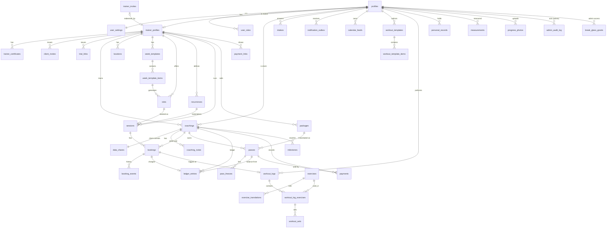

# DaFit: модель данных

- Статус: волна 1 реализована миграциями `supabase/migrations/20261015120000_base.sql` … `20261015125200_storage.sql` и `20261015130000_owner_decisions.sql` (решения Q60–Q65); волны 2–4 остаются проектом
- Дата: 2026-10-13, сверка со схемой волны 1: 2026-10-15
- Источники: [`docs/decisions.md`](../decisions.md) (первоисточник), [`CONTEXT.md`](../../CONTEXT.md) (словарь и имена в коде), [`docs/prd/README.md`](../prd/README.md) (волны), [`docs/prd/wave-2.md`](../prd/wave-2.md), ADR [0001](../adr/0001-supabase-backend.md), [0002](../adr/0002-secrets-handling.md), [0004](../adr/0004-telegram-auth.md), миграция `supabase/migrations/20261012204303_profiles.sql`.

По этому документу пишутся миграции. Блоки SQL ниже задают **спецификацию** и готовыми миграциями не считаются. Порядок создания, `comment on`, триггеры `set_updated_at` и гранты дописываются при переносе в `supabase/migrations/`. Если документ расходится с `decisions.md`, прав журнал. Решения, которых в журнале нет, собраны в разделе «Допущения» в конце.

Для волны 1 источник истины теперь миграции. Блоки §2.1 и §2.1a приведены к ним, а все отступления от первого проекта собраны в §2.1.0 с причинами. Где SQL здесь короче миграции (комментарии, гранты, триггеры, составные ключи), права миграция.

Имена таблиц английские, во множественном числе, от имён из `CONTEXT.md`: `coaching` → `coachings`, `pass` → `passes`, `set` → `workout_sets` (`set` занято как ключевое слово SQL), `charge`/`waiver` → строки `ledger_entries`.

---

## 1. Принципы

### 1.1. Платформа и RLS

- Supabase Postgres (ADR 0001). PostgREST открывает схемы `public` и `graphql_public`. Всё, что клиент не должен вызывать или читать напрямую, живёт в **неэкспонированных** схемах:
  - `private`: вспомогательные функции для RLS, триггерные функции, внутренние таблицы (outbox-курсоры и т. п.);
  - `analytics`: материализованные представления для админ-аналитики.
- **RLS включён на каждой таблице в `public`**, политики явные; по умолчанию запрещено всё. Если у таблицы нет политик на запись, писать в неё может только серверный код или SECURITY DEFINER-функция (так уже сделано для `profiles`).
- В политиках `auth.uid()` всегда пишется как `(select auth.uid())`, а функции-помощники как `(select private.fn(...))`, где это возможно: Postgres вычисляет их один раз на запрос (initPlan), а не на каждую строку.
- Каждый столбец, на который ссылается политика (`trainer_id`, `client_id`, `coaching_id`, `session_id`, `user_id`), проиндексирован.
- Политики чтения больших таблиц (`coachings`, `bookings`, `ledger_entries`, `passes`, `payments`, `money_events`, `sessions`, `measurements`, `progress_photos`) не вызывают помощник со столбцом строки: такой вызов идёт на каждую строку и не даёт планировщику взять индекс, и чтение без фильтра просматривало строки всех тренеров. Они сравнивают столбец с массивом, который помощник считает один раз: `coaching_id = any ((select private.trainer_coaching_ids('{passes}'))::uuid[])`. Тест `000_schema_invariants` это проверяет.
- Новые функции по умолчанию не исполняются ролью `PUBLIC` (базовая миграция меняет default privileges), поэтому каждая RPC выдаёт права явно, а забытый `revoke` не открывает её для `anon`.
- Анонимной роли (`anon`) доступны только SECURITY DEFINER-функции витрины (`get_trainer_showcase`, `get_trainer_showcase_prices`, `get_trial_link`), не таблицы. В волне 1 у `anon` есть `resolve_client_invite(token)`: лендинг ссылки клиента `/i/<token>` показывает карточку тренера до входа (коды тренера проверяются только после входа), и `get_trainer_showcase(slug)`: витрина `/trainers/<slug>`. Витрина отвечает «недоступна», когда тренер выключил её (`is_public = false`), его верификация отклонена (R16, Q60), аккаунт заблокирован или ждёт удаления; неизвестный адрес выглядит так же. Цены витрины отдаёт `get_trainer_showcase_prices(slug)`: живые пакеты с `is_public` в валюте тренера по умолчанию, с ценой за занятие и выгодой из `price_grid`; метку «выгоднее всего» функция ставит заново среди этих строк, чтобы её не забрал скрытый пакет. У закрытой витрины цен нет. «Стать клиентом» с витрины (`join_by_showcase`, только после входа) идёт через ссылку клиента тренера. `get_trial_link(token)` показывает тренера и условия пробного на `/trial/<token>`; пока записи на пробное нет (неделя 2), «Стать клиентом» по ней (`join_by_trial_link`) создаёт пару с источником `trial_link`.
- После каждой DDL-миграции запускаются Supabase security advisors (CLAUDE.md).

### 1.2. Идентификаторы и общие столбцы

- Первичный ключ: `uuid default gen_random_uuid()`. Исключение: объёмные журналы, где нужен только порядок (`admin_audit_log`, `notification_outbox`, `booking_events`, `product_events`), там `bigint generated always as identity`.
- `created_at timestamptz not null default now()`; изменяемым таблицам добавляется `updated_at timestamptz not null default now()` + триггер `public.set_updated_at()` (уже есть в миграции profiles).
- Внешние ключи на пользователя указывают на `public.profiles(id)` (а `profiles` ссылается на `auth.users(id) on delete cascade`). Поэтому удаление пользователя из `auth.users` каскадно удаляет его личные данные; учётные таблицы тренера (`coachings`, `bookings`, `passes`, `ledger_entries`, `payments`, `money_events`) ссылаются на клиента внешним ключом без каскада (`no action`) и до удаления переназначаются на «Удалённого клиента» (см. 1.6).

### 1.3. Время

- Все моменты времени имеют тип `timestamptz` (хранится в UTC). `timestamp without time zone` не используется нигде, кроме локального времени правила повтора (`recurrences.dtstart_local`), где это и есть смысл значения.
- **Часовой пояс IANA** хранится:
  - у пользователя: `user_settings.time_zone` (отображение, «день» клиента для дневника и активности, тихие часы, время утренней сводки, напоминания домашних заданий);
  - у правил расписания: `week_templates.time_zone`, `recurrences.time_zone` (копируется из пояса тренера при создании), чтобы разворачивание «пн/ср/пт 8:00» давало 8:00 местного времени и через переход на летнее/зимнее время;
  - аналитика тренера считает календарные периоды в поясе тренера (`user_settings.time_zone` тренера).
- Валидация пояса: домен `public.iana_tz` (`text`, проверка через `private.is_valid_tz(text)`). Список имён копируется из `pg_timezone_names` в тело функции при миграции, и проверка сверяет имя с этим массивом: само чтение `pg_timezone_names` сканирует файлы поясов на диске, около 17 мс на вызов, а домен проверяется при каждом входе и записи профиля. Таблицу для списка не заводим: проверка домена, которая читает таблицу, ломает восстановление дампа. Функция объявлена `immutable` осознанно; после обновления Postgres, которое добавит пояса, миграция пересоздаёт её тем же блоком.
- «Дни» (дневник питания, активность, замеры, домашние задания) хранятся как `date`: дата **в поясе клиента на момент записи** (wave-2). Где нужно, рядом хранится точный момент `timestamptz`.
- Длительности хранятся как `integer` в минутах/секундах с суффиксом (`duration_min`, `duration_s`), без `interval`: так проще для API и типов.

### 1.4. Деньги и единицы

- Сумма хранится как `bigint` в минимальных единицах (`*_minor`: копейки/центы) + `currency public.currency_code` (`char(3)`, проверка `^[A-Z]{3}$`, ISO 4217). Плавающая точка и `numeric` для денег не используются.
- Суммы разных валют никогда не складываются в БД: агрегаты группируются по `currency` (wave-2, мультивалютность без конвертации).
- Физические величины хранятся в метрике: вес в кг (`numeric(6,2)`), длины в см (`numeric(6,1)`), вода в мл (`integer`), сон в минутах, расстояние в метрах. Имперские единицы бывают только в интерфейсе (`user_settings.unit_system`).

### 1.5. Удаление: soft vs hard

| Класс данных | Политика | Почему |
|---|---|---|
| Личные данные клиента (замеры, фото, дневник, активность, анкета, цель, свои продукты) | **Hard delete** владельцем в любой момент | Данные принадлежат клиенту; история не нужна никому, кроме него |
| Деньги и учёт: `ledger_entries`, `payments`, `bookings`, `booking_events`, `sessions`, `money_events` | **Никогда не удаляются** пользователем. Отмена делается статусом (`cancelled`, `voided`), исправление новой строкой (сторно). Триггеры запрещают прямое удаление `bookings`, журналов и занятий с записями любой роли, включая сервер: строки уходят только каскадом при удалении пары или тренера. Занятие без записей удалить можно | Журнал, на котором держатся остаток, долг и выручка; «История с причинами» (Q21) |
| Справочники, на которые ссылается история: `packages`, `locations`, `exercises` (свои), `workout_templates`, `groups`, `payment_links`, `client_invites`, `trial_links`, `referral_offers` | **Soft delete**: `archived_at timestamptz` | Старые абонементы/занятия/логи должны продолжать показывать название пакета, локации, упражнения |
| Пара `coachings` | Не удаляется; `status = 'ended'` | История занятий и оплат остаётся видна обеим сторонам |
| Модерируемый контент (`reviews`, W4 `posts`) | Soft delete (`deleted_at`), окончательно стирается при удалении аккаунта автора | Нужен для разбора споров админом |
| Объекты Storage | Hard delete вместе со строкой (серверная задача, т. к. Storage не каскадится от FK) | См. столбец «Политика» |

### 1.6. Удаление аккаунта (30 дней, Q44)

1. Пользователь вызывает `request_account_deletion()` → строка в `account_deletions` (`scheduled_for = now() + interval '30 days'`).
2. Сразу: будущие записи пользователя отменяются бесплатно (`cancelled`, `cancelled_by_role = 'system'`); уведомления ему больше не отправляются; тренеры видят метку «клиент удаляет аккаунт». Если он тренер, его будущие занятия отменяются, клиенты получают уведомление.
3. В течение 30 дней вход разрешён только для отмены удаления (`cancel_account_deletion()`); экспорт данных доступен Метку несёт сам токен сессии: `request_account_deletion()` пишет `app_metadata.deletion_pending`, `cancel_account_deletion()` её снимает, и `src/proxy.ts` без запроса к базе пускает только на `/settings/delete`, `/settings/export`, `/login` и бета-согласие.
4. Через 30 дней cron (pg_cron зовёт `/api/cron/privacy`, серверный код с секретным ключом; тот же маршрут собирает экспорт в бакет `exports` по пути `{user}/{export}/part-N.zip`) выполняет **обезличивание** вместо полного каскада (решение владельца продукта). Порядок: объекты Storage пользователя и карточек тренера, затем `purge_account()`, затем `auth.admin.deleteUser` для каждого id, который она вернула:
   - удаляются объекты Storage пользователя и все личные данные: `user_settings`, `body_profiles`, `client_goals`, `intakes`, `measurements`, `progress_photos`, `food_diary_entries`, свои продукты, `activity_entries`, `nutrition_targets`, свои `workout_logs` (без `coaching_id`), `coaching_notes` о нём, `data_shares`, токены, `calendar_feeds`, `reviews`, участие в W3/W4;
   - учётные строки, принадлежащие тренеру, **сохраняются**: `coachings` (статус `ended`), `sessions`, `bookings`, `booking_events`, `passes`, `ledger_entries`, `payments`. Ссылка на клиента переводится на системный профиль-заглушку «Удалённый клиент» (`private.deleted_client_id()`, один на всю БД; `coaching_trainer_meta.client_alias` и `contact` обнуляются). Личные строки удаляются **до** переноса пар: иначе `on update cascade` перенесёт логи пар на заглушку. Поскольку на заглушку может указывать несколько пар одного тренера, `unique (trainer_id, client_id)` у `coachings` проверяется только для `client_id <> deleted_client_id()` (частичный уникальный индекс вместо ограничения);
   - затем `auth.admin.deleteUser(id)`; у сохраняемых учётных таблиц FK на `profiles` объявлен без каскада, поэтому удаление без предварительного переназначения падает с ошибкой и не стирает учёт тренера.
   - Аккаунт **тренера** удаляется так же, через GoTrue, в своей транзакции. Если задача удаления в той же транзакции уже писала строки этого тренера (заметки, заморозки, логи пар), она сначала удаляет `trainer_profiles` (каскадом уходят пары, абонементы, заморозки, заметки), а потом пользователя Auth. Иначе Postgres перепроверяет внешние ключи строк, записанных в текущей транзакции, после того как каскад уже удалил их пару, и удаление падает с 23503 (так делает и `tests.delete_trainer`). Снятие статуса тренера админом `trainer_profiles` не удаляет никогда: это стёрло бы пары, абонементы, оплаты и журнал всех его клиентов.
   Аналитика тренера продолжает учитывать эти занятия и деньги как «Удалённый клиент».
5. В `admin_audit_log` остаётся запись о факте удаления (идентификатор без FK, без персональных данных).

### 1.7. Журнал действий админа

`admin_audit_log` работает как append-only (триггер запрещает `update`/`delete` всем, включая `service_role`; очистить его можно только миграцией). Пишется **в той же транзакции**, что и действие: все админские действия идут через SECURITY DEFINER-функции `admin_*`, вызываемые с сессией самого админа, поэтому `actor_id = auth.uid()` нельзя подделать. Логируются: выдача/отзыв инвайтов, решения по верификации, решения по жалобам и отзывам, выдача/снятие роли, аварийный доступ, открытие карточки конкретного тренера в аналитике (wave-2 §8).

### 1.8. Как `auth.uid()` связан с профилем

- Вход описан в ADR 0004: сервер создаёт пользователя Supabase Auth (`app_metadata.telegram_id`) и делает upsert в `public.profiles`. `profiles.id = auth.users.id = auth.uid()`.
- Значит, в политиках «я» = `(select auth.uid())`, и любой `user_id`/`client_id`/`trainer_id` сравнивается с ним напрямую, без join на profiles.
- «Я тренер» = существует `trainer_profiles` с `user_id = auth.uid()`. «Я админ» = строка в `user_roles` с `role = 'admin'`. «Я клиент тренера X» = существует `coachings(trainer_id = X, client_id = auth.uid())`.
- `profiles` по-прежнему пишет только сервер при входе. Всё, что пользователь меняет сам, вынесено в `user_settings` (1:1).

### 1.9. Кто пишет: RLS, RPC или сервер

Три пути записи, по убыванию предпочтения:

1. **Напрямую через RLS** (клиент Supabase с сессией пользователя, `lib/supabase/server.ts`). Подходит, когда запись затрагивает одну таблицу и инвариант выражается политикой `with check`: настройки, свои замеры, дневник, логи тренировок, справочники тренера (локации, пакеты, шаблоны), заметки, группы. Если операция состоит из нескольких таких записей и должна пройти целиком, её оборачивает функция `security invoker` в `public` с `set search_path = ''`: она выполняется с политиками и грантами вызывающего в одной транзакции и ничего не расширяет (`replace_progress_photo`, `set_progress_photo_angle`, R82).
2. **Доменные RPC**: `security definer` функции в `public` с `set search_path = ''`, `revoke execute ... from public, anon`, `grant execute ... to authenticated`. Первая строка тела определяет `v_uid := auth.uid()` и проверяет права явно. Используются, когда операция трогает несколько таблиц или требует блокировок: запись на занятие, отмена/перенос, отметка посещения, списание/прощение, создание абонемента, присоединение по ссылке, лист ожидания, выпуск токенов, все `admin_*`. Таблицы, в которые пишут только RPC (`bookings`, `ledger_entries`, `booking_events`), не имеют политик insert/update/delete вовсе.
3. **Сервер с секретным ключом** (`lib/supabase/admin.ts`) применяется только там, где нет пользовательской сессии или нужно обойти RLS ради системной работы (ADR 0002 п. 6):
   - вход через Telegram: upsert `profiles`, создание `auth.users`;
   - диспетчер уведомлений (outbox → Telegram, маршрут `POST /api/cron/notifications`). Бот к базе не обращается и ключей Supabase не получает (ADR 0006). Как нажатие кнопки действия в уведомлении (wave-1 §3: Т2, Т7a, С1) доходит до базы, решается вместе с запросами на запись;
   - cron-задачи: материализация повторов и шаблонов недели, автозавершение занятий, утренняя сводка, дневные сводки питания, флаги оттока, обновление MV, очистка удалённых аккаунтов;
   - приём шагов от iOS Shortcuts (личный токен → пользователь);
   - отдача ICS-ленты календаря (токен → пользователь);
   - кеш Open Food Facts и импорт wger;
   - генерация архива экспорта данных.
   Сервер с секретным ключом **никогда** не отдаёт данные пользователю, прочитанные в обход RLS, кроме ICS-ленты (данные владельца токена, тот же набор, что он видит сам) и ответа iOS Shortcuts (только статус).

### 1.10. Storage

| Bucket | Доступ | Путь | Правила |
|---|---|---|---|
| `avatars` | public read (неугадываемый путь) | `{user_id}/{uuid}.webp` | Запись/удаление: только владелец (`(storage.foldername(name))[1] = auth.uid()::text`). ≤ 2 МБ, `image/webp`, `image/jpeg`, `image/png` |
| `certificates` | private | `{trainer_id}/{certificate_id}.{ext}` | Запись: владелец-тренер; чтение: владелец и админ (через signed URL). ≤ 10 МБ, изображения и PDF |
| `progress-photos` | private | `{client_id}/{photo_id}.webp` или `.jpg` | Загружается **только уже размытая** на устройстве версия (Q24/Q30); оригинал не покидает устройство. Запись/удаление: только клиент-владелец. Чтение: владелец и тот, кому видна строка `progress_photos` с этим `storage_path` (её политика `can_view(client_id, 'photos')`); объект без строки видит только владелец. Клиент приложения получает **signed URL на 5 минут**. ≤ 5 МБ, `image/webp`, `image/jpeg` |
| `exercise-media` | public read | `wger/{wger_id}/…`, `custom/{owner_id}/{uuid}.webp` | Запись wger: сервер; custom: владелец |
| `feedback` | private | `{user_id}/{feedback_id}/{n}.webp` | Запись: автор; чтение: автор и админ |
| `exports` | private | `{user_id}/{export_id}.zip`; архив больше лимита объекта 50 МБ делится на части `{user_id}/{export_id}/part-N.zip`, тогда `data_exports.storage_path` хранит префикс папки | Запись: сервер; чтение: владелец, signed URL на 15 мин на каждую часть; объекты удаляются через 7 дней |
| W4 `post-media` | public read | `{user_id}/{post_id}/{n}.webp` | Запись: автор; модерация: админ |

---

## 2. Схема по волнам

Обозначения: `PK`, `FK`, `UQ`, `IX` (индекс), `CK` (check). Если nullability не указана, столбец `not null`. Общие столбцы `created_at`/`updated_at` опущены, где они стандартные.

### 2.0. Расширения, домены, общие enum

```sql
create schema if not exists private;
create schema if not exists analytics;
create extension if not exists btree_gist with schema extensions;   -- exclusion по времени
create extension if not exists pg_trgm with schema extensions;      -- поиск упражнений и продуктов
-- Порядок в миграциях: enum (session_mode и др.) создаются до таблиц, которые на них ссылаются.
-- Не в волне 1: pg_cron и pg_net подключаются вместе с диспетчером уведомлений.
create extension if not exists pg_cron;                              -- планировщик (Supabase)
create extension if not exists pg_net with schema extensions;        -- HTTP-вызов диспетчера
-- W4: create extension if not exists postgis with schema extensions;

-- Тело функции собирается блоком DO при миграции: массив имён из pg_timezone_names (§1.3).
create function private.is_valid_tz(tz text) returns boolean
  language sql immutable set search_path = '' as
  $$ select coalesce(tz = any ('{Africa/Abidjan,…,Zulu}'::text[]), false) $$;

create domain public.iana_tz as text check (value is null or private.is_valid_tz(value));
create domain public.currency_code as char(3) check (value ~ '^[A-Z]{3}$');

create type public.app_role as enum ('admin');
create type public.app_locale as enum ('ru', 'en');
create type public.app_theme as enum ('system', 'light', 'dark');
create type public.unit_system as enum ('metric', 'imperial');
create type public.app_zone as enum ('trainer', 'client');
create type public.share_category as enum ('nutrition', 'measurements', 'photos', 'steps', 'intake', 'workouts');
```

Все enum волны 1 и уже известные значения волн 2–3 создаются в базовой миграции `20261015120000_base.sql`, чтобы файлы таблиц не ждали друг друга; ниже они показаны рядом с таблицами. Новые значения добавляются `alter type ... add value` (не переписывает данные).

---

### 2.1. Волна 1: «Тренер ведёт клиентов» (полностью)

#### 2.1.0. Отступления от первого проекта

Миграции волны 1 писались по контракту, в котором каждое расхождение первого проекта этого документа с `decisions.md`, PRD и между разделами решено отдельной строкой R1–R93. Блоки ниже уже приведены к этим решениям; таблица объясняет, откуда взялась каждая разница. Шесть строк ждали ответа владельца продукта (R16, R44, R50, R58, R82, R91). 15.10.2026 владелец поручил решить их Claude; решения записаны в `decisions.md` как [Q60–Q65](../decisions.md#12-решения-по-поручению-владельца).

| № | Что | Решение | Почему |
|---|---|---|---|
| R1 | Статус верификации | Новое значение `not_submitted`, оно же по умолчанию; `pending` после подачи документов. Зона и `is_trainer()` от него не зависят | Q55 называет «не подана» |
| R2 | Делегаты в волне 1 | Тип `delegation_scope` и подписи функций с `scope` создаются сейчас; добавлена `acts_for_trainer` | в волне 3 функции меняются через `create or replace` |
| R3 | Тарифы в волне 1 | `plans`, `plan_grants`, `access_requests` и проверка прав уже есть; покупки и `plan_subscriptions` позже | Q59 |
| R4 | Тихие часы по умолчанию | `22:00`–`08:00`, оба поля nullable | PRD 2.9-7 |
| R5 | Админ и карточки | Админ не видит карточки тренеров и заглушку | PRD PAIR-10 |
| R6 | `public_profiles` | Имя, аватар и пояс зеркалятся триггером в `profiles`; вью только над `profiles` | вью над двумя таблицами показывала бы пустые имена и ломала встраивание PostgREST |
| R7 | `telegram_id` | Nullable, с проверкой идентичности; скрыт колоночным грантом | у карточек и заглушки нет Telegram |
| R8 | Запросы на слияние | `new_coaching_id` и `managed_client_id` с `set null` | иначе слияние удаляет собственный запрос |
| R9 | `client_alias` | Перенесён в `coaching_trainer_meta`, которую видит только тренер; там же `archived_at`, `intake_seen_at`, `contact` | колоночный грант не может скрыть столбец от клиента и показать тренеру |
| R10 | Метка удаления для партнёров | `account_deletions` видят партнёры по паре | PRD С6; в строке только даты |
| R11 | Типы уведомлений | Недостающие типы добавлены сразу в enum | PRD §3 |
| R12 | Заметки после конца пары | Тренер-владелец читает и правит их дальше | PRD 2.12-5 не называет заметки среди потерянного |
| R13 | Запись админа в инвайты и роли | Политик записи нет, позже `admin_*` RPC | §1.7: все действия админа через журнал |
| R14 | Смещения напоминаний | Не больше 3, от 5 до 10080 минут, без повторов и NULL | NOTIF-1 |
| R15 | Срок инвайта тренера | По умолчанию 14 дней | PRD 2.2-1 |
| R16 | Витрина отклонённого тренера | Кроме значка, каталога и рейтингов, отказ в верификации закрывает только публичную витрину: по прямому адресу она отвечает «Тренер недоступен». Пока документы не поданы или на проверке, витрина работает без значка; повторная подача документов возвращает статус `pending`, и витрина снова открыта без значка. Ссылка клиента с QR, код и ссылка на пробное работают и после отказа, без значка ([Q60](../decisions.md#12-решения-по-поручению-владельца)) | Q15, Q55 против PRD 2.2-5 |
| R17 | Цена разового | Живой пакет на 1 занятие, без столбца в профиле | сетка Q22 «1/5/10/20» |
| R18 | Места и запросы | Место занимают `requested`, `confirmed`, `attended`, `no_show` | PRD 2.6.3-2 |
| R19 | Снимок дедлайна отмены | Удалён из `bookings`; RPC считает по текущему правилу тренера и пишет часы в `booking_events` | PRD 2.6.5-1 |
| R20 | Дедлайн на пару | `coachings.cancellation_deadline_hours` удалён | PRD 2.6.5-1: правило общее для всех клиентов тренера |
| R21 | Сетка цен | Формулы PRD: цена за занятие с округлением половины вверх, выгода вниз, при равенстве значок у большего пакета, без значка при выгоде меньше 1 % | PRD 2.8-2, MONEY-1/2 |
| R22 | Элементы шаблона недели | Окно `start_time`–`end_time` режется на слоты по `duration_min`; `buffer_min` в шаблоне; без `kind` и `capacity` | PRD 2.6.1-1, SCHED-1 |
| R23 | Пробные слоты | `allow_trial default true` у элементов и слотов | PRD 2.3-4 |
| R24 | Тренер меняет пояс | Шаблоны и открытые повторы переходят на новый пояс; занятия и слоты не трогаются | PRD 2.6.7-5 |
| R25 | Онлайн-ссылка | `sessions.meeting_url` не выдаётся; `session_meeting_url()` отдаёт её тренеру и участникам `confirmed`/`attended` | PRD 2.6.2-3, SCHED-21 |
| R26 | Исправление платежа | Аннулирование и новая строка; удаления нет | §1.5, ADR 0008 |
| R27 | Удаление абонемента | Тренер может удалить абонемент, пока в журнале только его `grant` и нет платежей; `grant` уходит каскадом | PRD 2.8-16, MONEY-10 |
| R28 | Неизменность журнала | Только добавление; `client_id` и `coaching_id` переезжают с парой, `created_by` только очищается, удаление только каскадом | Q44 и O1 требуют переноса строк |
| R29 | Уникальность живой записи | Ключ по `coaching_id` | обезличенные клиенты одной группы совпали бы на заглушке |
| R30 | «Не состоялось» | Обычный `waiver`; отличается по отмене тренером | PRD 2.6.6-5 |
| R31 | Утренняя сводка | Имя `daily_digest` (`user_settings.daily_digest_time`) | CONTEXT.md, quality.md |
| R32 | Перенос тренером | Меняется занятие, запись остаётся `confirmed`; `rescheduled` только для переносов клиента | PRD 2.6.5-5 |
| R33 | Списание без абонемента | Всегда долговой charge | Q22 |
| R34 | Покрытие после отката | Одно покрытие и один откат на charge | откат бывает только после окончательного прощения |
| R35 | Напоминания тренеру себе | `own_reminder_offsets` удалён | Q23 их не называет |
| R36 | Погашение долга без абонемента | Разовые абонементы, гасящие долговые charge; схема без изменений | screens.md |
| R37 | Вехи | Только `sessions_10/25/50/100`, без `first_session`, без сообщения бота; тип `milestone` удалён | Q24, Q35, CONTEXT, PRD 2.11-9 |
| R38 | Валюта цены долга | `default_currency` тренера | у пары валюты нет |
| R39 | Пробное на пару | Частичный уникальный индекс по живым пробным записям; «никогда дважды» проверяет `book_trial` | PRD 2.3-6, SHOP-6 |
| R40 | Виды замеров | `weight, neck, chest, waist, abdomen, hips, thigh, upper_arm, calf`, без `custom` | PRD 2.11-1 |
| R41 | Ракурсы фото | `front, side, back` | PRD 2.11-3, screens.md |
| R41b | Кто правит замеры | Правит и удаляет только автор; тренеру-автору нужен ещё доступ | PRD 2.11-1, PROG-1 |
| R42 | Правка записи тренировки | Правит только автор; удаляет автор (в паре) или клиент | PRD 2.10-10 |
| R43 | Рекорды | `max_weight, max_reps, max_duration` по правилам PRD; таблицу читает только клиент, тренер видит рекорды по видимым ему подходам | PRD 2.10-6; старое правило через `is_trainer_of` показывало подходы других пар |
| R44 | Свои тренировки на Free | Лог своей тренировки бесплатен и без ограничений на любом тарифе. `client.self_training` из Premium относится к своим программам и шаблонам (поздняя волна) ([Q61](../decisions.md#12-решения-по-поручению-владельца)) | Q57 против PRD 2.10-4 |
| R45 | Автор в журнале админа | `admin_audit_log.actor_id` без FK | `set null` был бы запрещённым UPDATE |
| R46 | Обратная связь | Виды `bug, idea, other`; статусы `new, in_progress, closed`; `locale`, `theme`; не больше 3 скриншотов | PRD 2.13, ADM-9 |
| R47 | Прямые правки админа | UPDATE на `feedback` и `break_glass_grants.revoked_at` остаются; триггеры пишут `admin_audit_log` в той же транзакции | §1.7, ADM-11 |
| R48 | Текстовые статусы | `managed_client_claims.status` и `access_requests.status` стали enum | единообразие, типы в TS |
| R49 | Issue на GitHub | Создаёт сервер автоматически, схема без изменений | PRD FDBK-1 |
| R50 | Ссылка календаря | Хранится только sha256 токена, ссылка показывается один раз, при создании. Потом настройки показывают, что фид подключён, дату создания и `last_accessed_at`; потерянную ссылку перевыпускают ([Q62](../decisions.md#12-решения-по-поручению-владельца)) | screens.md |
| R51 | Удаление шаблонов тренировок | Владелец может удалить, ссылки обнуляются; интерфейс по умолчанию архивирует | §1.5 |
| R52 | Путь фото | Имя объекта без бакета, `.webp` или `.jpg` | расхождение внутри документа |
| R53 | Файлы сертификатов | 10 МБ, JPG/PNG/PDF, не больше 5 на тренера | PRD 2.2-4 |
| R54 | Ссылка на экспорт | Маршрут приложения выдаёт подписанную ссылку на 15 минут, объект живёт 7 дней | PRD 2.12-6 |
| R55 | `reports` | Таблица есть, пути записи в волне 1 нет | |
| R56 | Срок запроса контакта | Правила в БД нет; RPC и диспетчер считают `pending` старше 7 дней истёкшим | |
| R57 | Индекс `access_requests` | Один открытый запрос на пользователя и тариф | старый индекс с приведением даты не компилировался |
| R58 | `has_entitlement` | Публичная обёртка не отвечает о чужих пользователях (кроме админа); наследование требует клиента пары, живую пару и платный тариф тренера; `nutrition_advanced` наследуется с волны 2. Живая пара включает `trial`, как и везде ([Q63](../decisions.md#12-решения-по-поручению-владельца)) | старая версия позволяла узнать чужой тариф |
| R59 | Админ и выдачи тарифов | `plan_grants` читают сам пользователь и админ | админке нужна история |
| R60 | Столбцы поздних волн | Не созданы: `coachings.broadcasts_muted`, `primary_nutrition_group_id`, `churn_hidden_until`, `trainer_profiles.referred_by_trainer_id`, `locations.club_id`, `sessions.conducted_by`, `notification_outbox.broadcast_id` | nullable-столбец добавляется мгновенно |
| R61 | Свои упражнения ушедшего тренера | `owner_id on delete set null`; такое упражнение видно только через записи клиента | каскад блокировал удаление аккаунта |
| R62 | Свои тренировки | `coaching_id is null and created_by = client_id`; записи удалённой пары видит только клиент | иначе записи старой пары видны другим тренерам |
| R63 | Блокировка админом | `profiles.blocked_at`, `blocked_reason`, не выданы пользователям | ADM-7 |
| R64 | Создание `user_settings` | Триггер после вставки в `profiles` и заполнение существующих | триггер покрывает и карточки |
| R65 | Целостность между арендаторами | Составные FK вместо доверия денормализованным `trainer_id`/`client_id`; `client_id` NO ACTION; ключи пары отложенные для слияния | нельзя сослаться на чужую пару |
| R66 | Токены и коды ссылок | Значения по умолчанию в БД, вставить свои нельзя | тренер вставляет ссылки напрямую |
| R67 | Согласия | Одна действующая строка на пользователя, вид и версию | |
| R68 | Настройка витрины | В волне 1 без ограничения тарифом | Q56 не уточняет |
| R69 | Замороженный аккаунт | Проверяют приложение и proxy, не RLS | §1.6 |
| R70 | Возврат в завершённую пару | RPC сбрасывает `data_shares` и поля завершения | PRD 2.3 |
| R71 | Обратная связь без входа | В волне 1 нет | RLS рассчитан на вошедших |
| R72 | Ответ на обратную связь | Значение `feedback_reply` зарезервировано | ADM-10 |
| R73 | Грант для цели | Целевой пользователь видит весь грант | |
| R74 | Детали вех | `achieved_at` = начало занятия; пробные и вставка сразу как `attended` считаются | PRD 2.6.2-7 |
| R75 | Дедупликация outbox | Глобальный уникальный ключ с моментом цели | перенос занятия ставит новые напоминания |
| R76 | Выборка outbox | Публичные definer-функции `claim_outbox` и `record_outbox_result` только для `service_role` (ADR 0006) | `private` недоступна через PostgREST |
| R77 | Ссылка онлайн-слота | Только в `week_template_items.meeting_url` (видит тренер); RPC записи копирует её в занятие | слоты видны клиентам до записи |
| R78 | Слоты и занятия внахлёст | Проверяет функция записи позже; RLS показывает только открытые будущие слоты | клиент не видит чужие занятия |
| R79 | Минимум до записи | `trainer_profiles.min_booking_notice_minutes default 120` | PRD 2.6.1-6 |
| R80 | Какие занятия видит клиент | Любые, где у него есть запись в любом статусе | история, экспорт, SCHED-22 |
| R81 | Расписание и справочники | Открытые слоты и занятия: только живые пары; локации, пакеты, ссылки на оплату, свои упражнения: пары в любом статусе | |
| R82 | Лимит фото на Free | Комплект: фото одной даты, не больше одного на ракурс, на любом тарифе (уникальность `(client_id, taken_on, angle)`). Новое фото ракурса заменяет прежнее через `replace_progress_photo` (удаление и вставка одной транзакцией), два фото даты меняются ракурсами через `set_progress_photo_angle`. Лимит Free проверяет политика вставки ([Q64](../decisions.md#12-решения-по-поручению-владельца)) | Q57, Q58, PRD 2.14-6, PLAN-3 |
| R83 | Удаление объектов Storage | Удаляет приложение; политика чтения фото требует живую строку | триггер БД не удаляет объекты |
| R84 | Суммы в журнале | reversal = минус settlement; refund и adjustment без денег; adjustment только по абонементу; повторный долг: `charge` с причиной `manual` и комментарием | |
| R85 | Счёт для лимита Free | Пары `trial` и `active`, карточки считаются, заглушка нет; под блокировкой строки | Q56, гонки |
| R86 | История абонементов и платежей | Решено после проверки: таблица `money_events`, её пишут триггеры | PRD строка 27, Q21 |
| R87 | Права по умолчанию | Базовая миграция отключает автоматическую выдачу прав `anon`/`authenticated` и EXECUTE для `public` | страховка |
| R88 | Форма политик | Одна разрешающая политика на команду | советник Supabase, quality.md |
| R89 | Профиль тренера для клиентов | Клиенты в любом статусе пары видят своих тренеров через `trainer_ids_visible` | |
| R90 | Буфер шаблона | `week_templates.buffer_min default 0` | PRD 2.6.1-1 |
| R91 | Лимит Free и карточки | Решено как вариант (а), без изменения схемы: при непривязанной карточке присоединение не упирается в лимит и всегда создаёт запрос на слияние; ответ «новый клиент» проверяет лимит снова. Если лимит превышен, человек видит в приложении прямое объяснение, что на бесплатном тарифе тренер сейчас не может добавить новых клиентов, и то же сообщение в боте (`coaching_ended`, PRD К12) ([Q65](../decisions.md#12-решения-по-поручению-владельца)) | O1 |
| R92 | Закрытые периоды | Слоты `status = 'closed'`, генератор их обходит | PRD 2.6.1-5 |
| R93 | Статусы и места | Переходы статусов занятий, записей и платежей, места и уменьшение вместимости держат триггеры для всех ролей | ошибка в одной RPC не должна портить историю |

После независимой проверки схемы добавлены ещё правила, которых не было ни в первом проекте, ни в контракте:

- проверки мест, остатка абонемента, лимита сертификатов и лимита Free берут родительскую строку `for no key update` и отказывают в транзакции `repeatable read` (`unsupported_isolation`);
- занятие с записями и сама запись не удаляются напрямую (`session_in_use`, только каскад);
- у абонемента ровно один `grant`, равный `sessions_total`; прощённый charge нельзя покрыть;
- аннулированный платёж больше не меняется; причину тренер пишет только при аннулировании;
- отозванный грант break-glass и отозванная выдача тарифа не возвращаются и не переписываются;
- запрос доступа можно создать только на платный тариф своей стороны;
- клиенты видят только живые ссылки на оплату;
- сообщения в чат команды (`verification_submitted`, `feedback_received`) тоже строки outbox, с `chat_target` вместо `user_id`;
- у пробной ссылки есть выключатель `is_enabled`, у пары для тренера поле `contact`;
- `profiles.last_seen_at` пользователям не выдан;
- большие таблицы читаются через функции-массивы (§4.1), чтобы условие шло по индексу.


#### Люди и доступ

**`profiles`** (существует; дополняется миграцией)

```sql
alter table public.profiles
  add column last_seen_at   timestamptz,          -- обновляет сервер при входе; админка читает через definer-функции
  add column bot_started_at timestamptz,          -- в волне 1 не пишется: бот к базе не обращается (ADR 0006)
  add column bot_blocked_at timestamptz,          -- Telegram вернул 403 при отправке; сброс при входе
  add column blocked_at     timestamptz,          -- админ заблокировал аккаунт (ADM-7), пишет только админская RPC
  add column blocked_reason text check (char_length(blocked_reason) <= 500),
  add column display_name   text,                 -- зеркало user_settings.display_name (триггер)
  add column avatar_path    text,                 -- зеркало user_settings.avatar_path (триггер)
  add column time_zone      public.iana_tz not null default 'Europe/Moscow',  -- зеркало user_settings.time_zone
  alter column telegram_id drop not null,         -- null только у карточек и у заглушки «Удалённый клиент»
  add constraint profiles_blocked_check check ((blocked_at is null) = (blocked_reason is null));
-- Колоночный грант: telegram_id, bot_*, blocked_*, claimed_by и last_seen_at видит только сервер.
-- Другим пользователям незачем знать, когда человек был в сети. select * поэтому падает с 42501.
revoke all on public.profiles from anon, authenticated;
grant select (id, username, first_name, last_name, photo_url, language_code, display_name, avatar_path, time_zone,
              managed_by_trainer_id, created_at, updated_at)
  on public.profiles to authenticated;
```

`bot_started_at` в волне 1 никто не пишет: бот к базе не обращается (ADR 0006), а писать человеку бот может и после разрешения в Mini App (`requestWriteAccess`). `bot_blocked_at` ставит диспетчер, когда Telegram отвечает 403 или «chat not found», и сбрасывает вход в приложение: другого признака жизни веб не видит. Комментарии к обоим столбцам поправлены миграцией `notification_dispatch`. Миграция `bot_messages` добавила две definer-функции для самого пользователя: `bot_messages_blocked()` читает его отметку для баннера «Уведомления выключены» (AUTH-7), `set_bot_messages(allowed, send_test)` записывает ответ на `requestWriteAccess` (отказ ставит отметку, разрешение снимает) и по кнопке в баннере ставит в очередь `bot_test`, не чаще раза в минуту.

Зеркальные столбцы нужны вью `public_profiles`: она `security_invoker` и читает только `profiles`, поэтому видит ровно тех, кого пускает политика `profiles` (сам, партнёры по парам в любом статусе, свои карточки тренера, админ без карточек и заглушки).

**`user_settings`**: всё, что пользователь меняет сам (1:1). Строку создаёт триггер при вставке `profiles`, в том числе для карточек; профили, созданные до миграции, получили её при миграции.

```sql
create table public.user_settings (
  user_id              uuid primary key references public.profiles(id) on delete cascade,
  display_name         text check (char_length(display_name) between 1 and 64),  -- null = имя из Telegram
  avatar_path          text,                       -- объект в bucket avatars; null = photo_url Telegram
  locale               public.app_locale not null default 'ru',   -- автоопределение из language_code при создании
  theme                public.app_theme not null default 'system',
  unit_system          public.unit_system,         -- null = по локали (en-US → imperial)
  time_zone            public.iana_tz not null default 'Europe/Moscow',  -- уточняется клиентом при первом входе
  last_zone            public.app_zone not null default 'client',
  quiet_hours_start    time default '22:00',       -- оба null = тихие часы выключены (PRD 2.9-7)
  quiet_hours_end      time default '08:00',
  daily_digest_time    time not null default '08:00',  -- время утренней сводки (daily digest), если пользователь тренер
  updated_at           timestamptz not null default now(),
  check ((quiet_hours_start is null) = (quiet_hours_end is null))
);
```

**`notification_preferences`**: только переопределения; если строки нет, действует значение по умолчанию из кода.

```sql
-- Одно значение на каждое сообщение PRD §3, поэтому каждое отключается отдельно (PRD 2.9-8). Тренер, который
-- сам у кого-то клиент, получает обе стороны пары сообщений, поэтому версии тренера и клиента разные:
-- booking_assigned (К1) / booking_created (Т1), booking_cancelled_by_trainer (К5) / booking_cancelled_by_client (Т3),
-- pass_ending (К10) / client_pass_ending (Т6). Вех в уведомлениях нет (R37).
create type public.notification_type as enum (
  'booking_assigned', 'booking_created', 'booking_requested', 'booking_confirmed', 'booking_declined',
  'booking_expired', 'booking_cancelled_by_trainer', 'booking_cancelled_by_client', 'booking_rescheduled',
  'session_reminder', 'session_changed',
  'charge_posted', 'charge_waived', 'pass_ending', 'client_pass_ending', 'pass_expired', 'debt', 'payment_reported',
  'daily_digest', 'coaching_created', 'coaching_ended', 'managed_client_claim', 'intake_submitted', 'intake_reminder',
  'contact_request', 'contact_response', 'verification_result', 'export_ready', 'account_deletion',
  'counterpart_deleting', 'plan_granted', 'plan_revoked', 'plan_expiring', 'feedback_reply',
  'break_glass', 'report_resolution',
  'bot_test',                                      -- тестовое сообщение после включения бота (AUTH-7)
  'verification_submitted', 'feedback_received',  -- А1, А2: в закрытую группу (notification_outbox.chat_target)
  -- W2
  'trainer_comment', 'trainer_broadcast', 'homework_reminder', 'homework_done', 'waitlist_offer',
  'waitlist_closed', 'review_prompt', 'review_reply', 'goal_changed',
  -- W3
  'delegation', 'challenge', 'badge', 'referral_bonus'
);

create table public.notification_preferences (
  user_id  uuid references public.profiles(id) on delete cascade,
  type     public.notification_type,
  enabled  boolean not null,
  primary key (user_id, type),
  -- служебные и аккаунтные типы, тестовое сообщение и сообщения группе отключить нельзя (PRD 2.9-8)
  check (enabled or private.notification_type_is_optional(type))
);
```

**`user_roles`**

```sql
create table public.user_roles (
  user_id    uuid references public.profiles(id) on delete cascade,
  role       public.app_role,
  granted_by uuid references public.profiles(id) on delete set null,
  granted_at timestamptz not null default now(),
  primary key (user_id, role)
);
```

Тренером пользователя делает наличие `trainer_profiles`, отдельной роли для этого нет (одна учётная запись, две зоны, Q13).

**`consents`**: бета-согласие при первом входе (Q44), append-only.

```sql
create type public.consent_kind as enum ('beta_terms', 'privacy_policy', 'contact_share');
create table public.consents (
  id          uuid primary key default gen_random_uuid(),
  user_id     uuid not null references public.profiles(id) on delete cascade,
  kind        public.consent_kind not null,
  version     text not null,                 -- версия текста, например '2026-11-beta'
  accepted_at timestamptz not null default now(),
  revoked_at  timestamptz                    -- отзыв один раз; время ставит guard-триггер, не клиент
);
create index on public.consents (user_id, kind);
create unique index consents_one_active_uniq on public.consents (user_id, kind, version) where revoked_at is null;
```

**`account_deletions`**, **`data_exports`**

```sql
create table public.account_deletions (
  user_id       uuid primary key references public.profiles(id) on delete cascade,
  requested_at  timestamptz not null default now(),
  scheduled_for timestamptz not null,
  cancelled_at  timestamptz
);
create index on public.account_deletions (scheduled_for) where cancelled_at is null;

create type public.export_status as enum ('queued', 'processing', 'ready', 'failed', 'expired');
create table public.data_exports (
  id           uuid primary key default gen_random_uuid(),
  user_id      uuid not null references public.profiles(id) on delete cascade,
  status       public.export_status not null default 'queued',
  storage_path text,                          -- объект в bucket exports или префикс папки с частями (§1.10)
  requested_at timestamptz not null default now(),
  ready_at     timestamptz,
  expires_at   timestamptz
);
create index on public.data_exports (user_id, requested_at desc);
```

#### Тренер, инвайты, верификация

```sql
create type public.verification_status as enum ('not_submitted', 'pending', 'verified', 'rejected');  -- «не подана» (Q55)

create table public.trainer_profiles (
  user_id                     uuid primary key references public.profiles(id) on delete cascade,
  slug                        text not null unique check (slug ~ '^[a-z0-9][a-z0-9-]{2,31}$'),  -- адрес витрины
  headline                    text check (char_length(headline) <= 120),
  bio                         text check (char_length(bio) <= 2000),
  specialties                 text[] not null default '{}',
  city                        text,
  works_offline               boolean not null default true,
  works_online                boolean not null default false,
  is_public                   boolean not null default true,      -- выключатель витрины; при verification_status = 'rejected' витрина недоступна и так (R16, Q60)
  -- W3: referred_by_trainer_id добавляется вместе с рефералкой
  verification_status         public.verification_status not null default 'not_submitted',
  verified_at                 timestamptz,
  default_currency            public.currency_code not null default 'RUB',
  cancellation_deadline_hours smallint not null default 24 check (cancellation_deadline_hours between 0 and 168),
  default_client_reminder_offsets smallint[] not null default '{1440,60}'   -- минуты до занятия; для новых пар
                              check (private.valid_reminder_offsets(default_client_reminder_offsets)),  -- ≤ 3, 5..10080, без NULL и повторов
  min_booking_notice_minutes  smallint not null default 120 check (min_booking_notice_minutes between 0 and 10080),  -- PRD 2.6.1-6
  trainer_invite_id           uuid unique,                                  -- FK ниже; каким инвайтом пришёл
  -- зарезервировано (later): studio_id uuid — добавляется со студиями
  -- Напоминаний самому тренеру нет (Q23 их не перечисляет), own_reminder_offsets не создаётся.
  updated_at                  timestamptz not null default now()
);

create table public.trainer_certificates (
  id           uuid primary key default gen_random_uuid(),
  trainer_id   uuid not null references public.trainer_profiles(user_id) on delete cascade,
  title        text not null,
  issuer       text,
  issued_on    date,
  storage_path text not null,                 -- bucket certificates, папка {trainer_id}/
  created_at   timestamptz not null default now()
);
create index on public.trainer_certificates (trainer_id);
-- Не больше 5 файлов на тренера (PRD 2.2-4): триггер trainer_certificates_limit под блокировкой профиля.

create table public.trainer_verifications (    -- история решений; текущий статус — в trainer_profiles
  id          uuid primary key default gen_random_uuid(),
  trainer_id  uuid not null references public.trainer_profiles(user_id) on delete cascade,
  decision    public.verification_status not null,   -- pending = повторная подача
  reason      text,                                  -- обязательна при rejected
  decided_by  uuid references public.profiles(id) on delete set null,
  created_at  timestamptz not null default now(),
  check (decision <> 'rejected' or reason is not null)
);
create index on public.trainer_verifications (trainer_id, created_at desc);

create table public.trainer_invites (
  id          uuid primary key default gen_random_uuid(),
  code_hash   bytea not null unique,           -- sha256 кода; сам код показывается админу один раз
  code_hint   text not null,                   -- последние 4 символа для поиска в админке
  note        text,                            -- кому выдан
  created_by  uuid references public.profiles(id) on delete set null,
  expires_at  timestamptz default now() + interval '14 days',   -- PRD 2.2-1
  redeemed_by uuid unique references public.profiles(id) on delete set null,
  redeemed_at timestamptz,
  revoked_at  timestamptz,
  created_at  timestamptz not null default now(),
  -- только в одну сторону: redeemed_by обнуляется при удалении аккаунта, а время погашения остаётся
  check (redeemed_by is null or redeemed_at is not null),
  check (redeemed_at is null or revoked_at is null)
);
alter table public.trainer_profiles
  add foreign key (trainer_invite_id) references public.trainer_invites(id) on delete set null;
```

Ссылки клиента и на пробное:

```sql
create table public.client_invites (
  id          uuid primary key default gen_random_uuid(),
  trainer_id  uuid not null references public.trainer_profiles(user_id) on delete cascade,
  token       text not null unique default private.gen_link_token(),   -- в ссылке/QR (startapp-параметр), 22 симв. base64url; генерирует БД
  code        text not null unique default private.gen_invite_code()   -- «Введите код тренера»; генерирует БД, без похожих символов
              check (code ~ '^[A-Z0-9]{6}$'),
  label       text,                            -- «Основная», «Зал на Ленина»
  max_uses    integer check (max_uses > 0),
  uses_count  integer not null default 0,
  expires_at  timestamptz,
  archived_at timestamptz,
  created_at  timestamptz not null default now()
);
create index on public.client_invites (trainer_id);

create table public.trial_links (
  id           uuid primary key default gen_random_uuid(),
  trainer_id   uuid not null references public.trainer_profiles(user_id) on delete cascade,
  token        text not null unique default private.gen_link_token(),
  title        text not null,
  description  text,
  duration_min smallint not null default 60 check (duration_min between 15 and 240),
  price_minor  bigint not null default 0 check (price_minor >= 0),   -- 0 = бесплатное пробное
  currency     public.currency_code not null,
  location_id  uuid,                           -- FK ниже; null = любая из слотов
  mode         public.session_mode,            -- null = как в слоте
  max_uses     integer check (max_uses > 0),
  uses_count   integer not null default 0,
  expires_at   timestamptz,
  is_enabled   boolean not null default true,  -- переключатель вкл/выкл (screens.md /trainer/links); токен сохраняется
  archived_at  timestamptz,                    -- окончательное удаление; архив не снимается
  created_at   timestamptz not null default now()
);
create index on public.trial_links (trainer_id);
```

Токены и коды генерирует база (значения по умолчанию), тренер выбрать их не может. Токены клиентских ссылок хранятся открыто: это адрес, а не секрет (их печатают в QR и показывают многократно). Раскрытие токена даёт только возможность стать клиентом этого тренера, а ссылка ровно для этого и нужна. Код инвайта тренера, наоборот, даёт привилегию и хранится хешем.

#### Пара, разрешения, заметки, анкета, связь

```sql
create type public.coaching_status as enum ('trial', 'active', 'ended');
create type public.coaching_source as enum ('client_invite', 'trainer_code', 'trial_link', 'referral', 'manual'); -- 'manual' = карточка клиента без аккаунта (managed_client), см. ниже

create table public.coachings (
  id                        uuid primary key default gen_random_uuid(),
  trainer_id                uuid not null references public.trainer_profiles(user_id) on delete cascade,
  client_id                 uuid not null references public.profiles(id),   -- без каскада: при удалении аккаунта переназначается на «Удалённого клиента» (§1.6)
  status                    public.coaching_status not null default 'active',
  source                    public.coaching_source not null,
  client_invite_id          uuid,                 -- составной FK (client_invite_id, trainer_id): только ссылка этого тренера
  trial_link_id             uuid,                 -- составной FK (trial_link_id, trainer_id)
  started_at                timestamptz not null default now(),   -- «вместе с …»
  ended_at                  timestamptz,
  ended_by                  uuid references public.profiles(id) on delete set null,
  end_reason                text,
  -- client_alias переехал в coaching_trainer_meta: колоночный грант не может показать столбец тренеру и скрыть от клиента.
  -- Дедлайна отмены на пару нет: правило тренера действует для всех его клиентов (PRD 2.6.5-1).
  self_book_on_debt         boolean not null default false,       -- «Разрешить запись в долг» этому клиенту (Q22); долг при списании возникает всегда
  debt_limit_sessions       smallint check (debt_limit_sessions > 0),  -- null = без лимита при self_book_on_debt
  client_reminder_offsets   smallint[] not null                   -- копия default_client_reminder_offsets при создании; меняет клиент
                            check (private.valid_reminder_offsets(client_reminder_offsets)),
  -- W2: broadcasts_muted и primary_nutrition_group_id добавляются вместе со своими функциями;
  -- churn_hidden_until ляжет в coaching_trainer_meta (R9)
  -- зарезервировано (later): studio_id uuid
  updated_at                timestamptz not null default now(),
  check (trainer_id <> client_id),
  check ((status = 'ended') = (ended_at is not null)),
  -- цели составных FK из таблиц пары (тенантная целостность)
  unique (id, trainer_id), unique (id, client_id), unique (id, trainer_id, client_id)
);
create index on public.coachings (client_id);
create index on public.coachings (trainer_id, status);
-- одна пара на (тренер, клиент), кроме обезличенных пар «Удалённого клиента» (§1.6)
create unique index coachings_trainer_client_uniq on public.coachings (trainer_id, client_id)
  where client_id <> private.deleted_client_id();
```

Повторное присоединение к тому же тренеру после `ended` реактивирует ту же строку (`coachings_trainer_client_uniq`), история сохраняется; RPC при этом сбрасывает `data_shares` и поля завершения.

Завершает пару любая сторона через RPC `end_coaching(coaching_id, reason)` (PRIV-5). В одной транзакции пара получает `ended`, будущие записи пары (`requested`, `confirmed`) отменяются без списания от имени завершившей стороны с `cancel_reason = 'coaching_ended'` и строкой `booking_events`, будущее персональное или пробное занятие без других живых записей отменяется, повторы пары останавливаются (`recurrences.ended_at`), другой стороне ставится `coaching_ended` (Т9; поле `ended_by` в payload). Повторный вызов для завершённой пары ничего не меняет. Архив клиента у тренера (`coaching_trainer_meta.archived_at`), заметки и «Разрешить запись в долг» пишутся напрямую под политиками, без RPC.

Таблицы пары (`passes`, `payments`, `bookings`, `ledger_entries`, `money_events`, `recurrences`, `workout_logs` …) ссылаются на пару составным ключом `(coaching_id, trainer_id, client_id)` с `on update cascade`, поэтому строка не может указать на чужую пару, а смена клиента пары (заглушка, слияние карточки) переносит их сама. Составные FK по `coaching_id` объявлены `deferrable initially immediate`: RPC слияния переносит строки между парами в несколько шагов под `set constraints all deferred`.

```sql
create table public.coaching_trainer_meta (     -- то, что видит только тренер пары; создаётся с парой триггером
  coaching_id    uuid primary key references public.coachings(id) on delete cascade,
  client_alias   text check (char_length(client_alias) between 1 and 64),  -- как тренер подписал клиента у себя
  contact        text check (char_length(contact) <= 200),                 -- «контакт для себя» из формы карточки (PRD 2.5-3)
  archived_at    timestamptz,                    -- тренер убрал клиента из активного списка (PAIR-6)
  intake_seen_at timestamptz,                    -- когда тренер открыл анкету; отсюда «изменилась с …» (PRD 2.4-5)
  created_at     timestamptz not null default now(),
  updated_at     timestamptz not null default now()
);
```

**Карточка клиента без аккаунта** (`managed_client`, журнал решений §4, было O1). Чтобы не делать `client_id` nullable в десятке таблиц (`bookings`, `passes`, `ledger_entries`, `payments`, `measurements`, `workout_logs` …), карточка хранится как обычная строка `profiles` без возможности входа:

```sql
alter table public.profiles
  add column managed_by_trainer_id uuid references public.trainer_profiles(user_id) on delete cascade,  -- не null = карточка без аккаунта
  add column claimed_by            uuid references public.profiles(id) on delete set null;              -- в кого слита карточка (до удаления)

create table public.managed_client_claims (       -- запрос тренеру «Это <Имя>?» при приходе человека по ссылке
  id                uuid primary key default gen_random_uuid(),
  trainer_id        uuid not null references public.trainer_profiles(user_id) on delete cascade,
  claimant_id       uuid not null references public.profiles(id) on delete cascade,   -- реальный пользователь
  -- set null, а не cascade: слияние удаляет новую пару, а решённый запрос должен остаться
  new_coaching_id   uuid references public.coachings(id) on delete set null,          -- его новая пара
  managed_client_id uuid references public.profiles(id) on delete set null,           -- выбранная тренером карточка
  status            public.managed_client_claim_status not null default 'pending',    -- pending, merged, rejected
  decided_at        timestamptz,
  created_at        timestamptz not null default now(),
  check ((status = 'pending') = (decided_at is null)),
  check (status <> 'pending' or new_coaching_id is not null)
);
create index on public.managed_client_claims (trainer_id);
create unique index on public.managed_client_claims (new_coaching_id) where status = 'pending';
```

- Создание: RPC `create_managed_client(display_name, contact, note)` (тренер, definer). Функция создаёт пользователя Supabase Auth **без** `telegram_id` (синтетический email `managed-<uuid>@users.fit.invalid`, `banned_until = 'infinity'`), строку `profiles` с `managed_by_trainer_id = uid`, пару `coachings(source = 'manual')` и `data_shares` со всеми категориями `true` (данные вносит тренер; разрешения клиента не применимы, пока клиента нет). Контакт ложится в `coaching_trainer_meta.contact`, заметка в `coaching_notes` (скрыта от клиента). Лимит Free проверяет `assert_can_add_client`. Войти под карточкой невозможно: `signInWithTelegram()` ищет только по `app_metadata.telegram_id` (ADR 0004).
- Уведомления: `private.enqueue_notification()` пропускает получателей с `managed_by_trainer_id is not null`; запись на слоты и напоминания для пары-карточки недоступны.
- RLS: карточку видят только её тренер и его делегаты (политика `profiles` через `managed_by_trainer_id = uid` / `is_coaching_trainer`); в остальном работают обычные политики пары.
- Переход (claim): `join_by_invite` / `join_by_code` создают пару как обычно, а если у тренера есть карточки без аккаунта, ещё и строку `managed_client_claims (pending)` и уведомление тренеру. Лимит Free (R91, решение Q65): эти две RPC пропускают `assert_can_add_client`, только когда у тренера есть непривязанная карточка, и тогда всегда создают запрос; `resolve_managed_client_claim` с ответом «новый клиент» проверяет лимит снова и при превышении завершает новую пару с `plan_limit_reached`. Человеку приложение тогда прямо объясняет, что на бесплатном тарифе тренер сейчас не может добавить новых клиентов. Слияние возвращает счётчик к прежнему. RPC `resolve_managed_client_claim(claim_id, managed_client_id | null)` (тренер) в одной транзакции: переносит все строки карточки на `claimant_id` (`update … set client_id = claimant` в `coachings`, `sessions`/`bookings`, `passes`, `ledger_entries`, `payments`, `coaching_notes`, `measurements`, `workout_logs`, `personal_records` …), объединяет пару карточки с новой парой (история переносится в пару карточки, новая пара удаляется, `coachings.source` остаётся `manual`, сохраняется `started_at` карточки), сбрасывает `data_shares` на умолчания клиента (`intake = false`, `intake_decided_at = null` → клиенту показывается шаг согласия), ставит `profiles.claimed_by` и удаляет пользователя Auth карточки. Составные ключи пары (`*_pair_fkey`) на время переноса откладываются (`set constraints … deferred`), поэтому строки новой пары сначала переезжают в пару карточки, а `client_id` пары карточки каскадом обновляет её дочерние строки. Фото прогресса меняют владельца, но файлы в Storage остаются по старому пути. `null` → `rejected`, карточка остаётся. Слияние необратимо. Экран «Это тот же клиент?» получает всё одним вызовом `get_managed_client_claim(claim_id)`: человека, карточки со счётчиками того, что перейдёт, и `limit_full`.


```sql
create table public.data_shares (              -- одна строка на пару, создаётся вместе с парой
  coaching_id  uuid primary key references public.coachings(id) on delete cascade,
  nutrition    boolean not null default true,  -- дневник, норма, вода, цель, параметры калькулятора
  measurements boolean not null default true,  -- вес и замеры
  photos       boolean not null default false, -- фото прогресса — только явным разрешением (Q38)
  steps        boolean not null default true,  -- шаги и сон
  intake       boolean not null default false, -- анкета: только по явному согласию при создании пары (Q38)
  intake_decided_at timestamptz,               -- когда клиент ответил на шаг согласия; null = ещё не ответил (анкета скрыта)
  workouts     boolean not null default true,  -- самостоятельные тренировки клиента (Q38)
  updated_at   timestamptz not null default now()
);

create table public.coaching_notes (
  id                uuid primary key default gen_random_uuid(),
  coaching_id       uuid not null references public.coachings(id) on delete cascade,   -- тренер-владелец читает и правит и после завершения пары (R12)
  author_id         uuid references public.profiles(id) on delete set null,  -- тренер или делегат
  session_id        uuid,                       -- FK на sessions; заметка к занятию
  body              text not null check (char_length(body) between 1 and 5000),
  visible_to_client boolean not null default false,   -- скрыто от клиента по умолчанию (Q38)
  created_at        timestamptz not null default now(),
  updated_at        timestamptz not null default now()
);
create index on public.coaching_notes (coaching_id, created_at desc);

create table public.intakes (                  -- версии анкеты клиента; актуальна последняя
  id            uuid primary key default gen_random_uuid(),
  user_id       uuid not null references public.profiles(id) on delete cascade,
  form_version  text not null,                -- версия набора вопросов в коде
  answers       jsonb not null,               -- цели, здоровье, травмы, противопоказания
  parq_answers  jsonb not null,               -- PAR-Q: {q1: bool, ...}
  parq_flagged  boolean not null generated always as (private.parq_any_yes(parq_answers)) stored,  -- считает БД; клиент не может занизить
  submitted_at  timestamptz not null default now()
);
create index on public.intakes (user_id, submitted_at desc);
-- Уведомления (миграция 20261016224700_intake_notifications.sql): триггер intakes_notify_trainers после первой версии
-- ставит intake_submitted (Т8, с parq_flagged) каждому тренеру живой пары с share:intake; кнопка «Напомнить» тренера
-- вызывает RPC remind_intake(coaching_id), которая ставит клиенту intake_reminder не чаще раза в сутки на пару и
-- только пока анкеты нет и клиент её этому тренеру показывает (иначе intake_filled / intake_hidden).

create type public.contact_request_status as enum ('pending', 'accepted', 'declined', 'expired');
create table public.contact_requests (          -- «Попросить связаться», Q39
  id           uuid primary key default gen_random_uuid(),
  coaching_id  uuid not null references public.coachings(id) on delete cascade,
  requester_id uuid not null references public.profiles(id) on delete cascade,
  recipient_id uuid not null references public.profiles(id) on delete cascade,
  status       public.contact_request_status not null default 'pending',
  created_at   timestamptz not null default now(),
  responded_at timestamptz                      -- expired ставят RPC и диспетчер для pending старше 7 дней, правила в БД нет
);
create index on public.contact_requests (recipient_id, status);
```

#### Расписание

```sql
create type public.session_mode as enum ('offline', 'online');
create type public.session_kind as enum ('personal', 'group', 'trial');
create type public.session_status as enum ('scheduled', 'completed', 'cancelled');
create type public.slot_status as enum ('open', 'booked', 'closed');

create table public.locations (
  id          uuid primary key default gen_random_uuid(),
  trainer_id  uuid not null references public.trainer_profiles(user_id) on delete cascade,
  name        text not null,
  address     text,
  lat         numeric(9,6),
  lng         numeric(9,6),
  notes       text,                            -- «вход со двора», парковка
  -- W4: club_id добавляется вместе с клубами
  archived_at timestamptz,
  created_at  timestamptz not null default now(),
  updated_at  timestamptz not null default now()
);
create index on public.locations (trainer_id);
alter table public.trial_links add foreign key (location_id, trainer_id)   -- только место того же тренера
  references public.locations(id, trainer_id) on delete set null (location_id);

create table public.week_templates (
  id            uuid primary key default gen_random_uuid(),
  trainer_id    uuid not null references public.trainer_profiles(user_id) on delete cascade,
  name          text not null,
  time_zone     public.iana_tz not null,
  is_active     boolean not null default false,
  horizon_weeks smallint not null default 4 check (horizon_weeks between 1 and 12),
  buffer_min    smallint not null default 0 check (buffer_min between 0 and 240),   -- перерыв между слотами (PRD 2.6.1-1)
  generated_until date,                         -- до какой даты (вкл.) слоты уже созданы
  created_at    timestamptz not null default now(),
  updated_at    timestamptz not null default now()
);
create unique index on public.week_templates (trainer_id) where is_active;   -- один активный шаблон

create table public.week_template_items (
  id           uuid primary key default gen_random_uuid(),
  template_id  uuid not null references public.week_templates(id) on delete cascade,
  iso_weekday  smallint not null check (iso_weekday between 1 and 7),
  start_time   time not null,                  -- окно start_time–end_time режется на слоты по duration_min (R22)
  end_time     time not null,
  duration_min smallint not null check (duration_min between 15 and 480),
  location_id  uuid references public.locations(id) on delete set null,   -- триггер: только место тренера шаблона
  mode         public.session_mode not null default 'offline',
  meeting_url  text check (meeting_url ~ '^https://'),   -- ссылка онлайн; таблица видна только тренеру (R77)
  allow_trial  boolean not null default true,  -- PRD 2.3-4
  check (end_time > start_time and extract(epoch from (end_time - start_time)) / 60 >= duration_min)
  -- Слоты только персональные (вместимость 1); групповые занятия тренер создаёт в sessions.
);
create index on public.week_template_items (template_id);

create table public.slots (
  id                uuid primary key default gen_random_uuid(),
  trainer_id        uuid not null references public.trainer_profiles(user_id) on delete cascade,
  starts_at         timestamptz not null,
  ends_at           timestamptz not null,
  location_id       uuid references public.locations(id) on delete set null,
  mode              public.session_mode not null default 'offline',
  status            public.slot_status not null default 'open',   -- closed = отметка «закрыто» (отпуск); генератор её обходит (R92)
  allow_trial       boolean not null default true,
  template_item_id  uuid references public.week_template_items(id) on delete set null,
  created_at        timestamptz not null default now(),
  updated_at        timestamptz not null default now(),
  check (ends_at > starts_at),
  exclude using gist (trainer_id with =, tstzrange(starts_at, ends_at) with &&) where (status <> 'closed')
);
create index on public.slots (trainer_id, starts_at);
create index on public.slots (starts_at) where status = 'open';

-- Расписание тренера (миграция 20261016193700_schedule_slots):
-- save_week_template(items, horizon_weeks, buffer_min) сохраняет неделю целиком: убирает будущие свободные
--   слоты старого шаблона (кроме занятых), заменяет окна и режет новые слоты на horizon_weeks вперёд.
-- close_schedule_days(from, to) удаляет свободные слоты в эти местные дни, ставит один слот-отметку
--   status = 'closed' без template_item_id на весь период и возвращает оставшиеся занятия для предупреждения.
-- reopen_schedule(slot_id) снимает отметку и дорезает слоты из шаблона.
-- Одиночный слот тренер закрывает и открывает обычным update status под RLS.
-- pg_cron «slots-roll» (00:15 UTC) каждый день досоздаёт слоты до горизонта: private.roll_slots().
-- Местное время в UTC переводит private.local_to_utc: время в «дыре» перехода на летнее время уходит
--   на конец дыры, неоднозначное берёт первое прочтение (PRD 2.6.7-3).
--
-- Занятия и повторы (миграция 20261016204500_schedule_sessions, PRD 2.6.2, 2.6.5):
-- create_session(coaching, starts_at, duration, mode, …, weekdays, until | count) назначает клиенту одно
--   занятие или еженедельный повтор: запись сразу confirmed (source trainer или recurrence) со строкой
--   booking_events, свободные слоты под занятием удаляются, клиенту одно К1 на весь повтор.
-- Повтор хранится в recurrences в местном времени тренера; private.materialize_recurrence создаёт
--   занятия на полгода вперёд, pg_cron «recurrences-roll» (00:20 UTC) досоздаёт остальные.
-- session_conflicts(from, to, ignore) отдаёт пересекающиеся занятия тренера: это предупреждение, не запрет.
-- update_session(…, following) переносит одно занятие (is_exception у вхождения повтора) или это и следующие:
--   каждое переезжает на новое время в свой день, повтор тоже; клиенту одно К6 «было → стало».
-- cancel_session(id, reason, following) отменяет занятия и записи тренером без списаний, освобождает слоты,
--   при following останавливает повтор (ended_at); клиенту одно К5 со списком дат.
--
-- Запись клиента и запросы (миграция 20261016221900_client_bookings, PRD 2.6.4, 2.6.5-6):
-- private.booking_auto_confirm(coaching, kind, starts_at) решает по §3.5: (true, pass_id) по абонементу,
--   (true, null) по разрешённому долгу, (false, null) = запрос. Только читает; правило денег меняется здесь.
-- booking_preview(slot_id) отдаёт экрану подтверждения то же решение и остаток абонемента после записи.
-- book_slot(slot_id) создаёт персональное занятие на слоте (ссылка онлайн берётся из окна шаблона), слот
--   становится booked, запись confirmed с reserved_pass_id или requested (source client_slot); тренеру Т1 или Т2.
-- decide_booking(id, accept, reason) тренер подтверждает запрос (К2, абонемент подбирается заново) или
--   отклоняет (К3); withdraw_booking_request(id) клиент отзывает запрос, тренеру Т3. Занятие отклонённого или
--   отозванного запроса отменяется, слот снова open, если время впереди и его не закрыли и не заняли.
-- pg_cron «booking-requests-expire» (каждые 5 минут) переводит запросы без ответа к началу занятия в expired, К4.
--
-- Запись на пробное (миграция 20261016234300_trial_booking, PRD 2.3-4..6, R23, R39):
-- get_trial_slots(token) для всех: открытые слоты тренера с allow_trial на 2 недели после min_booking_notice,
--   не короче пробного и в формате и месте ссылки, если они заданы; ends_at = начало + длительность пробного.
--   Входящему, которому пробное нельзя (своя ссылка, действующий клиент, пробное уже было), строк нет.
-- book_trial(token, slot_id) делает пару через private.join_pair (новая пара в статусе trial) и запись requested
--   с source trial на занятии kind trial (title и trial_link_id из ссылки); тренеру Т2 с trial = true.
--   Пробное никогда не подтверждается само; «никогда дважды» = нет живой, проведённой или списанной пробной записи.
-- decide_booking не резервирует абонемент для пробного: платное списывается со своего разового абонемента.
--
-- Групповые занятия (миграция 20261016235700_group_sessions, PRD 2.6.3):
-- create_group_session(…, capacity, title, mode, …) создаёт групповое занятие или повтор (open_for_booking);
--   materialize_recurrence и roll_recurrences раскладывают групповой повтор так же, как персональный.
--   Название группы обязательно при создании; триггер sessions_keep_group_title не даёт стереть его потом.
-- add_group_participant(session, coaching) тренер добавляет клиента: запись сразу confirmed, клиенту К1.
-- bookable_group_sessions(trainer, from, to) отдаёт клиенту группы тренера с open_for_booking, занятыми местами
--   и своей записью; private.bookable_group_session проверяет пару, время, места и что клиент ещё не записан.
-- group_booking_preview(session) и book_group_session(session) решают оплату через
--   booking_auto_confirm(coaching, 'group', starts_at): confirmed с reserved_pass_id, в долг или requested.
-- drop_request_session не трогает групповое занятие, когда запрос на него отклонён или отозван.

create table public.recurrences (
  id                uuid primary key default gen_random_uuid(),
  trainer_id        uuid not null references public.trainer_profiles(user_id) on delete cascade,
  coaching_id       uuid references public.coachings(id) on delete cascade,  -- персональный повтор с клиентом
  rrule             text not null,             -- подмножество RFC 5545: FREQ=WEEKLY;INTERVAL=n;BYDAY=MO,WE,FR
  dtstart_local     timestamp not null,        -- локальная дата-время первого занятия
  time_zone         public.iana_tz not null,
  until_date        date,                      -- включительно; null + count null = бессрочно (горизонт)
  occurrence_count  smallint check (occurrence_count between 1 and 500),
  duration_min      smallint not null check (duration_min between 15 and 480),
  kind              public.session_kind not null check (kind <> 'trial'),
  title             text,
  capacity          smallint not null default 1 check (capacity between 1 and 100),
  location_id       uuid references public.locations(id) on delete set null,
  mode              public.session_mode not null default 'offline',
  meeting_url       text check (meeting_url ~ '^https://'),   -- не выдаётся на SELECT; тренер читает через recurrence_meeting_url()
  open_for_booking  boolean not null default false,   -- групповой повтор, на который клиенты записываются сами
  materialized_until date,                     -- до какой локальной даты созданы sessions
  ended_at          timestamptz,               -- «больше не повторять» (будущие экземпляры отменены)
  created_by        uuid references public.profiles(id) on delete set null,
  created_at        timestamptz not null default now(),
  updated_at        timestamptz not null default now(),
  check (kind = 'group' or capacity = 1),
  check (kind = 'personal' or coaching_id is null)
);
create index on public.recurrences (trainer_id);
create index on public.recurrences (coaching_id);

create table public.sessions (
  id                 uuid primary key default gen_random_uuid(),
  trainer_id         uuid not null references public.trainer_profiles(user_id) on delete cascade,
  kind               public.session_kind not null,
  title              text,
  starts_at          timestamptz not null,
  ends_at            timestamptz not null,
  location_id        uuid references public.locations(id) on delete set null,
  mode               public.session_mode not null,
  meeting_url        text check (meeting_url ~ '^https://'),   -- не выдаётся на SELECT; ссылку отдаёт session_meeting_url() (R25)
  capacity           smallint not null default 1 check (capacity between 1 and 100),   -- места занимают requested, confirmed, attended, no_show
  open_for_booking   boolean not null default false,   -- клиенты тренера видят и записываются сами
  status             public.session_status not null default 'scheduled',
  cancelled_at       timestamptz,
  cancelled_by       uuid references public.profiles(id) on delete set null,
  cancel_reason      text,
  slot_id            uuid references public.slots(id) on delete set null,
  recurrence_id      uuid references public.recurrences(id) on delete set null,
  original_starts_at timestamptz,               -- для экземпляров повтора: исходное время (ключ исключения)
  is_exception       boolean not null default false,   -- экземпляр повтора изменён вручную
  trial_link_id      uuid references public.trial_links(id) on delete set null,
  -- W3: conducted_by (подмена) добавляется вместе с делегированием
  created_by         uuid references public.profiles(id) on delete set null,
  manually_adjusted_at timestamptz,             -- метрика беты «занятия без ручных правок» (Q26)
  completed_at       timestamptz,
  created_at         timestamptz not null default now(),
  updated_at         timestamptz not null default now(),
  check (ends_at > starts_at),
  check (kind = 'group' or capacity = 1),
  check (mode = 'offline' or location_id is null),
  check ((status = 'cancelled') = (cancelled_at is not null))
);
create index on public.sessions (trainer_id, starts_at);
create index on public.sessions (starts_at) where status = 'scheduled';
create unique index on public.sessions (slot_id) where status <> 'cancelled';
create unique index on public.sessions (recurrence_id, original_starts_at) where recurrence_id is not null;
alter table public.coaching_notes add foreign key (session_id) references public.sessions(id) on delete set null;
```

Пересечение занятий тренера не запрещено ограничением (тренер может сознательно поставить два занятия подряд с наложением); RPC и интерфейс предупреждают. Слоты пересекаться не могут.

Статусы занятия меняет триггер для всех ролей: `scheduled → completed | cancelled`, `completed → cancelled`. Занятие с записями удалить нельзя (`session_in_use`), его отменяют; занятие без записей удалить можно. Когда тренер меняет пояс, шаблоны недели и открытые повторы переходят на новый пояс (триггер на `user_settings`), а созданные занятия и слоты сохраняют свои моменты времени (R24).

**Записи**

```sql
create type public.booking_status as enum (
  'requested',       -- запрос на запись (нет подходящего абонемента), ждёт тренера
  'confirmed',
  'declined',        -- тренер отклонил запрос
  'expired',         -- запрос не подтверждён до начала занятия
  'cancelled',       -- бесплатная отмена (клиент до дедлайна, тренер, система)
  'late_cancelled',  -- клиент отменил после дедлайна → списание
  'rescheduled',     -- заменена новой записью (rescheduled_to_id)
  'attended',
  'no_show'
);
create type public.booking_source as enum ('trainer', 'client_slot', 'client_session', 'waitlist', 'recurrence', 'trial');
create type public.actor_role as enum ('client', 'trainer', 'delegate', 'system', 'admin');

create table public.bookings (
  id                    uuid primary key default gen_random_uuid(),
  session_id            uuid not null references public.sessions(id) on delete cascade,
  coaching_id           uuid not null references public.coachings(id) on delete cascade,
  client_id             uuid not null references public.profiles(id) on delete restrict,     -- денормализация для RLS
  trainer_id            uuid not null references public.trainer_profiles(user_id) on delete cascade,
  status                public.booking_status not null,
  source                public.booking_source not null,
  reserved_pass_id      uuid,                   -- FK на passes; абонемент, под который запись автоподтверждена (подсказка)
  -- Снимка часов дедлайна нет: RPC считает дедлайн по текущему правилу тренера и пишет часы и deadline_at в booking_events.payload
  requested_at          timestamptz,
  confirmed_at          timestamptz,
  decided_by            uuid references public.profiles(id) on delete set null,
  cancelled_at          timestamptz,
  cancelled_by          uuid references public.profiles(id) on delete set null,
  cancelled_by_role     public.actor_role,
  cancel_reason         text check (char_length(cancel_reason) <= 500),
  rescheduled_to_id     uuid references public.bookings(id) on delete set null,
  attendance_marked_by  uuid references public.profiles(id) on delete set null,  -- null = автоотметка
  attendance_marked_at  timestamptz,
  created_at            timestamptz not null default now(),
  updated_at            timestamptz not null default now()
);
-- Ключ по паре, а не по клиенту: обезличенные клиенты одной группы все указывают на заглушку (R29).
create unique index bookings_one_live_per_pair_uniq on public.bookings (session_id, coaching_id)
  where status in ('requested', 'confirmed', 'attended', 'no_show', 'late_cancelled');
-- Одна живая пробная запись на пару; «никогда дважды» проверяет book_trial (R39).
create unique index bookings_one_trial_per_pair_uniq on public.bookings (coaching_id)
  where source = 'trial' and status in ('requested', 'confirmed', 'attended', 'no_show', 'late_cancelled');
create index on public.bookings (session_id, status);
create index on public.bookings (client_id, status);
create index on public.bookings (coaching_id, created_at desc);
create index on public.bookings (trainer_id, status) where status = 'requested';

create table public.booking_events (            -- история с причинами (Q21), append-only
  id          bigint generated always as identity primary key,
  booking_id  uuid not null references public.bookings(id) on delete cascade,
  from_status public.booking_status,
  to_status   public.booking_status not null,
  actor_id    uuid references public.profiles(id) on delete set null,
  actor_role  public.actor_role not null,
  reason      text,
  payload     jsonb not null default '{}',      -- напр. {old_starts_at, new_starts_at}
  created_at  timestamptz not null default now()
);
create index on public.booking_events (booking_id, id);
```

«Запрос на запись» (`booking_request` в словаре) хранится как `bookings.status = 'requested'`, отдельной таблицы нет: подтверждённый запрос становится той же записью, а история лежит в `booking_events`.

Инварианты записей держат триггеры для всех ролей, включая RPC (R93), поэтому ошибка в одной RPC не испортит историю:

- статусы: создать запись можно как `requested`, `confirmed` или `attended`; дальше только `requested → confirmed | declined | expired | cancelled`, `confirmed → cancelled | late_cancelled | rescheduled | attended | no_show`, `attended ↔ no_show`, `attended | no_show → cancelled`;
- места (R18, PRD 2.6.3-2): место занимают `requested`, `confirmed`, `attended` и `no_show`; `late_cancelled` его освобождает. Триггер после вставки или смены статуса или занятия берёт строку занятия `for no key update` и пересчитывает места (`session_full`); уменьшить вместимость ниже занятых мест нельзя (`capacity_below_occupied`). `for no key update`, а не `for update`: внешний ключ к этому моменту уже держит `for key share` на строке занятия, и `for update` приводил параллельные записи к взаимной блокировке вместо очереди;
- блокировка с последующим подсчётом верна только в READ COMMITTED (так работают PostgREST, RPC и pg_cron) или SERIALIZABLE. В REPEATABLE READ подсчёт видит старый снимок, поэтому такие транзакции получают `unsupported_isolation`;
- запись не удаляется напрямую никем (триггер), её отменяют статусом; уходит она только каскадом вместе с парой или тренером.

То же правило мест действует для листа ожидания (W2), отсюда тест конкурентности wave-2 9.5.

#### Деньги

```sql
create type public.package_applies_to as enum ('any', 'personal', 'group');

create table public.packages (                  -- то, что тренер продаёт; набор = ценовая сетка
  id                uuid primary key default gen_random_uuid(),
  trainer_id        uuid not null references public.trainer_profiles(user_id) on delete cascade,
  title             text not null check (char_length(title) between 1 and 120),
  sessions_count    smallint not null check (sessions_count between 1 and 200),  -- 1 = разовое занятие
  price_minor       bigint not null check (price_minor >= 0),
  currency          public.currency_code not null,
  validity_days     smallint check (validity_days between 1 and 730),   -- null = бессрочно
  applies_to        public.package_applies_to not null default 'any',
  is_public         boolean not null default true,     -- в сетке на витрине
  sort_order        smallint not null default 0,
  price_updated_at  timestamptz not null default now(),  -- подсказка «цены не менялись 12 мес.» (W2)
  archived_at       timestamptz,
  created_at        timestamptz not null default now(),
  updated_at        timestamptz not null default now(),
  unique (id, trainer_id)                              -- цель составного FK из passes
);
create index on public.packages (trainer_id);          -- полный: каскад при удалении тренера
create unique index packages_one_drop_in on public.packages (trainer_id, currency, applies_to)
  where sessions_count = 1 and archived_at is null;   -- одна цена разового на валюту и тип

create type public.pass_status as enum ('active', 'cancelled');   -- exhausted/expired/frozen — производные

create table public.passes (                    -- абонемент: экземпляр пакета на клиента в паре
  id             uuid primary key default gen_random_uuid(),
  coaching_id    uuid not null,                  -- составной FK к паре, ниже
  client_id      uuid not null references public.profiles(id),  -- NO ACTION: удаление аккаунта переносит пару на заглушку, ключ пары каскадом меняет client_id здесь (§1.6)
  trainer_id     uuid not null references public.trainer_profiles(user_id) on delete cascade,
  package_id     uuid,                           -- составной FK к пакету этого тренера, ниже
  title          text not null check (char_length(title) between 1 and 120),  -- снимок
  sessions_total smallint not null check (sessions_total between 1 and 200),  -- снимок; сам остаток — в журнале
  price_minor    bigint not null check (price_minor >= 0),
  currency       public.currency_code not null,
  applies_to     public.package_applies_to not null default 'any',
  is_drop_in     boolean not null default false, -- разовое занятие = абонемент на 1
  -- W3: is_bonus boolean not null default false: бонусный абонемент рефералки, цена 0 (20261017040300_referral_offers.sql).
  starts_on      date not null,                  -- дата продажи в поясе тренера
  expires_at     timestamptz,                    -- базовый срок без учёта заморозок; null = бессрочно
  status         public.pass_status not null default 'active',
  cancelled_at   timestamptz,
  cancelled_by   uuid references public.profiles(id) on delete set null,  -- ставит триггер из auth.uid()
  cancel_reason  text check (char_length(cancel_reason) <= 500),
  note           text check (char_length(note) <= 500),
  sold_by        uuid references public.profiles(id) on delete set null,  -- ставит триггер из auth.uid()
  created_at     timestamptz not null default now(),
  updated_at     timestamptz not null default now(),
  check ((status = 'cancelled') = (cancelled_at is not null)),
  check (not is_drop_in or sessions_total = 1),
  foreign key (coaching_id, trainer_id, client_id) references public.coachings (id, trainer_id, client_id)
    on update cascade on delete cascade deferrable initially immediate,
  foreign key (package_id, trainer_id) references public.packages (id, trainer_id) on delete set null (package_id),
  unique (id, coaching_id)                        -- цель составных FK из bookings, ledger_entries, payments
);
create index on public.passes (coaching_id);
create index on public.passes (client_id);
create index on public.passes (trainer_id, created_at);
create index on public.passes (package_id);
alter table public.bookings add foreign key (reserved_pass_id, coaching_id)
  references public.passes (id, coaching_id) on delete set null (reserved_pass_id);

create table public.pass_freezes (
  id         uuid primary key default gen_random_uuid(),
  pass_id    uuid not null references public.passes(id) on delete cascade,
  period     daterange not null check (not isempty(period) and lower_inc(period) and not upper_inf(period)),
  reason     text check (char_length(reason) <= 500),
  created_by uuid references public.profiles(id) on delete set null,
  created_at timestamptz not null default now(),
  updated_at timestamptz not null default now(),
  exclude using gist (pass_id with =, period with &&)
);
```

Абонемент создаёт RPC вместе со строкой `grant` в журнале. Напрямую тренер меняет только `title` и `note`; отмена, срок, заморозки и остальное идут через RPC. Срок (`expires_at`) меняется только с причиной: RPC ставит `fit.change_reason`, без неё триггер отвечает `reason_required` для любой роли (PRD 2.8-8). Удалить абонемент может тренер пары, пока в журнале по нему есть только `grant` и на него не ссылается ни один платёж; строка `grant` уходит каскадом (R27, PRD 2.8-16). Абонемент с движением по журналу отменяют, а не удаляют.

Сделано (миграция `20261016214300_passes_payments`):

- `create_pass(coaching_id, package_id | null, title, sessions, price_minor, currency, validity_days, applies_to, starts_on, note, payment_minor, payment_method, paid_at)` (тренер) создаёт абонемент из пакета или свой, пишет `grant`, гасит долг (§3.4) и, если передана сумма, подтверждённый платёж. Возвращает `pass_id` и число погашенных долговых занятий. Срок: начало дня после `starts_on + validity_days − 1` в зоне тренера.
- `cancel_pass(pass_id, reason)` пишет `refund` на остаток с причиной в `note`, снимает `reserved_pass_id` у будущих подтверждённых записей; повторный вызов ничего не меняет.
- `change_pass_expiry(pass_id, last_day | null, reason)` меняет срок только с причиной (`null` = бессрочный).
- Общие функции для списаний: `private.pick_pass(coaching_id, kind, at, prefer)` выбирает абонемент по §3.4, `private.pass_next_share(pass_id)` даёт справедливую долю следующего списания, `private.settle_debt(pass_id)` гасит долг. Их вызывают будущие `post_charge`, прощение и дозапись проведённого.
- Платёж клиента «Я оплатил» (`status = 'reported'`) ставит тренеру `payment_reported` триггером `payments_notify_reported`.

**История денег** (`money_events`, PRD строка 27, Q21 «История с причинами»). Записи пишут `booking_events`, журнал сам себе история, а абонементы, заморозки и платежи меняются и напрямую. Поэтому каждое их изменение записывает триггер `BEFORE` на этих таблицах (для всех ролей, кроме каскадов). Таблица только для добавления.

```sql
create type public.money_event_action as enum (
  'pass_created', 'pass_changed', 'pass_cancelled', 'pass_deleted',
  'freeze_added', 'freeze_changed', 'freeze_removed',
  'payment_created', 'payment_changed', 'payment_confirmed', 'payment_voided'
);

create table public.money_events (
  id          bigint generated always as identity primary key,
  coaching_id uuid not null,
  client_id   uuid not null references public.profiles(id),   -- NO ACTION, как у passes
  trainer_id  uuid not null,
  pass_id     uuid,          -- без FK: история переживает удалённый абонемент
  payment_id  uuid,          -- без FK
  freeze_id   uuid,          -- без FK: снятая заморозка сохраняет историю
  action      public.money_event_action not null,
  actor_id    uuid references public.profiles(id) on delete set null,   -- auth.uid(); null = серверная задача
  actor_role  public.actor_role not null,
  reason      text check (char_length(reason) <= 500),   -- fit.change_reason транзакции, иначе причина отмены, аннулирования или заморозки
  old_values  jsonb,         -- изменённые столбцы до (вся строка при удалении)
  new_values  jsonb,         -- изменённые столбцы после (вся строка при создании)
  created_at  timestamptz not null default now(),
  check (case
           when action in ('pass_created', 'pass_changed', 'pass_cancelled', 'pass_deleted')
             then pass_id is not null and payment_id is null and freeze_id is null
           when action in ('freeze_added', 'freeze_changed', 'freeze_removed')
             then pass_id is not null and freeze_id is not null and payment_id is null
           else payment_id is not null and freeze_id is null
         end),
  foreign key (coaching_id, trainer_id, client_id) references public.coachings (id, trainer_id, client_id)
    on update cascade on delete cascade deferrable initially immediate
);
-- Только добавление: client_id и coaching_id переезжают вместе с парой, actor_id только очищается,
-- удаление только каскадом (как у журнала, R28). Читают клиент пары и тренер пары.
```

**Журнал списаний**. Точные правила см. в разделе 3.

```sql
create type public.ledger_entry_type as enum (
  'grant',               -- +N: абонемент оформлен (или бонус)
  'charge',              -- −1: проведённое / поздняя отмена / неявка
  'waiver',              -- +1: прощение конкретного charge
  'settlement',          -- −1 с абонемента: покрытие долгового charge из нового абонемента
  'settlement_reversal', -- +1: откат settlement при прощении покрытого charge
  'refund',              -- −k: закрытие неиспользованного остатка при возврате денег/отмене абонемента
  'adjustment'           -- ±k: ручная корректировка тренера с обязательным комментарием, всегда по абонементу (R84)
);
create type public.charge_reason as enum ('attended', 'late_cancel', 'no_show', 'manual');   -- manual: повторное выставление долга с комментарием

create table public.ledger_entries (
  id               uuid primary key default gen_random_uuid(),
  coaching_id      uuid not null,                -- составные FK к паре, абонементу, записи и charge этой пары, ниже
  client_id        uuid not null references public.profiles(id),  -- NO ACTION, как у passes (§1.6)
  trainer_id       uuid not null references public.trainer_profiles(user_id) on delete cascade,
  entry_type       public.ledger_entry_type not null,
  pass_id          uuid,                         -- null у долгового charge
  booking_id       uuid,
  related_entry_id uuid,                         -- waiver/settlement/reversal → charge
  sessions_delta   integer not null,
  amount_minor     bigint not null default 0,    -- стоимость, приписанная записи (знак как у выручки: charge > 0, waiver < 0)
  currency         public.currency_code,
  charge_reason    public.charge_reason,
  occurred_at      timestamptz not null,         -- для charge начало занятия, иначе created_at
  note             text check (char_length(note) <= 500),
  created_by       uuid references public.profiles(id) on delete set null,  -- ставит триггер из auth.uid(); null = система
  created_at       timestamptz not null default now(),
  check (case entry_type
           when 'grant' then sessions_delta > 0 and pass_id is not null
           when 'charge' then sessions_delta = -1 and charge_reason is not null
           when 'waiver' then sessions_delta = 1 and related_entry_id is not null
           when 'settlement' then sessions_delta = -1 and pass_id is not null and related_entry_id is not null
           when 'settlement_reversal' then sessions_delta = 1 and pass_id is not null and related_entry_id is not null
           when 'refund' then sessions_delta < 0 and pass_id is not null
           when 'adjustment' then sessions_delta <> 0 and note is not null and pass_id is not null
           else false
         end),
  -- Знак суммы как у выручки (R84): charge и settlement приносят, waiver и reversal возвращают, остальные без денег.
  check (case
           when entry_type in ('grant', 'refund', 'adjustment') then amount_minor = 0
           when entry_type in ('charge', 'settlement') then amount_minor >= 0
           else amount_minor <= 0
         end),
  check (charge_reason is null or entry_type = 'charge'),
  check ((amount_minor = 0) or currency is not null),
  check (entry_type <> 'charge' or charge_reason = 'manual' or booking_id is not null),
  check (charge_reason is distinct from 'manual' or (note is not null and booking_id is null)),
  foreign key (coaching_id, trainer_id, client_id) references public.coachings (id, trainer_id, client_id)
    on update cascade on delete cascade deferrable initially immediate,
  foreign key (pass_id, coaching_id) references public.passes (id, coaching_id) on delete cascade,
  foreign key (booking_id, coaching_id) references public.bookings (id, coaching_id) on delete cascade,
  foreign key (related_entry_id, coaching_id) references public.ledger_entries (id, coaching_id),
  unique (id, coaching_id)
);
create unique index ledger_one_charge_per_booking on public.ledger_entries (booking_id) where entry_type = 'charge';
create unique index ledger_one_grant_per_pass_uniq on public.ledger_entries (pass_id) where entry_type = 'grant';
create unique index ledger_one_waiver_per_charge on public.ledger_entries (related_entry_id) where entry_type = 'waiver';
-- Одно покрытие и один откат на charge (R34): откат бывает только после окончательного прощения.
create unique index ledger_one_settlement_per_charge on public.ledger_entries (related_entry_id)
  where entry_type = 'settlement';
create unique index ledger_one_reversal_per_charge_uniq on public.ledger_entries (related_entry_id)
  where entry_type = 'settlement_reversal';
create index on public.ledger_entries (pass_id);
create index on public.ledger_entries (coaching_id, occurred_at);
create index on public.ledger_entries (trainer_id, occurred_at);
create index on public.ledger_entries (client_id);
create index on public.ledger_entries (booking_id) where booking_id is not null;
create index on public.ledger_entries (related_entry_id) where related_entry_id is not null;
```

Журнал только для добавления (R28, ADR 0008): строки не меняются, кроме `client_id` и `coaching_id` (перенос пары при удалении аккаунта и слиянии карточки) и очистки `created_by`; удаляются только каскадом (удаление пары или тренера, удаление неиспользованного абонемента вместе с его `grant`); `truncate` запрещён. Триггер проверки при вставке берёт строку абонемента `for no key update` и проверяет остаток под блокировкой (`pass_overdrawn`), а также:

- `grant` равен `sessions_total` абонемента, у абонемента ровно один `grant`;
- `charge` по записи бывает только для статусов `attended`, `no_show`, `late_cancelled`;
- `waiver`, `settlement` и `settlement_reversal` ссылаются на charge этой же пары; прощённый charge нельзя покрыть, а `settlement_reversal` возможен только после `waiver`;
- в транзакции с уровнем изоляции `repeatable read` такие записи отклоняются (`unsupported_isolation`): проверка остатка после блокировки видела бы старый снимок.

```sql
create type public.payment_method as enum ('cash', 'bank_transfer', 'sbp', 'card', 'payment_link', 'other');
create type public.payment_status as enum ('reported', 'confirmed', 'voided');
create type public.payment_direction as enum ('in', 'refund');

create table public.payments (
  id           uuid primary key default gen_random_uuid(),
  coaching_id  uuid not null,                  -- составной FK к паре, ниже
  client_id    uuid not null references public.profiles(id),  -- NO ACTION, как у passes (§1.6)
  trainer_id   uuid not null references public.trainer_profiles(user_id) on delete cascade,
  pass_id      uuid,                           -- за какой абонемент этой пары; null = «на счёт»
  direction    public.payment_direction not null default 'in',
  amount_minor bigint not null check (amount_minor > 0),
  currency     public.currency_code not null,
  method       public.payment_method not null,
  paid_at      timestamptz not null,           -- поступления (wave-2) считаются по этой дате
  status       public.payment_status not null,
  reported_by  uuid references public.profiles(id) on delete set null,  -- клиент «я оплатил»
  confirmed_by uuid references public.profiles(id) on delete set null,
  confirmed_at timestamptz,
  voided_at    timestamptz,
  voided_by    uuid references public.profiles(id) on delete set null,  -- тренер или клиент, отозвавший своё сообщение
  void_reason  text check (char_length(void_reason) <= 500),
  note         text check (char_length(note) <= 500),
  -- later: provider text, provider_payment_id text unique (эквайринг)
  created_at   timestamptz not null default now(),
  updated_at   timestamptz not null default now(),
  check ((status = 'voided') = (voided_at is not null)),
  check (status <> 'confirmed' or confirmed_at is not null),
  check (status <> 'voided' or void_reason is not null),
  foreign key (coaching_id, trainer_id, client_id) references public.coachings (id, trainer_id, client_id)
    on update cascade on delete cascade deferrable initially immediate,
  foreign key (pass_id, coaching_id) references public.passes (id, coaching_id) on delete set null (pass_id)
);
create index on public.payments (coaching_id, paid_at);
create index on public.payments (trainer_id, paid_at) where status = 'confirmed';
create index on public.payments (pass_id);
create index on public.payments (client_id);
-- Жизненный цикл для всех ролей (R93): создаётся как reported или confirmed; reported → confirmed | voided,
-- confirmed → voided; voided окончательный. Авторов и время ставит тот же триггер из auth.uid().
-- Ошибку исправляют аннулированием и новой строкой, удаления нет (R26). У аннулированного платежа поля
-- аннулирования больше не меняются; причину тренер пишет только в момент аннулирования.

create type public.payment_link_kind as enum ('sbp', 'self_employed', 'bank', 'other');
create table public.payment_links (
  id          uuid primary key default gen_random_uuid(),
  trainer_id  uuid not null references public.trainer_profiles(user_id) on delete cascade,
  title       text not null check (char_length(title) between 1 and 64),
  url         text not null check (url ~ '^https://'),
  kind        public.payment_link_kind not null default 'other',
  sort_order  smallint not null default 0,
  archived_at timestamptz,
  created_at  timestamptz not null default now(),
  updated_at  timestamptz not null default now()
);
create index on public.payment_links (trainer_id);
-- Клиенты пары видят только живые ссылки; архивные видит только тренер.
```

#### Уведомления, напоминания, календарь

Отдельной таблицы «напоминаний» нет. **Настройки** хранятся в `coachings.client_reminder_offsets` (клиент, на пару) и `trainer_profiles.default_client_reminder_offsets` (значения по умолчанию для новых пар). Напоминаний самому тренеру нет (R35, Q23). **Запланированные** напоминания хранятся как строки outbox с типом `session_reminder`.

```sql
create type public.outbox_status as enum ('pending', 'processing', 'sent', 'failed', 'skipped', 'cancelled');

create table public.notification_outbox (
  id               bigint generated always as identity primary key,
  user_id          uuid references public.profiles(id) on delete cascade,   -- null = сообщение в чат команды
  chat_target      text check (chat_target in ('admin_group')),             -- чат команды для А1 и А2; id чата знает диспетчер
  type             public.notification_type not null,
  dedupe_key       text not null unique,       -- с моментом цели: 'reminder:{booking_id}:{offset}:{epoch начала}' (R75)
  payload          jsonb not null check (jsonb_typeof(payload) = 'object'),  -- ключи шаблона и deep link, без лишних персональных данных
  booking_id       uuid references public.bookings(id) on delete cascade,
  session_id       uuid references public.sessions(id) on delete cascade,
  -- W2: broadcast_id uuid (FK на broadcasts) добавится вместе с рассылками (R60).
  scheduled_for    timestamptz not null,       -- когда должно уйти по смыслу
  deliver_after    timestamptz not null,       -- с учётом тихих часов (см. ниже)
  status           public.outbox_status not null default 'pending',
  attempts         smallint not null default 0 check (attempts >= 0),
  locked_until     timestamptz,                -- аренда воркером
  last_error       text check (char_length(last_error) <= 500),   -- код ошибки Telegram, без токенов и URL с секретами
  telegram_message_id bigint,
  sent_at          timestamptz,
  created_at       timestamptz not null default now(),
  check (status <> 'sent' or sent_at is not null),
  check (status <> 'processing' or locked_until is not null),
  check (deliver_after >= scheduled_for),
  check (type <> 'session_reminder' or booking_id is not null),
  -- Ровно один получатель: пользователь или чат команды (verification_submitted, feedback_received;
  -- PRD §3 А1, А2, FDBK-1), чтобы любое исходящее сообщение оставалось строкой outbox (ADR 0006).
  check (num_nonnulls(user_id, chat_target) = 1)
);
create index on public.notification_outbox (deliver_after) where status = 'pending';
create index on public.notification_outbox (booking_id);
create index on public.notification_outbox (user_id);
create index on public.notification_outbox (session_id) where session_id is not null;
create index on public.notification_outbox (created_at) where status in ('sent', 'skipped', 'cancelled');   -- очистка через 90 дней
-- RLS включён, политик нет и не будет: outbox доступен только секретному ключу и definer-коду.
```

Механика (бот serverless, Q11):

- Постановка в очередь происходит внутри доменных RPC и триггеров, в той же транзакции, что и изменение (transactional outbox): подтверждение записи создаёт строки напоминаний по `client_reminder_offsets`; отмена или перенос переводит их в `cancelled` (по `booking_id`) и ставит новые.
- `notification_preferences` и `profiles.bot_blocked_at` проверяются при отправке (строка уходит в `skipped`), чтобы смена настроек действовала и на уже запланированное.
- Тихие часы (ADR 0006): если `scheduled_for` попадает в тихие часы получателя, напоминание о занятии (`session_reminder`) и тестовое сообщение `bot_test` уходят **в своё время** (`deliver_after = scheduled_for`), но беззвучно: диспетчер при отправке передаёт `disable_notification = true`; для остальных (несрочных) типов `deliver_after` = конец тихих часов. Если тихие часы изменились после постановки, выборка переносит несрочную строку на их новый конец.
- Диспетчер: `pg_cron` раз в минуту вызывает `private.dispatch_notifications()`, и если есть что отправить, она через `pg_net` вызывает защищённый маршрут Vercel `POST /api/cron/notifications` (секрет в заголовке; секрет хранится в Supabase Vault и в env Vercel как `CRON_SECRET`). Маршрут с секретным ключом забирает пачку `public.claim_outbox(50)` (`for update skip locked`, ставит `processing` и `locked_until` на 5 минут), отправляет через Bot API с учётом лимитов Telegram и сразу фиксирует каждый результат через `public.record_outbox_result`. Ошибка 403 → `profiles.bot_blocked_at`, `skipped`. Повтор с экспоненциальной задержкой (30 с, 1, 2, 4 мин) до 5 попыток, затем `failed`; 429 возвращает остаток пачки в очередь без траты попыток. Ставят строки в очередь через `private.enqueue_notification`, она же применяет тихие часы. Подробности и настройка окружения: ADR 0006.
- Утренняя сводка: cron раз в 15 минут ставит строки `daily_digest` тренерам, у которых `user_settings.daily_digest_time` в их поясе попадает в текущее окно (`dedupe_key` по дате защищает от дублей; имя по R31).
- Хранение: `sent/skipped/cancelled` старше 90 дней удаляются cron-задачей.

```sql
create table public.calendar_feeds (            -- календарный фид (ICS), CONTEXT `calendar_feed`
  id               uuid primary key default gen_random_uuid(),
  user_id          uuid not null references public.profiles(id) on delete cascade,
  zone             public.app_zone not null,   -- лента тренера или клиента
  token_hash       bytea not null unique check (octet_length(token_hash) = 32),   -- sha256; сам токен показывается один раз
  created_at       timestamptz not null default now(),
  revoked_at       timestamptz,
  last_accessed_at timestamptz,
  check (revoked_at is null or revoked_at >= created_at)
);
create unique index on public.calendar_feeds (user_id, zone) where revoked_at is null;
create index on public.calendar_feeds (user_id);
-- Пишет только серверный код; пользователь читает свои строки без token_hash.
```

ICS-маршрут `GET /api/calendar/{token}.ics`: хеш → `user_id` (секретный ключ), затем выборка ровно того, что этот пользователь видит в своей зоне; в событие попадают время, тип, локация/ссылка, имя второй стороны; заметок и данных тела в нём нет. Маршрут обновляет `last_accessed_at`: по нему `/settings/calendar` показывает, когда календарь последний раз забирал фид. Саму ссылку настройки показывают только при создании (R50, Q62).

#### Тренировки

```sql
create type public.exercise_source as enum ('wger', 'custom');

create table public.exercises (
  id               uuid primary key default gen_random_uuid(),
  source           public.exercise_source not null,
  wger_id          integer unique,
  wger_uuid        uuid unique,
  owner_id         uuid references public.profiles(id) on delete set null,  -- автор своего упражнения (тренер); R61
  name             text not null check (char_length(name) between 1 and 200),   -- имя на языке автора или англ. имя wger
  category         text,                       -- wger category или своя
  muscles_primary  text[] not null default '{}',
  muscles_secondary text[] not null default '{}',
  equipment        text[] not null default '{}',
  video_url        text check (video_url ~ '^https://'),   -- видео ссылкой (Q25)
  image_path       text,                       -- bucket exercise-media
  license          text,                       -- 'CC-BY-SA-4.0' для wger
  license_author   text,                       -- авторы из wger, показываются в карточке
  source_url       text,
  archived_at      timestamptz,
  created_at       timestamptz not null default now(),
  updated_at       timestamptz not null default now(),
  check ((source = 'wger') = (wger_id is not null)),
  check (source = 'custom' or owner_id is null),   -- своё упражнение без автора остаётся, когда автор удалил аккаунт
  check (source <> 'wger' or license is not null),
  check (source = 'wger' or wger_uuid is null),
  check (image_path is null
         or (source = 'wger' and image_path like 'wger/%')
         or (source = 'custom' and (owner_id is null or image_path like ('custom/' || owner_id::text || '/%'))))
);
-- Читают: упражнения wger все; своё упражнение автор, его клиенты (любой статус пары, R81) и клиент,
-- у которого оно есть в собственных записях тренировок. Своё упражнение без автора видно только через эти записи (R61).
create index on public.exercises (owner_id);
create index exercises_name_trgm on public.exercises using gin (name extensions.gin_trgm_ops);  -- pg_trgm

create table public.exercise_translations (
  exercise_id uuid references public.exercises(id) on delete cascade,
  locale      public.app_locale,
  name        text not null,
  description text,
  primary key (exercise_id, locale)
);
create index exercise_translations_name_trgm on public.exercise_translations using gin (name extensions.gin_trgm_ops);

create table public.workout_templates (
  id          uuid primary key default gen_random_uuid(),
  owner_id    uuid not null references public.profiles(id) on delete cascade,   -- тренер
  title       text not null,
  notes       text,
  archived_at timestamptz,
  created_at  timestamptz not null default now(),
  updated_at  timestamptz not null default now()
);
create index on public.workout_templates (owner_id);

create table public.workout_template_items (
  id                uuid primary key default gen_random_uuid(),
  template_id       uuid not null references public.workout_templates(id) on delete cascade,
  position          smallint not null,
  exercise_id       uuid not null references public.exercises(id),
  target_sets       smallint check (target_sets between 1 and 50),
  target_reps       smallint check (target_reps between 1 and 1000),
  target_weight_kg  numeric(6,2) check (target_weight_kg >= 0),
  target_duration_s integer check (target_duration_s > 0),
  rest_s            smallint check (rest_s >= 0),
  notes             text,
  unique (template_id, position)
);

create table public.workout_logs (
  id               uuid primary key default gen_random_uuid(),
  client_id        uuid not null references public.profiles(id) on delete cascade,
  coaching_id      uuid,                       -- null = самостоятельная тренировка или пара удалена; FK (coaching_id, client_id) on delete set null
  booking_id       uuid unique,                -- FK (booking_id, coaching_id) к записи этой пары, on delete set null
  template_id      uuid references public.workout_templates(id) on delete set null,
  title            text check (char_length(title) <= 200),
  performed_at     timestamptz not null,
  local_date       date not null,
  duration_min     smallint check (duration_min between 1 and 600),
  notes            text check (char_length(notes) <= 5000),
  created_by       uuid default auth.uid() references public.profiles(id) on delete set null,
  created_at       timestamptz not null default now(),
  updated_at       timestamptz not null default now()
);
create index on public.workout_logs (client_id, performed_at desc);
create index on public.workout_logs (coaching_id, performed_at desc);
create index on public.workout_logs (created_by);
-- Своя тренировка: coaching_id is null and created_by = client_id (R62). Правит запись только автор,
-- удаляет автор (в паре) или клиент (R42). Записи пары меняются только пока пара жива.

create table public.workout_log_exercises (
  id          uuid primary key default gen_random_uuid(),
  log_id      uuid not null references public.workout_logs(id) on delete cascade,
  position    smallint not null,
  exercise_id uuid not null references public.exercises(id),
  notes       text,
  unique (log_id, position)
);
create index on public.workout_log_exercises (exercise_id);

create table public.workout_sets (               -- «подход» (set)
  id              uuid primary key default gen_random_uuid(),
  log_exercise_id uuid not null references public.workout_log_exercises(id) on delete cascade,
  position        smallint not null,
  reps            smallint check (reps between 0 and 1000),
  weight_kg       numeric(6,2) check (weight_kg between 0 and 1000),
  duration_s      integer check (duration_s between 0 and 86400),
  distance_m      integer check (distance_m between 0 and 1000000),
  rpe             numeric(3,1) check (rpe between 1 and 10),
  is_warmup       boolean not null default false,
  unique (log_exercise_id, position),
  check (coalesce(reps, duration_s, distance_m) is not null)
);

create type public.pr_type as enum ('max_weight', 'max_reps', 'max_duration');   -- R43
create table public.personal_records (            -- кеш, его пишут только триггеры тренировок
  client_id   uuid references public.profiles(id) on delete cascade,
  exercise_id uuid references public.exercises(id) on delete cascade,
  record_type public.pr_type,
  value       numeric(10,2) not null,           -- кг, повторы или секунды
  set_id      uuid references public.workout_sets(id) on delete set null,
  achieved_at timestamptz not null,
  primary key (client_id, exercise_id, record_type)
);
```

`personal_records` служит кешем: SECURITY DEFINER-триггеры на `workout_sets`, `workout_log_exercises` и `workout_logs` пересчитывают рекорды пары (клиент, упражнение) функцией `private.recompute_personal_records()` по подходам без разминки. Рекорды по PRD 2.10-6 (R43): наибольший вес, наибольшее число повторов без веса, наибольшая длительность; при равенстве берётся самый ранний подход. Для заглушки «Удалённый клиент» рекорды не считаются. Таблицу читает только сам клиент; тренер видит рекорды через представление `visible_personal_records` (§5.1), где рекорд считается только по подходам, которые этот тренер видит. «Прошлые результаты» берутся обычным запросом к последним `workout_log_exercises` по упражнению.

#### Прогресс

```sql
create type public.measurement_kind as enum (   -- R40; новые виды добавляются alter type
  'weight', 'neck', 'chest', 'waist', 'abdomen', 'hips', 'thigh', 'upper_arm', 'calf'
);

create table public.measurements (
  id           uuid primary key default gen_random_uuid(),
  client_id    uuid not null references public.profiles(id) on delete cascade,
  kind         public.measurement_kind not null,
  value        numeric(7,2) not null check (value > 0),   -- кг или см
  measured_at  timestamptz not null,
  local_date   date not null,
  entered_by   uuid default auth.uid() references public.profiles(id) on delete set null,  -- клиент или тренер (Q24)
  note         text check (char_length(note) <= 500),
  created_at   timestamptz not null default now(),
  updated_at   timestamptz not null default now()
);
create index on public.measurements (client_id, kind, measured_at desc);
create index on public.measurements (entered_by);
-- Правит и удаляет только автор; тренеру-автору нужен ещё открытый доступ measurements (R41b).

create type public.photo_angle as enum ('front', 'side', 'back');   -- R41
create table public.progress_photos (
  id            uuid primary key default gen_random_uuid(),
  client_id     uuid not null references public.profiles(id) on delete cascade,
  angle         public.photo_angle not null,
  taken_on      date not null,
  storage_path  text not null unique,           -- имя объекта без бакета: {client_id}/{id}.webp или .jpg (R52); только размытая версия
  face_blurred  boolean not null check (face_blurred),   -- клиент подтверждает обработку на устройстве
  blur_method   text not null check (blur_method in ('auto', 'auto+brush', 'brush', 'none_no_face')),
  width         smallint not null,
  height        smallint not null,
  note          text check (char_length(note) <= 500),
  created_at    timestamptz not null default now(),
  updated_at    timestamptz not null default now(),
  check (width > 0 and height > 0),
  check (storage_path in (client_id::text || '/' || id::text || '.webp', client_id::text || '/' || id::text || '.jpg')),
  unique (client_id, taken_on, angle) deferrable initially immediate   -- комплект: фото одной даты, по одному на ракурс (R82, Q64);
                                                 -- проверка в конце оператора, поэтому один UPDATE меняет два ракурса местами
);
-- Отдельного индекса (client_id, taken_on) нет: уникальный индекс начинается с этих столбцов,
-- и обратный проход по нему отдаёт фото клиента от новых к старым.

create type public.milestone_kind as enum ('sessions_10', 'sessions_25', 'sessions_50', 'sessions_100');   -- R37
create table public.milestones (                 -- зафиксированные вехи пары (для уведомления и ленты прогресса)
  id          uuid primary key default gen_random_uuid(),
  coaching_id uuid not null references public.coachings(id) on delete cascade,
  kind        public.milestone_kind not null,
  booking_id  uuid,                             -- FK (booking_id, coaching_id) к записи этой пары, on delete set null
  achieved_at timestamptz not null,             -- начало занятия, на котором порог достигнут (R74)
  unique (coaching_id, kind)
);
```

Для «До/после» в интерфейсе выбирают два фото одного ракурса, отдельной таблицы нет. «Вместе с …» считается из `coachings.started_at`, «проведено N» берётся из `coaching_stats` (раздел 5). Веху создаёт триггер, когда запись становится `attended` (вставка сразу как `attended` тоже считается, пробные записи тоже); при откате (`attended → no_show`) веха не удаляется. Сообщения бота и строки outbox о вехе нет (R37).

Комплект фото (R82, решение [Q64](../decisions.md#12-решения-по-поручению-владельца)): фото одной даты `taken_on`, не больше одного на ракурс, то есть до 3 фото, на любом тарифе. База проверяет это уникальностью `(client_id, taken_on, angle)`. Правки на месте нет: UPDATE выдан только на `note` и `angle`, а у бакета `progress-photos` нет политики UPDATE. Новое фото того же ракурса и даты заменяет прежнее в три шага, и сбой ни на одном из них не теряет фото:

1. Приложение загружает новый объект (политика «progress-photos: owner uploads»). Объект без строки видит только владелец (R83).
2. RPC `public.replace_progress_photo(старый id, новые поля)` в одной транзакции удаляет старую строку и вставляет новую с той же датой и ракурсом. Функция `security invoker`, поэтому работают политики удаления и вставки вызывающего, лимит Free и гранты на столбцы; ничего не расширяется. Если вставку отклонили, удаление откатывается вместе с ней, и старое фото остаётся.
3. Только после успеха приложение удаляет старый объект. Если этот шаг сорвался, остаётся лишний объект без строки, а фото цело.

По отдельности удаление и вставка через PostgREST шли бы двумя транзакциями, и сбой между ними (отказ лимита, обрыв связи, закрытое окно Telegram) удалял бы фото насовсем. Ракурс фото меняет `public.set_progress_photo_angle(id, angle)` (тоже `security invoker`, политика UPDATE и грант на `angle`): если этот ракурс в той же дате занят, два фото меняются ракурсами одним оператором. Ради этого уникальность объявлена `deferrable initially immediate`: она проверяется один раз в конце оператора, после всех его строк. Обычный UPDATE `angle` на свободный ракурс тоже работает, на занятый упирается в уникальность.

Лимит фото на Free (Q57, Q58, PRD 2.14-6, PLAN-3) проверяет политика вставки через `private.can_add_progress_photo(taken_on)`. Клиент на Free начинает не больше `limits.progress_photo_sets_per_month` новых комплектов за календарный месяц загрузки (по `created_at` в поясе клиента), а недостающие ракурсы в комплект, уже начатый в этом месяце, добавляются свободно. Замена фото или недостающий ракурс в комплекте прошлого месяца расходует комплект этого месяца: проверка считает даты фото, загруженных в этом месяце, а фото старого комплекта загружены раньше. Если комплект этого месяца уже начат, `replace_progress_photo` получает отказ политики вставки (42501) и откатывается целиком, старое фото остаётся. Приложение проверяет это заранее по своим строкам и сразу предлагает Premium, чтобы не загружать новое фото зря. Смена ракурса через `set_progress_photo_angle` в лимит не входит: это UPDATE, нового фото он не добавляет. Ограничения нет при `client.progress_photos_unlimited` или пока у клиента есть живая пара (пробная или активная, Q63) с тренером на платном тарифе. Фото принадлежат клиенту, а не паре, поэтому унаследованное право снимает лимит целиком. Параллельные загрузки одного клиента идут по очереди под рекомендательной блокировкой.

#### Обратная связь, жалобы, аудит, аварийный доступ

```sql
create type public.feedback_kind as enum ('bug', 'idea', 'other');               -- R46
create type public.feedback_status as enum ('new', 'in_progress', 'closed');
create table public.feedback (
  id               uuid primary key default gen_random_uuid(),
  user_id          uuid default auth.uid() references public.profiles(id) on delete set null,
  zone             public.app_zone,
  kind             public.feedback_kind not null,
  body             text not null check (char_length(body) between 1 and 5000),
  route            text check (char_length(route) <= 200),
  platform         text check (char_length(platform) <= 32),   -- 'tma-android', 'web-desktop' …
  app_version      text check (char_length(app_version) <= 32),
  locale           public.app_locale,
  theme            public.app_theme,
  attachment_paths text[] not null default '{}' check (cardinality(attachment_paths) <= 3),   -- {user_id}/{id}/…
  status           public.feedback_status not null default 'new',
  github_issue_url text check (github_issue_url is null or github_issue_url like 'https://github.com/%'),
  created_at       timestamptz not null default now(),
  updated_at       timestamptz not null default now()
);
create index on public.feedback (user_id);
create index on public.feedback (status, created_at desc);

create type public.report_target as enum ('review', 'user', 'trainer_profile', 'club', 'post', 'buddy_profile');
create type public.report_status as enum ('open', 'kept', 'hidden', 'dismissed');
create table public.reports (                    -- жалобы и споры (в т. ч. «Оспорить» отзыв, W2)
  id              uuid primary key default gen_random_uuid(),
  reporter_id     uuid references public.profiles(id) on delete set null,
  target_type     public.report_target not null,
  target_id       uuid not null,               -- без FK: полиморфная ссылка
  reason          text not null check (char_length(reason) between 1 and 64),   -- 'insult', 'false_facts', 'not_my_client', 'spam', 'other' …
  body            text check (char_length(body) <= 2000),
  status          public.report_status not null default 'open',
  resolved_by     uuid references public.profiles(id) on delete set null,
  resolved_at     timestamptz,
  resolution_note text check (char_length(resolution_note) <= 2000),
  created_at      timestamptz not null default now(),
  check ((status = 'open') = (resolved_at is null))
);
create index on public.reports (status, created_at);
create index on public.reports (target_type, target_id);
create index on public.reports (reporter_id);
-- В волне 1 пути записи нет (R55): таблица ждёт жалоб на отзывы из волны 2.

create table public.admin_audit_log (
  id          bigint generated always as identity primary key,
  actor_id    uuid,                            -- без FK (R45): set null был бы запрещённым UPDATE
  action      text not null check (action ~ '^[a-z_]+\.[a-z_]+$'),   -- 'trainer_invite.create', 'verification.decide', 'break_glass.open' …
  target_type text,
  target_id   uuid,
  reason      text,
  metadata    jsonb not null default '{}',     -- без персональных данных клиента
  created_at  timestamptz not null default now()
);
create index on public.admin_audit_log (created_at desc);
create index on public.admin_audit_log (target_type, target_id);
-- Только добавление, без исключений: строки не меняются и не удаляются, truncate запрещён.

create table public.break_glass_grants (         -- логируемый аварийный доступ админа (Q41)
  id             uuid primary key default gen_random_uuid(),
  admin_id       uuid not null references public.profiles(id) on delete cascade,
  target_user_id uuid not null references public.profiles(id) on delete cascade,
  categories     public.share_category[] not null check (cardinality(categories) > 0),
  reason         text not null check (char_length(reason) >= 20),
  expires_at     timestamptz not null,
  revoked_at     timestamptz,
  created_at     timestamptz not null default now(),
  check (expires_at > created_at and expires_at <= created_at + interval '1 hour'),
  check (revoked_at is null or revoked_at >= created_at)
);
create index on public.break_glass_grants (admin_id, target_user_id);   -- полный: политика и каскад
create index on public.break_glass_grants (target_user_id);
-- Отозванный грант остаётся отозванным для любой роли: revoked_at пишется один раз (триггер keep_revoked).
-- Доступ открывается снова только новым грантом.
```

Грант создаётся только через `admin_open_break_glass(target_user, categories, reason)`. Функция проверяет `is_admin()`, пишет `admin_audit_log` и ставит пользователю уведомление о факте доступа (новый тип `break_glass` в `notification_type`, см. Допущения, п. 26). Пока грант действует, `private.can_view()` возвращает `true` для этого админа и этих категорий.

---

### 2.1a. Тарифы и права на функции (волна 1; Q55–Q59, ADR 0014)

Тарифы работают с первого дня; в бете выдачи создаёт только админ, покупок нет.

```sql
create type public.plan_side as enum ('trainer', 'client');
create table public.plans (
  code        text primary key check (code ~ '^[a-z]+_[a-z]+$'),   -- 'trainer_free', 'trainer_pro', 'client_free', 'client_premium'
  side        public.plan_side not null,
  rank        smallint not null check (rank >= 0),   -- 0 = free, 1 = платный; чем выше ранг, тем шире права
  title       jsonb not null check (jsonb_typeof(title) = 'object' and title ? 'ru' and title ? 'en'),
  limits      jsonb not null default '{}' check (jsonb_typeof(limits) = 'object'),   -- trainer_free: {"max_active_clients": 3}; client_free: {"progress_photo_sets_per_month": 1}
  features    text[] not null default '{}',   -- коды функций, см. ниже
  price_minor bigint,                         -- null в бете
  currency    public.currency_code,
  check ((price_minor is null) = (currency is null))
);

create type public.plan_grant_source as enum ('admin', 'purchase', 'referral_bonus');
create table public.plan_grants (
  id          uuid primary key default gen_random_uuid(),
  user_id     uuid not null references public.profiles(id) on delete cascade,
  plan_code   text not null references public.plans(code),
  source      public.plan_grant_source not null default 'admin',
  granted_by  uuid references public.profiles(id) on delete set null,   -- админ
  reason      text not null check (length(reason) between 3 and 500),
  starts_at   timestamptz not null default now(),
  expires_at  timestamptz,                                              -- null = бессрочно
  revoked_at  timestamptz,
  revoked_by  uuid references public.profiles(id) on delete set null,
  revoke_reason text,
  created_at  timestamptz not null default now(),
  check (expires_at is null or expires_at > starts_at),
  check (revoked_at is null or (revoke_reason is not null and char_length(revoke_reason) between 3 and 500))
);
create index on public.plan_grants (user_id, plan_code);   -- полный: политика (user_id = auth.uid()) и каскад
create index on public.plan_grants (plan_code);
-- Меняется только отзыв, и только один раз для любой роли: revoked_at, revoked_by и revoke_reason
-- пишутся вместе и потом не меняются; revoked_by только очищается при удалении аккаунта админа.
-- Строки уходят только каскадом от profiles; truncate запрещён.

create table public.access_requests (               -- «Запросить доступ»
  id          uuid primary key default gen_random_uuid(),
  user_id     uuid not null references public.profiles(id) on delete cascade,
  plan_code   text not null references public.plans(code),
  feature     text check (char_length(feature) <= 64),
  status      public.access_request_status not null default 'open',   -- enum ('open', 'granted', 'declined'), R48
  created_at  timestamptz not null default now(),
  decided_by  uuid references public.profiles(id) on delete set null,
  decided_at  timestamptz,
  check ((status = 'open') = (decided_at is null))
);
create unique index access_requests_one_open_uniq on public.access_requests (user_id, plan_code) where status = 'open';   -- R57
create index on public.access_requests (user_id);
create index on public.access_requests (plan_code);
-- Пользователь создаёт запрос только на платный тариф (rank >= 1) своей стороны: тариф тренера, только если он тренер.
```

**Коды функций** (фиксированный справочник в коде и в `plans.features`):
- тренер Pro: `trainer.unlimited_clients`, `trainer.analytics`, `trainer.finance`, `trainer.groups`, `trainer.broadcasts`, `trainer.client_nutrition`, `trainer.delegation`, `trainer.referral_offers`, `trainer.showcase_custom`, `trainer.export`;
- клиент Premium: `client.trends`, `client.nutrition_advanced`, `client.progress_photos_unlimited`, `client.self_training` (свои программы и шаблоны тренировок, поздняя волна; лог своих тренировок бесплатен, Q61), позже `client.ai`, `client.community_perks`.

**Проверка прав**: одна функция, её используют RLS/RPC и сервер для интерфейса:

```sql
-- private.has_entitlement: SECURITY DEFINER, search_path = ''. true, если:
--  1) у пользователя действует выдача тарифа (не отозвана, starts_at <= now() < coalesce(expires_at, 'infinity')),
--     в features которого есть p_feature; или
--  2) p_pair задан, функция наследуемая, p_user клиент этой пары, пара живая (trial или active), а у тренера пары
--     действует тариф тренера ранга >= 1 (Q58, R58, Q63). В волне 1 наследуются client.progress_photos_unlimited и
--     client.trends; client.nutrition_advanced станет наследуемым в волне 2 вместе с ведением питания.
create function private.has_entitlement(p_user uuid, p_feature text, p_pair uuid default null) returns boolean ...;
-- Обёртка для приложения: о чужом пользователе отвечает только админу и серверу, остальным ошибка (R58).
create function public.has_entitlement(p_user uuid, p_feature text, p_pair uuid default null) returns boolean ...;
create function public.effective_plan(p_user uuid, p_side public.plan_side) returns text ...;   -- для «Мой тариф»
```

- **Лимит Free-тренера** проверяет `private.assert_can_add_client(trainer)`, её первой вызывает каждая RPC, создающая живую пару (`redeem_client_invite`, `create_managed_client`, `accept_trial_booking` и другие): если у тренера нет `trainer.unlimited_clients`, а пар в статусах `trial` и `active` (карточки считаются, заглушка нет) уже `limits.max_active_clients`, возвращается ошибка `plan_limit_reached` (R85). Функция берёт строку `trainer_profiles` `for no key update`, поэтому два клиента не займут последнее место одновременно; в `repeatable read` она отказывает (`unsupported_isolation`). Исключение для карточек описано в R91 (§2.1, «Переход»). Запись в `coachings` напрямую через RLS запрещена.
- **Понижение тарифа:** данные не удаляются; функции Pro проверяют `has_entitlement` на запись, чтение ранее созданных данных остаётся (группы, отчёты: «только чтение»).
- **RLS:** `plans` читают все аутентифицированные; в `plan_grants` пользователь видит свои выдачи, админ: все, через `admin_grant_plan()` / `admin_revoke_plan()` (SECURITY DEFINER, проверка `is_admin()`, запись в `admin_audit_log`, постановка уведомления в outbox); в `access_requests` пользователь создаёт и видит свои запросы, админ решает их через RPC.
- **Выдача:** одна действующая выдача тарифа на пользователя; чтобы поменять срок, админ отзывает выдачу и выдаёт заново. `admin_grant_plan()` закрывает открытые запросы на этот тариф как `granted`, отклоняет их `admin_decline_access_request()`. Кнопка «Запросить доступ» вызывает `request_access()`: при открытом запросе или запросе за последние сутки возвращается прежний (PLAN-4). «Мой тариф» читает `my_plan()` (тариф по каждой стороне, срок, для тренера счёт клиентов и лимит) и `my_inherited_rights()` (живые пары с тренером на платном тарифе).
- Истечение проверяется по времени в `has_entitlement`, без cron. Уведомление «тариф заканчивается через 3 дня» ставит сама `admin_grant_plan()`: строка `plan_expiring` в outbox с `scheduled_for = expires_at - 3 дня`; `admin_revoke_plan()` отменяет её (`cancelled`).

### 2.2. Волна 2: «Питание и аналитика»

```sql
create type public.goal_type as enum ('lose', 'gain', 'maintain');
create type public.activity_level as enum ('minimal', 'low', 'moderate', 'high', 'very_high');
create type public.calc_sex as enum ('male', 'female');

create table public.client_goals (               -- история; актуальна последняя строка
  id         uuid primary key default gen_random_uuid(),
  user_id    uuid not null references public.profiles(id) on delete cascade,
  goal       public.goal_type not null,
  set_at     timestamptz not null default now()
);
create index on public.client_goals (user_id, set_at desc);

create table public.body_profiles (               -- входные данные калькулятора (1:1)
  user_id                   uuid primary key references public.profiles(id) on delete cascade,
  calc_sex                  public.calc_sex,
  birth_date                date,                -- также 18+ для калькулятора и W4 бадди
  height_cm                 numeric(5,1) check (height_cm between 80 and 260),
  activity_level            public.activity_level,
  preferred_target_coaching_id uuid references public.coachings(id) on delete set null, -- чья норма активна (wave-2 §2.13)
  updated_at                timestamptz not null default now()
);

create type public.target_source as enum ('trainer', 'group', 'calculator');
create table public.nutrition_targets (          -- неизменяемые версии нормы с периодом действия
  id                   uuid primary key default gen_random_uuid(),
  source               public.target_source not null,
  client_id            uuid references public.profiles(id) on delete cascade,   -- trainer/calculator
  coaching_id          uuid references public.coachings(id) on delete cascade,  -- trainer
  group_id             uuid,                                                     -- group; FK ниже
  kcal                 smallint not null check (kcal between 500 and 10000),
  protein_g            smallint check (protein_g between 0 and 1000),
  fat_g                smallint check (fat_g between 0 and 1000),
  carbs_g              smallint check (carbs_g between 0 and 2000),
  water_ml             integer check (water_ml between 0 and 10000),
  steps_target         integer check (steps_target between 0 and 100000),
  calc_inputs          jsonb,                  -- снимок входов калькулятора (вес, рост, возраст, активность, цель)
  effective_from       date not null,          -- день клиента/группы
  effective_to         date,                   -- исключительно; null = действует
  low_kcal_confirmed_at timestamptz,           -- тренер подтвердил предупреждение < 1200/1500
  set_by               uuid references public.profiles(id) on delete set null,
  created_at           timestamptz not null default now(),
  check (case source
           when 'trainer'    then coaching_id is not null and client_id is not null and group_id is null
           when 'group'      then group_id is not null and client_id is null and coaching_id is null
           when 'calculator' then client_id is not null and coaching_id is null and group_id is null
         end),
  check (effective_to is null or effective_to > effective_from)
);
create unique index on public.nutrition_targets (coaching_id) where source = 'trainer' and effective_to is null;
create unique index on public.nutrition_targets (group_id) where source = 'group' and effective_to is null;
create unique index on public.nutrition_targets (client_id) where source = 'calculator' and effective_to is null;
create index on public.nutrition_targets (client_id, effective_from);
```

Активную норму клиента на дату возвращает функция `private.active_nutrition_target(client, date)` по приоритету wave-2 §2.10: индивидуальная норма тренера (из пары `preferred_target_coaching_id`, иначе последняя заданная, только при активной паре и разрешении `nutrition`) → норма основной группы по питанию → калькулятор. Итог дня фиксируется в `nutrition_daily_summaries.target_id`, поэтому «попадание в норму» за прошлые дни не меняется при смене нормы.

```sql
create type public.food_source as enum ('off', 'custom');
create type public.food_kind as enum ('product', 'dish');

create table public.foods (
  id              uuid primary key default gen_random_uuid(),
  source          public.food_source not null,
  kind            public.food_kind not null default 'product',
  owner_id        uuid references public.profiles(id) on delete cascade,   -- custom: приватно для владельца
  barcode         text check (barcode ~ '^[0-9]{8,14}$'),
  off_code        text,                          -- код продукта OFF
  name            text not null,
  names           jsonb not null default '{}',   -- {'ru': ..., 'en': ...} из OFF
  brand           text,
  kcal_100g       numeric(6,1) check (kcal_100g between 0 and 900),
  protein_100g    numeric(5,1) check (protein_100g between 0 and 100),
  fat_100g        numeric(5,1) check (fat_100g between 0 and 100),
  carbs_100g      numeric(5,1) check (carbs_100g between 0 and 100),
  serving_g       numeric(7,1) check (serving_g > 0),
  serving_label   text,
  nutriments_missing boolean not null default false,
  image_url       text,
  off_fetched_at  timestamptz,                   -- кеш OFF; обновление старше 30 дней
  archived_at     timestamptz,
  created_at      timestamptz not null default now(),
  updated_at      timestamptz not null default now(),
  check ((source = 'custom') = (owner_id is not null)),
  check ((source = 'off') = (off_code is not null)),
  check (coalesce(protein_100g,0) + coalesce(fat_100g,0) + coalesce(carbs_100g,0) <= 100),
  check (kind = 'product' or source = 'custom')
);
create unique index on public.foods (off_code) where source = 'off';
create index on public.foods (barcode) where source = 'off';
create unique index on public.foods (owner_id, barcode) where source = 'custom' and barcode is not null;
create index on public.foods (owner_id) where source = 'custom';
create index foods_name_trgm on public.foods using gin (name extensions.gin_trgm_ops);

create table public.food_dish_items (            -- блюдо = набор продуктов с граммовками
  dish_id   uuid references public.foods(id) on delete cascade,
  food_id   uuid references public.foods(id),
  grams     numeric(7,1) not null check (grams > 0 and grams <= 5000),
  position  smallint not null,
  primary key (dish_id, position)
);

create table public.food_favorites (
  user_id uuid references public.profiles(id) on delete cascade,
  food_id uuid references public.foods(id) on delete cascade,
  created_at timestamptz not null default now(),
  primary key (user_id, food_id)
);

create type public.meal_type as enum ('breakfast', 'lunch', 'dinner', 'snack');
create table public.food_diary_entries (
  id          uuid primary key default gen_random_uuid(),
  client_id   uuid not null references public.profiles(id) on delete cascade,
  local_date  date not null,
  meal        public.meal_type not null,
  food_id     uuid references public.foods(id) on delete set null,  -- null = быстрый ввод ккал
  title       text,
  grams       numeric(7,1) check (grams > 0 and grams <= 5000),
  servings    numeric(5,2) check (servings > 0),
  kcal        numeric(6,1) not null check (kcal between 0 and 5000),   -- снимок на момент записи
  protein_g   numeric(6,1) check (protein_g >= 0),
  fat_g       numeric(6,1) check (fat_g >= 0),
  carbs_g     numeric(6,1) check (carbs_g >= 0),
  logged_at   timestamptz not null default now(),
  updated_at  timestamptz not null default now()
);
create index on public.food_diary_entries (client_id, local_date);

create table public.food_day_comments (          -- комментарий тренера к дню
  id                  uuid primary key default gen_random_uuid(),
  client_id           uuid not null references public.profiles(id) on delete cascade,
  coaching_id         uuid not null references public.coachings(id) on delete cascade,
  author_id           uuid references public.profiles(id) on delete set null,
  local_date          date not null,
  body                text not null check (char_length(body) between 1 and 1000),
  hidden_by_client_at timestamptz,
  created_at          timestamptz not null default now(),
  updated_at          timestamptz not null default now()
);
create index on public.food_day_comments (client_id, local_date);

create table public.nutrition_daily_summaries (  -- закрытые дни; пишет cron после конца дня клиента
  client_id      uuid references public.profiles(id) on delete cascade,
  local_date     date,
  entries_count  smallint not null,
  kcal           numeric(7,1) not null,
  protein_g      numeric(6,1) not null,
  fat_g          numeric(6,1) not null,
  carbs_g        numeric(6,1) not null,
  water_ml       integer not null default 0,
  target_id      uuid references public.nutrition_targets(id) on delete set null,
  target_kcal    smallint,
  in_range       boolean,                     -- |kcal − target| ≤ 10% (вкл.); null — нет нормы или нет записей
  computed_at    timestamptz not null default now(),
  primary key (client_id, local_date)
);
```

Правка дневника за закрытый день помечает сводку устаревшей (триггер ставит строку в очередь пересчёта `private.summary_recalc_queue`), cron пересчитывает.

```sql
create type public.activity_metric as enum ('steps', 'water', 'sleep');
create type public.activity_source as enum ('manual', 'ios_shortcut');

create table public.activity_entries (
  id            uuid primary key default gen_random_uuid(),
  client_id     uuid not null references public.profiles(id) on delete cascade,
  local_date    date not null,                 -- сон — дата пробуждения
  metric        public.activity_metric not null,
  value         integer not null,              -- шаги / мл / минуты
  sleep_quality smallint check (sleep_quality between 1 and 5),
  source        public.activity_source not null default 'manual',
  recorded_at   timestamptz not null default now(),
  check (case metric
           when 'steps' then value between 0 and 100000
           when 'water' then value between 1 and 5000
           when 'sleep' then value between 0 and 1440 end),
  check (metric = 'sleep' or sleep_quality is null)
);
create unique index on public.activity_entries (client_id, local_date, metric, source) where metric in ('steps', 'sleep');
create index on public.activity_entries (client_id, metric, local_date);
```

Шаги за день: значение `manual`, если есть, иначе `ios_shortcut` (ручной ввод приоритетнее, wave-2 §4.3). Вода: сумма строк дня (каждое нажатие «+250 мл» даёт отдельную строку). Метрики лежат в одной таблице с полем `metric`, а не в трёх столбцах одной строки, потому что разные метрики закрыты разными разрешениями (вода: `nutrition`; шаги и сон: `steps`), а RLS работает по строкам.

```sql
create table public.ingest_tokens (              -- личный токен iOS Shortcuts (Q37)
  id            uuid primary key default gen_random_uuid(),
  user_id       uuid not null references public.profiles(id) on delete cascade,
  token_hash    bytea not null unique,         -- sha256; токен показывается один раз
  scope         text not null default 'steps:write' check (scope = 'steps:write'),
  created_at    timestamptz not null default now(),
  revoked_at    timestamptz,
  last_used_at  timestamptz,
  window_start  timestamptz,                   -- лимит 60 запросов/ч
  window_count  smallint not null default 0
);
create unique index on public.ingest_tokens (user_id) where revoked_at is null;
-- Выдача и отзыв: S-RPC issue_ingest_token (старый отзывается сразу, токен возвращается один раз), revoke_ingest_token.
```

Группы, рассылки:

```sql
create table public.groups (
  id          uuid primary key default gen_random_uuid(),
  trainer_id  uuid not null references public.trainer_profiles(user_id) on delete cascade,
  name        text not null,
  goal        public.goal_type,
  description text,
  color       text check (color ~ '^#[0-9a-fA-F]{6}$'),
  archived_at timestamptz,
  created_at  timestamptz not null default now(),
  updated_at  timestamptz not null default now()
);
create index on public.groups (trainer_id);
alter table public.nutrition_targets add foreign key (group_id) references public.groups(id) on delete cascade;

create table public.group_members (
  group_id    uuid references public.groups(id) on delete cascade,
  coaching_id uuid references public.coachings(id) on delete cascade,
  client_id   uuid not null references public.profiles(id) on delete cascade,
  added_at    timestamptz not null default now(),
  primary key (group_id, coaching_id)
);
create index on public.group_members (coaching_id);
alter table public.coachings add column primary_nutrition_group_id uuid references public.groups(id) on delete set null;   -- R60
-- триггер: группа и пара принадлежат одному тренеру

create table public.broadcasts (
  id          uuid primary key default gen_random_uuid(),
  trainer_id  uuid not null references public.trainer_profiles(user_id) on delete cascade,
  group_id    uuid not null references public.groups(id) on delete cascade,
  body        text not null check (char_length(body) between 1 and 2000),
  button_kind text check (button_kind in ('deep_link', 'url')),
  button_url  text,
  deleted_at  timestamptz,                    -- удалено из истории; отправленное не редактируется
  created_by  uuid references public.profiles(id) on delete set null,
  created_at  timestamptz not null default now()
);
create index on public.broadcasts (trainer_id, created_at);
alter table public.notification_outbox add column broadcast_id uuid references public.broadcasts(id) on delete set null;   -- R60
```

Статистика рассылки считается агрегатом `notification_outbox` по `broadcast_id` и `status`. Лимит 5 в сутки проверяет RPC `send_broadcast`.

Лист ожидания, домашние задания, отзывы, флаги оттока, события продукта:

```sql
create type public.waitlist_status as enum ('waiting', 'offered', 'accepted', 'declined', 'expired', 'left', 'closed');
create table public.waitlist_entries (
  id               uuid primary key default gen_random_uuid(),
  session_id       uuid not null references public.sessions(id) on delete cascade,
  coaching_id      uuid not null references public.coachings(id) on delete cascade,
  client_id        uuid not null references public.profiles(id) on delete cascade,
  status           public.waitlist_status not null default 'waiting',
  joined_at        timestamptz not null default now(),   -- порядок очереди
  offered_at       timestamptz,
  offer_expires_at timestamptz,
  resolved_at      timestamptz,
  booking_id       uuid references public.bookings(id) on delete set null
);
create unique index on public.waitlist_entries (session_id, client_id) where status in ('waiting', 'offered');
create index on public.waitlist_entries (session_id, joined_at) where status = 'waiting';
create index on public.waitlist_entries (offer_expires_at) where status = 'offered';

create table public.homework (
  id                  uuid primary key default gen_random_uuid(),
  coaching_id         uuid not null references public.coachings(id) on delete cascade,
  title               text not null,
  description         text,
  video_url           text check (video_url ~ '^https://'),
  workout_template_id uuid references public.workout_templates(id) on delete set null,
  due_date            date not null,            -- первый (или единственный) срок, день клиента
  repeat_weekdays     smallint[] check (repeat_weekdays <@ '{1,2,3,4,5,6,7}'),
  repeat_until        date,
  archived_at         timestamptz,
  created_by          uuid references public.profiles(id) on delete set null,
  created_at          timestamptz not null default now(),
  updated_at          timestamptz not null default now(),
  check ((repeat_weekdays is null) = (repeat_until is null))
);
create index on public.homework (coaching_id);

create table public.homework_exercises (
  homework_id  uuid references public.homework(id) on delete cascade,
  position     smallint check (position between 1 and 30),
  exercise_id  uuid not null references public.exercises(id),
  prescription text check (char_length(prescription) <= 200),   -- «3×12, 20 кг»
  primary key (homework_id, position)
);

create table public.homework_occurrences (       -- каждая отметка; «просрочено» — производное
  id             uuid primary key default gen_random_uuid(),
  homework_id    uuid not null references public.homework(id) on delete cascade,
  due_on         date not null,
  done_at        timestamptz,
  comment        text check (char_length(comment) <= 1000),
  workout_log_id uuid references public.workout_logs(id) on delete set null,   -- свой лог клиента с подходами (10.2)
  unique (homework_id, due_on)
);

create type public.review_status as enum ('published', 'disputed', 'hidden');
create table public.reviews (
  id                uuid primary key default gen_random_uuid(),
  coaching_id       uuid not null unique references public.coachings(id) on delete cascade,  -- один отзыв на пару
  client_id         uuid not null references public.profiles(id) on delete cascade,
  trainer_id        uuid not null references public.trainer_profiles(user_id) on delete cascade,
  rating            smallint not null check (rating between 1 and 5),
  body              text check (char_length(body) <= 2000),
  status            public.review_status not null default 'published',
  publish_consent   boolean,                 -- W4: согласие автора на публичный показ; null = ещё не спрошен (отзывы W2), false = отказ (Q53)
  publish_asked_at  timestamptz,             -- вопрос задаётся один раз
  hidden_reason     text,
  trainer_reply     text check (char_length(trainer_reply) <= 2000),
  trainer_replied_at timestamptz,
  deleted_at        timestamptz,
  created_at        timestamptz not null default now(),
  updated_at        timestamptz not null default now()
);
create index on public.reviews (trainer_id) where deleted_at is null;

create table public.review_revisions (           -- история правок для админа
  id         uuid primary key default gen_random_uuid(),
  review_id  uuid not null references public.reviews(id) on delete cascade,
  rating     smallint not null,
  body       text,
  created_at timestamptz not null default now()
);

create table public.churn_flags (                -- «под угрозой ухода», пишет ночной cron
  coaching_id uuid primary key references public.coachings(id) on delete cascade,
  trainer_id  uuid not null references public.trainer_profiles(user_id) on delete cascade,
  reasons     jsonb not null,                  -- [{code:'no_sessions', days:15}, …]
  computed_at timestamptz not null default now()
);
create index on public.churn_flags (trainer_id);

create table public.product_events (             -- продуктовая телеметрия для метрик беты, без значений данных
  id          bigint generated always as identity primary key,
  user_id     uuid references public.profiles(id) on delete cascade,
  name        text not null,                   -- 'app_open', 'diary_entry_created', 'feature_used' …
  zone        public.app_zone,
  entry       text,                            -- 'reminder', 'broadcast', 'direct', 'deep_link'
  props       jsonb not null default '{}',     -- только whitelisted ключи (feature, screen)
  occurred_at timestamptz not null default now()
);
create index on public.product_events (occurred_at);
create index on public.product_events (user_id, occurred_at);
```

---

### 2.3. Волна 3: «Команда и вовлечение»

```sql
create type public.delegation_kind as enum ('assistant', 'substitute');
create type public.delegation_status as enum ('pending', 'active', 'declined', 'revoked', 'expired');
create type public.delegation_scope as enum (
  'schedule',     -- создавать/менять/отменять занятия, подтверждать запросы
  'attendance',   -- отмечать посещение, прощать списания
  'workouts',     -- вести логи тренировок клиента
  'homework',
  'notes',        -- читать/писать заметки тренера
  'progress',     -- видеть замеры/фото (в пределах data_shares клиента)
  'nutrition',    -- видеть питание/активность (в пределах data_shares клиента)
  'passes',       -- оформлять абонементы
  'payments'      -- отмечать оплаты
);

create table public.delegations (
  id                  uuid primary key default gen_random_uuid(),
  owner_trainer_id    uuid not null references public.trainer_profiles(user_id) on delete cascade,
  delegate_trainer_id uuid not null references public.trainer_profiles(user_id) on delete cascade,
  kind                public.delegation_kind not null,
  session_id          uuid references public.sessions(id) on delete cascade,  -- подмена: ровно одно занятие
  scopes              public.delegation_scope[] not null check (cardinality(scopes) > 0),
  all_clients         boolean not null default false,  -- помощник на всех клиентов
  starts_at           timestamptz not null default now(),
  ends_at             timestamptz,
  status              public.delegation_status not null default 'pending',
  accepted_at         timestamptz,
  revoked_at          timestamptz,
  created_at          timestamptz not null default now(),
  check (owner_trainer_id <> delegate_trainer_id),
  check ((kind = 'substitute') = (session_id is not null)),
  check (kind = 'assistant' or not all_clients)
);
create index on public.delegations (delegate_trainer_id) where status = 'active';
create index on public.delegations (owner_trainer_id);

create table public.delegation_clients (          -- помощник на конкретных клиентов
  delegation_id uuid references public.delegations(id) on delete cascade,
  coaching_id   uuid references public.coachings(id) on delete cascade,
  primary key (delegation_id, coaching_id)
);
create index on public.delegation_clients (coaching_id);
```

Подмена покрывает пары всех записей своего занятия; при принятии `sessions.conducted_by` = делегат.

Как сделано (миграция `20261017090713_delegations.sql`): `delegate_trainer_id` пуст, пока приглашение не принято по одноразовой ссылке (`invite_hash`, sha256 токена); `scopes` никогда не содержат `passes` и `payments` (PRD волны 3 §1 правило 3), поэтому деньги видит только владелец, а чтение `ledger_entries` идёт по scope `passes`. Подмене выдаются `attendance` и `workouts` до конца занятия, анкета участников идёт через `can_view('intake')`. Помощник на всех клиентов (`all_clients`) проходит `acts_for_trainer` для строк тренера без пары (расписание). Выключатель клиента «доступ помощника к прогрессу» хранится в `assistant_progress_blocks (coaching_id)`. Действия делегата в `booking_events` помечаются `actor_role = 'delegate'` и `payload.on_behalf_of`.

Расписание помощника (миграция `20261017113217_delegate_schedule.sql`): делегат читает `coachings`, `profiles` и `sessions` только тех пар, что ему переданы (`delegated_coaching_ids`, `delegated_client_ids`, `delegated_session_ids`), подменяющий тренер только участников своего занятия до его конца. Помощник со scope `schedule` создаёт и отменяет персональные занятия своих клиентов и записывает прошедшие (`create_session`, `record_past_session`, `own_future_session`). Помощник на всех клиентов ведёт всё расписание владельца: групповые занятия, закрытые дни, недельный шаблон и пересечения (`create_group_session`, `close_schedule_days`, `save_week_template`, `session_conflicts` с `p_trainer_id`, проверка `schedule_trainer`). Строки остаются владельца (`trainer_id`), делегат записан в `created_by`.

Геймификация (серии и значки: миграция `20261017100917_streaks_badges.sql`, волна 3 §2.1–2.2; челленджи и лидерборды: `20261017103914_group_challenges.sql`, §2.3–2.4, ниже):

```sql
create table public.badges (                      -- каталог, сидится миграцией; названия в словарях приложения
  code      text primary key,                    -- 'sessions_10', 'workout_streak_4', 'diary_30', 'records_1', 'homework_10'
  family    text not null,                       -- sessions | workout_streak | diary | records | homework | challenge
  threshold integer not null,                    -- сколько нужно в своей семье
  position  smallint not null unique
);

create table public.user_badges (                 -- пишет только private.award_badges
  user_id    uuid references public.profiles(id) on delete cascade,
  badge_code text references public.badges(code),
  awarded_at timestamptz not null default now(),
  seen_at    timestamptz,                         -- клиент увидел Да-момент
  primary key (user_id, badge_code)
);

create table public.workout_week_goals (           -- цель серии «Тренировки»; нет строки = 2 в неделю
  client_id  uuid primary key references public.profiles(id) on delete cascade,
  per_week   smallint not null check (per_week between 1 and 14),
  set_by     uuid references public.profiles(id) on delete set null,
  updated_at timestamptz not null default now()
);
```

Серии не хранятся: `public.my_streaks()` и `public.pair_streaks(coaching)` (тренер живой пары; дневник только при доступе «питание», шаги при доступе «шаги») считают их на чтении из занятий, логов, дневника и шагов. «Тренировки»: недели пн–вс по дню клиента, неделя засчитана при `per_week` тренировок (отмеченные занятия + логи без занятия), неделя с отменой тренером или заморозкой абонемента пропускается, первый пропуск в календарном месяце прощает заморозка. «Дневник» и «Шаги» так же по дням (шаги: ручное значение дня, иначе iOS, против `steps_target` нормы дня, иначе 8000). Текущая неделя или день серию не обрывают, пока не закончились. Значки выдают триггеры на `bookings`, `workout_logs`, `food_diary_entries`, `personal_records`, `homework_occurrences` через `private.award_badges`, вместе с сообщением бота `badge`; значки занятий снимаются, когда отмеченных занятий стало меньше порога. «Дней дневника» считаются всего, не подряд (допущение).

```sql
create table public.challenges (
  id           uuid primary key default gen_random_uuid(),
  trainer_id   uuid not null references public.trainer_profiles(user_id) on delete cascade,
  group_id     uuid not null references public.groups(id) on delete cascade,   -- марафон = челлендж группы (Q29)
  title        text not null,                     -- 1–80 знаков
  metric       text not null check (metric in ('workouts', 'steps', 'diary_days', 'adherence_days')),  -- веса, замеров, фото нет
  goal         integer,                           -- необязательная цель, 1–10 000 000
  starts_on    date not null,
  ends_on      date not null,                     -- целые недели, 1–12
  leaderboard  boolean not null default true,
  cancelled_at timestamptz,
  finished_at  timestamptz,                       -- итог подведён, значки выданы
  created_at   timestamptz not null default now()
);

create table public.challenge_participants (
  challenge_id        uuid not null references public.challenges(id) on delete cascade,
  coaching_id         uuid not null references public.coachings(id) on delete cascade,
  user_id             uuid not null references public.profiles(id) on delete cascade,
  show_on_leaderboard boolean not null default false,   -- по желанию (Q40)
  alias               text,                             -- псевдоним в лидерборде, до 30 знаков
  score               integer not null default 0,       -- кеш; пересчитывается, пока метрика открыта тренеру
  score_updated_at    timestamptz,
  joined_at           timestamptz not null default now(),
  primary key (challenge_id, coaching_id)
);
```

Челлендж создаёт тренер группы с фичей `trainer.groups` через `create_challenge` (старт сегодня или позже, бот зовёт всех клиентов живых пар группы сообщением `challenge`); отменяет `cancel_challenge`. Клиент вступает сам через `join_challenge`: нужна открытая тренеру категория метрики (`workouts`, `steps`, для дневника и нормы `nutrition`), иначе ошибка `share_needed`; показ в лидерборде выключен, пока клиент его не включит (`set_challenge_leaderboard`, с псевдонимом); `leave_challenge` выходит. Счёт считается по дням клиента от `starts_on` до конца или сегодняшнего дня (дни в норме только прошедшие): тренировки как в серии, сумма шагов (ручные, иначе iOS), дни с дневником, дни в пределах ±10% нормы (`adherence_counts`). Закрытая категория замораживает счёт на последнем значении, лидерборд помечает его скрытым. `my_challenges()` отдаёт клиенту челленджи его групп с его участием. Каждый час `finish_challenges()` подводит итог челленджей, чей последний день у тренера прошёл: значок `challenge_done` за цель, `challenge_winner` первым трём местам со счётом больше нуля, если лидерборд включён. Пара, ушедшая из группы или завершённая, выходит из идущих челленджей тренера, значки остаются.

Лидерборд не хранится в таблице: SECURITY DEFINER-функция `challenge_board(challenge_id)` возвращает место (по счёту среди всех участников), псевдоним или имя (`first_name`) и итоговый `score`. Тренер челленджа видит всех, участник видит показанных в лидерборде и себя, остальные ничего. Сырых данных (шагов по дням, питания) функция не отдаёт.

Рефералка (миграция `20261017040300_referral_offers.sql`, волна 3 §3.1; бонусы тренерам за тренеров, §3.2, в `20261017090519_trainer_referrals.sql`, ниже):

```sql
alter table public.passes add column is_bonus boolean not null default false;   -- бонусный абонемент, цена 0 (R60)

create table public.referral_offers (              -- акция тренера «приведи друга → +N занятий»
  id                uuid primary key default gen_random_uuid(),
  trainer_id        uuid not null references public.trainer_profiles(user_id) on delete cascade,
  referrer_sessions smallint not null check (referrer_sessions between 1 and 5),   -- пригласившему
  referee_sessions  smallint not null default 0 check (referee_sessions between 0 and 5),  -- другу
  min_amount_minor  bigint check (min_amount_minor > 0),   -- условие: оплата от суммы (с currency)
  currency          public.currency_code,
  package_id        uuid,                                  -- или оплата этого пакета; FK (package_id, trainer_id)
  active_to         date,                                  -- последний день в часовом поясе тренера; null = без срока
  archived_at       timestamptz,                           -- одна неархивная акция на тренера (частичный unique)
  created_at        timestamptz not null default now()
);

create table public.referral_codes (               -- личная ссылка клиента в паре: /r/<code>, startapp=rf_<code>
  coaching_id uuid primary key references public.coachings(id) on delete cascade,
  code        text not null unique check (code ~ '^[a-z0-9]{10}$'),
  created_at  timestamptz not null default now()
);

create type public.referral_kind as enum ('client_to_client', 'trainer_to_trainer');
create type public.referral_status as enum ('pending', 'qualified', 'void');
create type public.referral_void_reason as enum ('declined', 'pair_ended', 'payment_voided');
create table public.referrals (
  id                    uuid primary key default gen_random_uuid(),
  kind                  public.referral_kind not null default 'client_to_client',
  offer_id              uuid references public.referral_offers(id) on delete set null,  -- условия на момент прихода
  trainer_id            uuid not null references public.profiles(id) on delete cascade,
  referrer_id           uuid not null references public.profiles(id) on delete cascade,
  referee_id            uuid not null references public.profiles(id) on delete cascade,
  coaching_id           uuid not null unique references public.coachings(id) on delete cascade,  -- пара приглашённого
  referrer_coaching_id  uuid references public.coachings(id) on delete set null,
  status                public.referral_status not null default 'pending',
  qualifying_payment_id uuid references public.payments(id) on delete set null,
  qualified_at          timestamptz,
  voided_at             timestamptz,
  void_reason           public.referral_void_reason,
  created_at            timestamptz not null default now(),
  check (referrer_id <> referee_id)
);

create type public.bonus_kind as enum ('sessions', 'plan_month', 'plan_discount');
create type public.bonus_status as enum ('pending', 'granted', 'void');
create table public.bonuses (
  id             uuid primary key default gen_random_uuid(),
  referral_id    uuid not null references public.referrals(id) on delete cascade,
  beneficiary_id uuid not null references public.profiles(id) on delete cascade,
  kind           public.bonus_kind not null,
  sessions       smallint check (sessions > 0),
  pass_id        uuid references public.passes(id) on delete set null,   -- бонусный абонемент
  status         public.bonus_status not null default 'pending',
  granted_at     timestamptz,
  voided_at      timestamptz,
  created_at     timestamptz not null default now()
);
```

Все четыре таблицы под RLS без грантов: читают и пишут только функции. Тренер: `save_referral_offer` (Pro, `trainer.referral_offers`; новая акция архивирует прежнюю), `stop_referral_offer`, `trainer_referral_offer`, `trainer_referrals`, `decline_referral` (только `pending`). Клиент: `client_referral(coaching_id)` создаёт код при первом вызове, если у тренера идёт акция. Лендинг: `resolve_referral(code)` (доступна anon, как `resolve_client_invite`), `join_by_referral(code)` делает пару через `private.join_pair` с `source = 'referral'` и, если человек новый для тренера и акция идёт, `pending`-реферал.

«Только после факта оплаты» (Q50): триггер `payments_referral` (`after insert or update of status on payments`) на `confirmed`-платеже `direction = 'in'` в паре приглашённого вызывает `private.qualify_referral`: если платёж подходит под условие акции (пакет оплаченного абонемента или сумма в валюте акции), реферал становится `qualified`, каждой стороне создаётся бонусный абонемент (`is_bonus`, цена 0, `grant` в журнале, гасит долг) и уходит `referral_bonus`. Пригласившему не больше 10 бонусов на акцию. Если этот платёж переведён в `voided` в течение 14 дней после `qualified_at`, `private.revoke_referral` отменяет бонусные абонементы без списаний и погашений (`refund` остатка, `cancelled`), бонусы и реферал становятся `void`; использованный бонус остаётся (wave-3 §3.1-7). Завершение пары аннулирует её `pending`-рефералы с обеих сторон.

Тренер приводит тренера (§3.2, `20261017090519_trainer_referrals.sql`):

```sql
alter type public.referral_void_reason add value 'verification_rejected';
-- referrals.trainer_id и coaching_id становятся nullable: у trainer_to_trainer пары нет
--   check ((kind = 'client_to_client') = (trainer_id is not null and coaching_id is not null)),
--   unique (referee_id) where kind = 'trainer_to_trainer'
alter table public.bonuses add column discount_percent smallint;  -- только для plan_discount

create table public.trainer_referral_codes (       -- многоразовый код тренера, вид как у инвайта (12 символов)
  trainer_id uuid primary key references public.trainer_profiles(user_id) on delete cascade,
  code       text not null unique,                 -- хранится как есть: не секрет, в отличие от инвайта
  created_at timestamptz not null default now()
);

create table public.trainer_referral_terms (       -- одна строка: бонус за приглашённого тренера, задаёт админ
  id               boolean primary key default true check (id),
  bonus_kind       public.bonus_kind not null default 'plan_month',  -- plan_month | plan_discount
  discount_percent smallint,                                         -- 1..100 для plan_discount
  updated_at       timestamptz not null default now(),
  updated_by       uuid references public.profiles(id) on delete set null
);
```

Ссылка тренера ведёт на обычный экран погашения инвайта (`/onboarding/trainer?code=…`, в Mini App `startapp=ti_<code>`): `trainer_invite_status` отвечает `referral` на чужой реферальный код, `redeem_trainer_invite` принимает его так же, как инвайт, но многоразово: создаёт `trainer_profiles` (Free, `trainer_invite_id = null`), реферал `trainer_to_trainer` (`pending`) и бонус пригласившему по текущим `trainer_referral_terms` (`pending`). Покупки тарифа в бете нет (Q59), поэтому бонус остаётся `pending` (§3.2-11). Решение админа «Отклонить» по верификации приглашённого (триггер на `trainer_verifications`) делает реферал и бонус `void` с причиной `verification_rejected`; доступ и клиенты у тренера остаются (Q55). Тренер видит свой код и приглашённых через `my_trainer_referral()` (код создаётся при первом вызове), бонус читают тренеры и админы через `trainer_referral_terms()`, меняет админ `admin_set_trainer_referral_bonus(kind, percent)` (аудит `trainer_referral.set_bonus`, действует для новых приглашений).

```sql
create type public.check_in_method as enum ('qr', 'trainer');
create table public.check_ins (                    -- QR-чек-ин
  booking_id    uuid primary key references public.bookings(id) on delete cascade,
  client_id     uuid not null references public.profiles(id) on delete cascade,
  trainer_id    uuid not null references public.profiles(id) on delete cascade,  -- для политики чтения тренера
  method        public.check_in_method not null,
  checked_in_at timestamptz not null default clock_timestamp(),
  recorded_by   uuid references public.profiles(id) on delete set null
);
```

Сделано в `20261017032700_qr_check_in.sql` (вариант (а) из wave-3 §5: динамический QR занятия). QR на экране тренера содержит ссылку `t.me/<bot>?startapp=ck_<session_id>_<код>`, где код равен `HMAC(ключ, session_id, 15-секундное окно)`, 10 символов base64url. Ключ лежит в `private.check_in_keys` (одна строка, ни одной роли не доступна), код считает и проверяет база: `session_check_in_qr` (тренер, вместе со списком отметившихся) и `check_in_by_qr` (клиент), поэтому отдельного серверного секрета нет. Принимаются текущее и предыдущее окно, так что код живёт 15–30 с. Чек-ин ставит `bookings.status = 'attended'` и сразу списывает занятие через `private.post_charge`, как отметка «Был» тренером; повторный скан ничего не меняет. Статичный QR локации (вариант (б), `20261017035730_location_check_in.sql`): `location_check_in_tokens(location_id, trainer_id, token)` с постоянным 22-символьным токеном, ссылка `startapp=cl_<token>`; `location_check_in_token` выдаёт его тренеру и по запросу перевыпускает (старая распечатка перестаёт работать), `check_in_by_location` отмечает клиента на ближайшую запись в этой локации с открытым окном. Чтение таблицы закрыто всем ролям, токен отдаёт только функция.

Месячный отчёт клиента строится на лету из существующих таблиц, кеша нет. Сделано в `20261017101247_monthly_reports.sql`. `private.monthly_report(user, month)` собирает месяц клиента по его часовому поясу: посещённые занятия по тренерам, тренировки в журнале, рекорды месяца, первый и последний замер каждого вида, дни в дневнике и дни в норме (±10% калорий), средние шаги и сон, домашние задания. Месяц без активности отчёта не имеет. Читает отчёт только сам клиент через `my_monthly_report(month)`, и только за закончившийся месяц. Карточка для сторис замораживает то, что на ней напечатано, в `story_cards(id, user_id, month, kind, data, expires_at)`: `create_story_card(month, kind, coaching, confirm)` считает цифры из отчёта сам, вес кладёт только с `confirm`. Картинку 1080×1920 рисует `/api/story/<id>` по `story_card(id)`, это публичный поиск по случайному id, как витрина; карточка живёт 30 дней. Сообщение «Итоги месяца» (`monthly_report`, отключаемое) ставит pg_cron `monthly-reports` 1-го числа с 10:00 по времени клиента.

---

### 2.4. Волна 4: зарезервировано (создаётся в январе 2027, модель фиксируется сейчас)

Требования к ядру W1–W3, которые уже соблюдены, чтобы W4 ничего не переписывал: пользователь один (`profiles`), публичные поля профиля отделены колоночными грантами, витрина тренера (`slug`, `is_public`), `locations.club_id`, `reviews` уже собираются, `reports.target_type` включает `post`/`club`/`buddy_profile`, `birth_date` уже есть в `body_profiles`.

```sql
create extension if not exists postgis with schema extensions;

create type public.post_visibility as enum ('public', 'followers', 'private');
create type public.post_kind as enum ('manual', 'achievement');
create table public.posts (
  id              uuid primary key default gen_random_uuid(),
  author_id       uuid not null references public.profiles(id) on delete cascade,
  kind            public.post_kind not null default 'manual',
  body            text check (char_length(body) <= 4000),
  visibility      public.post_visibility not null default 'followers',
  achievement_ref jsonb,                   -- {type:'badge', code:…}; данные тела/питания/фото — никогда (Q48)
  confirmed_at    timestamptz,             -- авто-пост публикуется только после подтверждения автором
  moderation_status text not null default 'visible' check (moderation_status in ('visible', 'hidden')),
  deleted_at      timestamptz,
  created_at      timestamptz not null default now(),
  check (kind = 'manual' or confirmed_at is not null or visibility = 'private')
);
create table public.post_media (post_id uuid references public.posts(id) on delete cascade, position smallint, storage_path text not null, primary key (post_id, position));
create table public.follows (
  follower_id uuid references public.profiles(id) on delete cascade,
  followee_id uuid references public.profiles(id) on delete cascade,
  created_at  timestamptz not null default now(),
  primary key (follower_id, followee_id),
  check (follower_id <> followee_id)
);
create table public.user_blocks (
  user_id         uuid references public.profiles(id) on delete cascade,
  blocked_user_id uuid references public.profiles(id) on delete cascade,
  created_at      timestamptz not null default now(),
  primary key (user_id, blocked_user_id)
);

create table public.buddy_profiles (
  user_id      uuid primary key references public.profiles(id) on delete cascade,
  is_visible   boolean not null default false,
  sports       text[] not null,
  level        text not null check (level in ('beginner', 'intermediate', 'advanced')),
  gender       text check (gender in ('male', 'female')),      -- по желанию
  gender_pref  text check (gender_pref in ('male', 'female', 'any')),
  availability jsonb not null default '{}',                    -- {mon:['morning','evening'], …}
  approx_area  extensions.geography(point, 4326) not null,     -- центр ячейки сетки ~2 км, не точная позиция (Q49)
  radius_km    smallint not null default 10 check (radius_km between 1 and 100),
  updated_at   timestamptz not null default now()
);
create index on public.buddy_profiles using gist (approx_area) where is_visible;
create table public.buddy_interests (
  from_user_id uuid references public.profiles(id) on delete cascade,
  to_user_id   uuid references public.profiles(id) on delete cascade,
  created_at   timestamptz not null default now(),
  primary key (from_user_id, to_user_id)
);   -- матч = взаимная пара строк; контакт открывает функция только при взаимности; 18+ проверяет RPC по birth_date

create table public.clubs (
  id                uuid primary key default gen_random_uuid(),
  name              text not null,
  address           text not null,
  location          extensions.geography(point, 4326) not null,   -- адрес публичного места, точная точка допустима
  website           text,
  created_by        uuid references public.profiles(id) on delete set null,
  moderation_status text not null default 'pending' check (moderation_status in ('pending', 'approved', 'rejected')),
  created_at        timestamptz not null default now()
);
create index on public.clubs using gist (location);
create table public.club_trainers (club_id uuid references public.clubs(id) on delete cascade, trainer_id uuid references public.trainer_profiles(user_id) on delete cascade, primary key (club_id, trainer_id));
alter table public.locations add column club_id uuid references public.clubs(id) on delete set null;   -- R60
```

Точная позиция пользователя не хранится нигде: «тренеры рядом» и бадди считаются по координате, которую клиент присылает в запросе, а в БД попадает только ячейка сетки.

### 2.5. После беты: зарезервировано

```sql
-- Студии (Q18: в модели, без реализации)
create table public.studios (
  id         uuid primary key default gen_random_uuid(),
  name       text not null,
  owner_id   uuid not null references public.profiles(id) on delete restrict,
  created_at timestamptz not null default now()
);
create type public.studio_role as enum ('owner', 'manager', 'trainer');
create table public.studio_members (
  studio_id uuid references public.studios(id) on delete cascade,
  user_id   uuid references public.profiles(id) on delete cascade,
  role      public.studio_role not null,
  primary key (studio_id, user_id)
);
-- при запуске: add column studio_id uuid null references studios(id) в trainer_profiles, coachings,
-- packages, locations, sessions; private.is_coaching_trainer() дополняется ролью manager.

-- Покупки тарифов (после беты, Q59): ещё один источник выдач — plan_grants.source = 'purchase'.
create table public.plan_subscriptions (
  id                  uuid primary key default gen_random_uuid(),
  user_id             uuid not null references public.profiles(id) on delete cascade,
  plan_code           text not null references public.plans(code),
  status              text not null check (status in ('trialing', 'active', 'past_due', 'cancelled')),
  current_period_end  timestamptz not null,
  provider            text,
  provider_ref        text unique,
  created_at          timestamptz not null default now()
);
alter table public.referrals add foreign key (qualifying_subscription_id) references public.plan_subscriptions(id) on delete set null;
-- Эквайринг: payments.provider / provider_payment_id + таблица payouts.
-- Подарочные сертификаты: gift_certificates(trainer_id, code_hash, package_id, redeemed_by, …).
-- Контур данных РФ: отдельный проект с той же схемой; маршрутизация по региону пользователя.
```

---

## 3. Остаток абонемента, списания и долг

### 3.1. Почему журнал, а не счётчики

Остаток и долг **не хранятся** в изменяемых полях. Есть один append-only журнал `ledger_entries`; остаток абонемента = сумма `sessions_delta` его строк, долг = непокрытые списания. Причины:

- **История с причинами** (Q21) получается бесплатно: каждая единица остатка объяснена строкой с занятием, автором и временем.
- **Прощение** устроено не как «вернуть +1 в счётчик», а как строка, которая ссылается на конкретное списание. Видно, что именно прощено, и простить дважды нельзя (уникальный индекс).
- **Гонки**: два параллельных изменения счётчика теряют обновление, а две вставки в журнал его не теряют. Уникальный индекс «одно списание на запись» делает автозавершение и ручную отметку идемпотентными.
- **Выручка** (wave-2: «заработано») считается той же суммой `amount_minor` по журналу за период; восстанавливать её из истории изменений счётчика не нужно.
- Ошибку исправляют сторно, строку не правят, поэтому сверка и аудит не ломаются.

Объём мал (≈ десятки строк на клиента в месяц), поэтому производные считаются представлениями без кеша. Если понадобится, кеш-столбец `passes.remaining_cached` поддерживается триггером и сверяется ночным cron; источником истины остаётся журнал.

### 3.2. Производные величины

```sql
-- Остаток абонемента
remaining(pass)       = sum(sessions_delta) over ledger_entries where pass_id = pass
-- Эффективный срок: базовый срок + дни заморозок, начавшихся до него
effective_expires_at  = expires_at + (sum of days in pass_freezes.period, начатых до expires_at) * interval '1 day'
-- Статус (вью pass_balances)
status = case
  when passes.status = 'cancelled'                       then 'cancelled'
  when remaining = 0                                     then 'exhausted'
  when effective_expires_at <= now()                     then 'expired'   -- остаток сгорает, строк не пишем
  when today ∈ any pass_freezes.period                   then 'frozen'
  else 'active' end
-- Доступно для новых записей (автоподтверждение)
available(pass) = remaining − count(bookings: reserved_pass_id = pass, status = 'confirmed', session.starts_at > now())
-- Долговое списание: charge с pass_id is null, не прощённое (нет waiver) и не покрытое (нет settlement без reversal)
debt_sessions(coaching) = count(таких charge)
debt_amount(coaching)   = sum(amount_minor) этих charge, по валюте
-- Неоплаченное (деньги, а не занятия)
unpaid_minor(pass) = price_minor − sum(payments.amount_minor where pass_id = pass, status = 'confirmed', direction = 'in')
                                 + sum(… direction = 'refund')
```

Оплачен ли абонемент и есть ли долг по занятиям, это разные вещи: тренер может продать абонемент в долг по деньгам (оплата позже), а долг по занятиям возникает, когда занятия проведены сверх остатка (Q22, CONTEXT `debt`).

### 3.3. Какое событие пишет какую строку

Все записи делают доменные RPC под блокировкой строки записи (`select … from bookings where id = $1 for update`). Переходы статусов записи и занятия, места и правила журнала дополнительно держат триггеры для всех ролей (R93, §2.1 «Записи» и «Журнал списаний»), поэтому ошибка в RPC не испортит историю.

| Событие | Запись `bookings` | Строка журнала |
|---|---|---|
| Оформлен абонемент (`create_pass`) | нет | `grant +N` (`amount_minor = 0`), затем погашение долга (3.4) |
| Разовое занятие | создаётся абонемент `is_drop_in`, `sessions_total = 1`, цена из пакета на 1 | `grant +1` |
| Клиент отменил ≥ дедлайна до начала | `cancelled`, `cancelled_by_role = 'client'` | нет |
| Клиент отменил < дедлайна | `late_cancelled` | `charge −1`, `charge_reason = 'late_cancel'` |
| Перенос клиентом ≥ дедлайна | старая `rescheduled` → новая `confirmed`/`requested` (`rescheduled` только для переносов клиента) | нет |
| Перенос клиентом < дедлайна | запрещён RPC; доступна отмена со списанием или просьба тренеру | нет |
| Тренер отменил запись или занятие | `cancelled`, `cancelled_by_role = 'trainer'` | нет; если по записи уже был charge, пишется автоматический `waiver`. «Не состоялось» тоже `waiver`; в отчётах его отличают от прощения по `bookings.status = 'cancelled'` с ролью `trainer` (R30) |
| Тренер перенёс занятие | меняется `sessions.starts_at`/`ends_at`; запись остаётся `confirmed` (R32), напоминания ставятся заново | нет |
| Занятие завершилось (cron в `ends_at`) | `confirmed → attended` (кто не отмечен иначе) | `charge −1`, `'attended'` |
| Тренер отметил неявку | `no_show` | `charge −1`, `'no_show'` (если был `attended`-charge, строка не меняется, см. ниже) |
| Тренер исправил `attended ↔ no_show` | статус меняется, событие в `booking_events` | **нет**: сумма та же; разбивка «проведено/неявка» в аналитике берётся из `bookings.status` |
| Тренер «простил» (`waive_charge`) | статус не меняется | `waiver +1` → `related_entry_id` = charge, `amount_minor = −charge.amount_minor`; если charge был покрыт settlement, ещё и `settlement_reversal +1` на тот абонемент |
| Запрос (`requested`) отменён, отклонён, истёк | `cancelled`/`declined`/`expired` | никогда |
| Бесплатное пробное (`trial_links.price_minor = 0`) | `attended` | нет (у пробного нет списания) |
| Платное пробное | абонемент `is_drop_in` с ценой ссылки | `grant +1`, затем `charge` как обычно |
| Отмена абонемента тренером | `passes.status = 'cancelled'` | `refund −remaining`, `amount_minor = 0` (остаток обнуляется; деньги возвращаются отдельной `payments.direction = 'refund'`) |
| Ручная корректировка | нет | `adjustment ±k` по конкретному абонементу, с обязательным `note`, `amount_minor = 0` (R84) |
| Повторное выставление долга | нет | `charge −1` без абонемента и записи, `charge_reason = 'manual'`, с обязательным `note` (R84) |

Правило дедлайна: `deadline_at = session.starts_at − trainer_profiles.cancellation_deadline_hours * interval '1 hour'`; отмена бесплатна, если `now() <= deadline_at` (граница тоже бесплатна). Снимка часов в записи нет (R19), отдельного правила для пары тоже (R20): RPC отмены берёт текущее правило тренера, общее для всех его клиентов (PRD 2.6.5-1), и пишет часы и `deadline_at` в `booking_events.payload`. Если тренер переносит занятие, дедлайн считается от нового начала. Если место из листа ожидания принято позже дедлайна, запись создаётся, но отмена сразу будет поздней (wave-2 9.4, предупреждение в интерфейсе).

Частичных списаний нет (Q21): `sessions_delta` у charge всегда −1.

Сделано (миграция `20261017001300_charges`): все списания по записям идут через `private.post_charge(booking_id, reason)` (абонемент записи, правило выбора §3.4 или долг по цене разового; бесплатное пробное без строки), прощение через `private.waive_entry` (waiver и, если долг был погашен, `settlement_reversal`). Задача pg_cron `sessions-complete` каждые 5 минут завершает закончившиеся занятия, их подтверждённые записи становятся `attended` и списываются. Тренер: `mark_attendance(booking_id, status, reason)` (проведено, неявка, «Не состоялось» с причиной), `waive_charge(charge_id, reason)`, `record_past_session(...)` (дозапись проведённого), `adjust_pass(pass_id, delta, note)`. Клиенту уходят К8 (`charge_posted`, неявка и поздняя отмена) и К9 (`charge_waived`).

«Абонемент заканчивается» (`20261017113617_pass_ending.sql`): задача pg_cron `pass-ending` каждые 15 минут зовёт `private.queue_pass_ending()`. Она смотрит `pass_balances` действующих абонементов в незавершённых парах. Условие «мало» срабатывает, когда доступно 1 занятие или меньше (у абонемента больше одного занятия), условие «срок» за 7 дней до конца с учётом заморозок. По каждому абонементу и условию сообщение уходит один раз: клиенту К10 (`pass_ending`, с первой ссылкой на оплату тренера и его юзернеймом) и тренеру Т6 (`client_pass_ending`). Карточка клиента без аккаунта ничего не получает, её тренер получает. Оба типа можно отключить.

Сделано (миграция `20261017004300_client_cancellations`): клиент отменяет подтверждённую запись через `cancel_my_booking(booking_id, reason, late)`: до дедлайна `cancelled` без списания, после него ошибка `late_cancel`, пока клиент не согласится на списание (`late = true`, статус `late_cancelled`, списание `late_cancel` и К8). Групповая запись отменяется так же, её занятие остаётся. Перенос только личной записи и только до дедлайна: `reschedule_preview(booking_id, slot_id)` показывает, чем оплатится новое время, `reschedule_my_booking(booking_id, slot_id)` переводит старую запись в `rescheduled`, освобождает её слот и записывает на новый по правилам `book_slot`; тренер получает одно сообщение (Т4 `booking_rescheduled` или Т2 с `rescheduled_from`). Пробное никогда не списывается с абонемента: бесплатное без строки, платное (цена ссылки больше 0) списывается с разового абонемента `is_drop_in` по цене ссылки, который создаётся при списании. Пара `trial` становится `active` после проведённого пробного или продажи абонемента (разовый абонемент пробного не в счёт).

Сделано (миграция `20261017025100_cancel_preview`): `cancel_preview(booking_id)` до согласия клиента говорит, поздняя ли отмена и что она спишет: абонемент и остаток после списания, долг по цене разового или ничего (бесплатное пробное). Функция выполняет настоящую отмену и откатывает её, поэтому ответ совпадает с `post_charge`.

### 3.4. Выбор абонемента и погашение долга

При `charge` функция `private.post_charge(booking_id, reason)` выбирает абонемент:

1. Кандидаты: абонементы пары с `status = 'active'` (производный: не исчерпан, не истёк на момент **начала занятия**, не заморожен в дату занятия), `applies_to` совпадает с `sessions.kind` (`any` подходит всем; `trial` считается `personal`).
2. Сначала `bookings.reserved_pass_id`, если он ещё подходит; иначе ближайший `effective_expires_at` (бессрочные последними), затем самый ранний `starts_on`.
3. Если абонемент нашёлся, пишется `charge` с этим `pass_id`. Если нет, **всегда** пишется **долговое** `charge` с `pass_id = null` (Q22, было O2); автоматического превращения в разовое «не оплачено» нет.

`amount_minor` для charge по абонементу равен справедливой доле с распределением остатка копеек: для k-го нетто-списания абонемента (k = 1 + число непрощённых charge/settlement этого абонемента) `amount = floor(price·k/N) − floor(price·(k−1)/N)`; сумма по всем N занятиям ровно равна цене. Для долгового charge берётся цена разового занятия тренера в его `trainer_profiles.default_currency` (у пары валюты нет, R38): живой пакет `sessions_count = 1`, `applies_to` по типу занятия. Если такого пакета нет, `amount_minor = 0` и долг показывается только в занятиях.

Погашение: при `grant` нового абонемента функция проходит долговые charge пары по возрастанию `occurred_at` и для каждого, пока остаток > 0 и тип подходит, пишет `settlement −1` (`pass_id` = новый, `related_entry_id` = charge, `amount_minor` = доля абонемента по той же формуле, а у исходного charge сумма не меняется). Выручка за такое занятие в аналитике = `amount_minor` settlement (если он есть), иначе charge. Так долговое занятие, оплаченное позже абонементом, учитывается по цене абонемента, а не разового. У charge бывает не больше одного settlement и одного `settlement_reversal` (R34): прощённый charge покрыть нельзя, а откат пишется только вместе с прощением, поэтому повторного покрытия после отката не бывает. `settlement_reversal` возвращает сумму покрытия со знаком минус (R84). Долг без абонемента гасится так же, разовыми абонементами (R36).

### 3.5. Автоподтверждение и долг

При записи клиента на слот или занятие (`book_slot`, `book_session`) RPC решает статус:

- `confirmed`, если у пары есть подходящий абонемент с `available ≥ 1` (ставится `reserved_pass_id`);
- иначе `confirmed`, если тренер разрешил этому клиенту запись в долг (`coachings.self_book_on_debt`) и `debt_sessions < coalesce(debt_limit_sessions, ∞)`;
- иначе `requested`: тренер подтверждает (занятие при списании уйдёт в долг, либо тренер сразу оформляет разовое или абонемент) или отклоняет.

Для пары-карточки без аккаунта самостоятельной записи нет, занятия создаёт тренер.

Тренер, назначающий занятие сам, всегда создаёт `confirmed` (Q20), а наличие абонемента ему только показывается.

---

## 4. Политики RLS

### 4.1. Функции-помощники

Все функции лежат в схеме `private` (не экспонируется PostgREST, их нельзя вызвать как RPC), объявлены как `language sql stable security definer set search_path = ''`, все имена схемно-квалифицированы, владелец `postgres`, права: `revoke all on function … from public; grant execute … to authenticated, service_role`. У `authenticated` нет USAGE на схему `private`: политики вызывают функции по OID, а по имени из запроса их не достать. Базовая миграция отключает и выдачу EXECUTE роли `public` по умолчанию для новых функций.

В волне 1 делегатов нет: параметр `scope` уже есть в подписях (тип `delegation_scope`, R2), но пока не используется, и в волне 3 функции меняются через `create or replace` без смены подписи.

| Функция | Возвращает `true`, если текущий пользователь… |
|---|---|
| `private.is_admin()` | имеет `user_roles.role = 'admin'` |
| `private.is_trainer()` | имеет `trainer_profiles` |
| `private.is_coaching_client(coaching_id)` | клиент этой пары (любой статус) |
| `private.is_coaching_trainer(coaching_id, scope delegation_scope default null)` | тренер-владелец пары, любой статус. В волне 3 сюда добавится активный делегат (`status = 'active'`, `now()` в `[starts_at, ends_at)`), у которого пара покрыта (`all_clients`, `delegation_clients` или подмена на занятие с записью этой пары) и `scope = any(scopes)` |
| `private.is_coaching_member(coaching_id)` | клиент или тренер пары, любой статус |
| `private.is_live_coaching(coaching_id)` | пара в статусе `trial` или `active`; на пользователя не смотрит |
| `private.is_trainer_of(client_id, scope default null)` | тренер хотя бы одной живой пары (`trial`/`active`) с этим клиентом |
| `private.can_view(client_id, category share_category)` | это сам клиент; **или** тренер живой пары с `data_shares.<category> = true` (в волне 3 делегату нужен ещё scope: `progress` для `measurements`/`photos`, `nutrition` для `nutrition`/`steps`, `notes` для `intake`, `workouts` для `workouts`); **или** админ с действующим `break_glass_grants` на эту категорию |
| `private.acts_for_trainer(trainer_id, scope default null)` | это сам тренер; для таблиц тренера без пары (пакеты, локации, шаблоны недели, ссылки). В волне 3 сюда добавятся делегаты |
| `private.can_manage_session(session_id, scope default 'schedule')` | тренер занятия (в волне 3 ещё помощник со scope и подмена на это занятие) |
| `private.is_session_participant(session_id)` | у пользователя есть запись на это занятие в любом статусе (R80) |
| `private.trainer_ids_visible(p_live_only default false)` | `setof uuid`: тренеры, с которыми у пользователя есть пара как у клиента; с `p_live_only` только живые пары (R81, R89) |
| `private.pair_partner_ids()` | `setof uuid`: все, с кем у пользователя есть пара, в обе стороны и в любом статусе |
| `private.own_logged_exercise_ids()` | `setof uuid`: упражнения из собственных записей тренировок пользователя как клиента, включая записи пары |
| `private.attended_count(coaching_id)` | (число) проведённых записей пары, нужно для отзывов (≥ 3) и вех |

Для больших таблиц есть те же правила в виде массива: `private.trainer_coaching_ids(scopes)` (пары, где пользователь тренер), `private.acting_trainer_ids(scopes)`, `private.client_trainer_ids(p_live_only)`, `private.own_booked_session_ids()` и `private.viewable_client_ids(category)` (форма `can_view`). Политика пишется как `coaching_id = any ((select private.trainer_coaching_ids())::uuid[])`: функция считается один раз на запрос, а условие идёт по индексу. Построчный вызов функции на таблицах вроде `bookings` и `sessions` давал полный проход: сотни миллисекунд вместо единиц. Приведение `::uuid[]` обязательно, без него `any ((select …))` разбирается как подзапрос.

**Почему SECURITY DEFINER и фиксированный `search_path`.**

1. **Рекурсия RLS.** Политика `bookings` спрашивает про `coachings`, политика `coachings` про `delegations`, политика `delegations` про `coachings`. Если помощники выполняются с правами вызывающего, каждая такая проверка снова включает RLS и цепочка либо зацикливается («infinite recursion detected in policy»), либо работает медленно. DEFINER-функция читает служебные таблицы без RLS ровно один раз и возвращает только `boolean` о **текущем** пользователе, поэтому ничего лишнего не утекает.
2. **Производительность и одна точка правды.** Правило «кто тренер пары с учётом делегирования и разрешений клиента» записано один раз, а не скопировано в 40 политик; в политиках оно вызывается как `(select private.fn(...))` или с индексированными аргументами.
3. **`set search_path = ''`.** DEFINER-функция работает с правами владельца; без фиксированного пути злоумышленник может создать в доступной ему схеме объект с тем же именем (`coachings`, оператор `=`), и функция выполнит его с повышенными правами. Пустой путь + полные имена (`public.coachings`, `pg_catalog.now()`) закрывают эту атаку; Supabase advisor `function_search_path_mutable` проверяет именно это.
4. **Схема `private`.** Функции не попадают в REST API (`/rpc/...`), поэтому их нельзя дёргать перебором чужих идентификаторов (хотя и сами ответы касаются только вызывающего).

Пример политик (одна разрешающая политика на команду, R88):

```sql
create policy "measurements: client, sharing trainers, break-glass read" on public.measurements for select to authenticated
  using (client_id = any ((select private.viewable_client_ids('measurements'))::uuid[]));

create policy "measurements: client or sharing trainer inserts" on public.measurements for insert to authenticated
  with check (entered_by = (select auth.uid())
              and (client_id = (select auth.uid())
                   or (private.is_trainer_of(client_id, 'progress') and private.can_view(client_id, 'measurements'))));

create policy "coaching_notes: trainer, or client when visible, reads" on public.coaching_notes for select to authenticated
  using (private.is_coaching_trainer(coaching_id, 'notes')
         or (visible_to_client and private.is_coaching_client(coaching_id)));
```

### 4.2. Матрица

Строки волны 1 приведены к миграциям; делегатов (D) в волне 1 нет, они появятся в волне 3 с теми же функциями-помощниками. Одна разрешающая политика на команду (R88). Обозначения: **C**: клиент (сам пользователь / клиент пары), **T**: тренер-владелец пары, **D[scope]**: делегат с этим scope (W3), **A**: админ, **S**: только сервер с секретным ключом или SECURITY DEFINER-RPC/триггер, **pub**: через публичную DEFINER-функцию, **никто**: доступа нет ни у кого. «share:X» означает, что нужно ещё разрешение клиента `data_shares.X` в паре `trial`/`active`. Если D не указан, делегату недоступно. A не имеет доступа ни к чему, что не указано явно; персональные данные он видит только через break-glass (**BG**).

| Таблица | SELECT | INSERT | UPDATE | DELETE |
|---|---|---|---|---|
| `profiles` | сам; все, с кем есть пара (обе стороны, любой статус); тренер своих карточек; A (кроме карточек и заглушки, R5). Без `telegram_id`, `bot_*`, `blocked_*`, `claimed_by` и `last_seen_at` (колоночный грант); админ видит `telegram_id`, `last_seen_at` и блокировку через S-RPC `admin_search_users` и `admin_user_card` | S | S; блокировку пишут только S-RPC `admin_block_user` и `admin_unblock_user` (с причиной и аудитом, ADM-7) | S (удаление аккаунта) |
| `user_settings` | сам; остальные: только `display_name`, `avatar_path`, `time_zone` через вью `public_profiles` (R6) | S (триггер при создании профиля, R64) | сам | никто (каскад) |
| `notification_preferences` | сам | сам | сам (`enabled`) | сам |
| `user_roles` | сам; A | никто (позже `admin_grant_role`, R13) | никто | никто (позже `admin_revoke_role`) |
| `consents` | сам; A | сам (`user_id`, `kind`, `version`) | сам: только `revoked_at`, один раз | никто |
| `account_deletions` | сам; партнёры по паре в любом статусе (только даты, R10); A | S-RPC `request_account_deletion` | S-RPC `cancel_account_deletion` | S |
| `data_exports` | сам | S-RPC `request_data_export` | S | S |
| `trainer_profiles` | сам; его клиенты в любом статусе пары (R89); A; anon/прочие: **pub** `get_trainer_showcase(slug)` (при `verification_status = 'rejected'` отвечает «недоступна», R16, Q60); зона «Тренер» и `is_trainer()` доступны при наличии `trainer_profiles` (доступ не зависит от верификации и тарифа, Q55) | S-RPC `redeem_trainer_invite` | сам (кроме `verification_status`, `verified_at`, `trainer_invite_id`: колоночные гранты); A через `admin_decide_verification` | никто |
| `trainer_certificates` | сам; A | сам (не больше 5, R53) | сам | сам |
| `trainer_verifications` | сам; A | S-RPC `submit_trainer_verification` (подача), `admin_decide_verification` (решение) | никто | никто |
| `trainer_invites` | A (без хеша кода); статус кода для экрана погашения: S-RPC `trainer_invite_status` | A через `admin_create_trainer_invite` | S-RPC `admin_revoke_trainer_invite` (A), `redeem_trainer_invite` | никто |
| `client_invites` | T; **pub** по токену, по коду после входа (`resolve_client_invite`) | T; S-RPC `my_client_invite` (создаёт ссылку при первом открытии), `reissue_client_invite` | T; S-RPC `reissue_client_invite` (архивирует старые) | никто (архив) |
| `trial_links` | T; **pub** `get_trial_link(token)` | T | T (вкл. `is_enabled`) | никто (архив) |
| `coachings` | C; T; A напрямую не видит (только агрегаты) | S-RPC `join_by_invite`, `join_by_code`, `book_trial`, `create_managed_client` | T: `self_book_on_debt`, `debt_limit_sessions`; C: `client_reminder_offsets` (триггер не даёт стороне менять чужие столбцы); завершение через RPC `end_coaching` (любая сторона) | никто |
| `coaching_trainer_meta` | только T (R9) | S (вместе с парой) | T: `client_alias`, `contact`, `archived_at`, `intake_seen_at` | никто (каскад) |
| `data_shares` | C; T | S (вместе с парой) | **только C** (у карточки без аккаунта никто, все `true`) | никто |
| `managed_client_claims` | T (свои) | S-RPC `join_by_invite`/`join_by_code` | S-RPC `resolve_managed_client_claim` (T) | никто |
| `coaching_notes` | T, в том числе после завершения пары (R12); C: только `visible_to_client` | T (`author_id = uid`) | автор | автор |
| `intakes` | C; T только при share:intake (по умолчанию `false`, ставит клиент шагом согласия); BG | C | никто (новая версия) | C |
| `contact_requests` | requester; recipient | S-RPC `request_contact` (участник пары) | S-RPC (принять или отклонить, recipient) | никто |
| `locations` | T; клиенты тренера в любом статусе пары (R81) | T | T | никто (архив) |
| `week_templates`, `week_template_items` | T | T | T | T |
| `slots` | T; клиенты живых пар: `status = 'open'` и `starts_at > now()` (R81); пробные: **pub** через `get_trial_link` | T (`open` или `closed`); S (шаблон недели) | T, пока слот не занят | T, пока слот не занят |
| `recurrences` | T; C своей пары (без `meeting_url`; ссылку отдаёт `recurrence_meeting_url()` тренеру) | T, для живой пары | T | никто (`ended_at`) |
| `sessions` | T; участники с записью в любом статусе (R80); клиенты живых пар: `open_for_booking and status = 'scheduled'`. `meeting_url` не выдаётся, ссылку отдаёт `session_meeting_url()` (R25) | T (`scheduled`, личное или групповое); S (повторы) | T: `title`, `capacity`, `open_for_booking`; время, отмена и статус через RPC | никто (без записей удаляет RPC, R93) |
| `bookings` | C (свои); T | **только S-RPC** (`book_slot`, `book_session`, `assign_client`, `waitlist_accept`) | **только S-RPC** (`confirm`, `decline`, `cancel_booking`, `reschedule`, `mark_attendance`) | никто (каскад) |
| `booking_events` | как `bookings` | S (внутри RPC) | никто | никто |
| `packages` | T; клиенты тренера в любом статусе пары; **pub** витрина через `get_trainer_showcase_prices(slug)` (`is_public`) | T | T | никто (архив) |
| `passes` | C; T | S-RPC `create_pass` (T), пишет `grant` | T: `title`, `note` у активного абонемента; срок, отмена и остальное через RPC (срок только с причиной) | T, пока в журнале только `grant` и нет платежей (R27) |
| `pass_freezes` | C; T | T | T | T (ещё не начавшиеся) |
| `ledger_entries` | C; T | **только S-RPC/триггеры** (`post_charge`, `waive_charge`, `adjust_balance`: T) | никто (триггер запрещает, кроме переноса пары, R28) | никто (только каскад) |
| `payments` | C; T | T: `status = 'confirmed'`; C: `status = 'reported'` (`reported_by` ставит триггер) | T: сумма, метод, дата, абонемент, подтверждение и аннулирование с причиной; C: свою `reported` до подтверждения и её отзыв. Аннулированный платёж больше не меняется | никто (R26) |
| `money_events` | C; T | S (триггеры на `passes`, `pass_freezes`, `payments`) | никто | никто (только каскад) |
| `payment_links` | T; клиенты тренера в любом статусе пары: только живые (не архив) | T | T | никто (архив) |
| `notification_outbox` | никто | S | S | S |
| `calendar_feeds` | сам (без `token_hash`; ссылку показывают только при создании, R50, Q62) | S-RPC `create_calendar_feed` | S-RPC `revoke_calendar_feed` | никто |
| `exercises` | wger: все authenticated; custom: владелец, его клиенты в любом статусе пары, клиент, у которого упражнение есть в своих записях; custom без владельца: только через эти записи (R61) | custom: тренер (`owner_id = uid`); wger: S | владелец; wger: S | никто (архив) |
| `exercise_translations` | как `exercises` | владелец (custom); S (wger) | то же | то же |
| `workout_templates`, `workout_template_items` | владелец (W2: клиенты владельца, шаблоны их домашних заданий) | владелец (тренер) | владелец | владелец (R51) |
| `workout_logs`, `workout_log_exercises`, `workout_sets` | C; T пары лога; своя тренировка клиента (`coaching_id is null and created_by = client_id`): T живых пар с share:workouts (Q38, R62) | C (свои); T (с `coaching_id` своей живой пары) | автор лога; запись пары только пока пара жива (R42) | C или автор-тренер; запись пары только пока пара жива |
| `personal_records` | только C (R43); тренер видит рекорды через `visible_personal_records` | S (триггер) | S | S |
| `measurements` | share:measurements (`can_view`); BG | C; T share:measurements (`entered_by = uid`) | автор записи (R41b) | автор записи |
| `progress_photos` (+ Storage) | share:photos (по умолчанию **выкл**); BG | **только C**, с лимитом Free (`can_add_progress_photo`); одно фото на дату и ракурс (R82) | C (`note`, `angle`); занятый ракурс той же даты меняется местами через `set_progress_photo_angle` (R82) | C; замена фото через `replace_progress_photo`: удаление и вставка одной транзакцией (R82) |
| `milestones` | C; T | S (триггер) | никто | никто |
| `feedback` | автор; A | автор | A (`status`, `github_issue_url`), с записью в `admin_audit_log` | никто |
| `reports` | автор; A | никто в волне 1 (R55); позже RPC `create_report` | позже A через `admin_resolve_report` | никто |
| `admin_audit_log` | A | S (внутри `admin_*` и триггеры аудита) | никто (триггер) | никто (триггер) |
| `break_glass_grants` | A, выдавший грант; целевой пользователь видит весь грант (R73) | A через `admin_open_break_glass` | A, выдавший грант: `revoked_at`, один раз (с записью в журнал) | никто |
| `plans` | все authenticated | никто (миграции) | никто | никто |
| `plan_grants` | сам; A (R59) | A через `admin_grant_plan` | A через `admin_revoke_plan` (отзыв один раз) | никто (каскад) |
| `access_requests` | сам; A | сам: платный тариф своей стороны, тренерский только тренеру | S-RPC (решение A) | никто (каскад) |
| **W2** `client_goals` | C; T/D share:nutrition | C | никто | C |
| `body_profiles` | C; T/D share:nutrition; BG | C | C | C |
| `nutrition_targets` | C (свои и групп, где состоит); T: свои пары и группы; другой тренер клиента видит только факт «активна норма другого тренера» через функцию; D[nutrition] | T/D[nutrition] (source trainer/group, `low_kcal_confirmed_at` обязателен при низкой норме, это проверяет RPC `set_nutrition_target`); C (calculator) | никто (неизменяемые; закрытие периода через RPC) | никто |
| `foods` | OFF: все authenticated; custom: владелец | custom: владелец; OFF: S | владелец; OFF: S | никто (архив) |
| `food_dish_items`, `food_favorites` | владелец | владелец | владелец | владелец |
| `food_diary_entries` | share:nutrition; BG | **только C** | C | C |
| `food_day_comments` | C (без `hidden_by_client_at`-скрытых в UI); автор; T/D[nutrition] share:nutrition | T/D[nutrition] share:nutrition | автор: `body`; C: `hidden_by_client_at` | автор |
| `nutrition_daily_summaries` | share:nutrition | S (cron) | S | S |
| `activity_entries` | `metric = 'water'` → share:nutrition; `steps`/`sleep` → share:steps; BG | C через S-RPC `set_activity` (шаги, сон), `add_water`; S `ingest_steps` (ios_shortcut, только service_role по токену) | C: `set_activity` (ручное значение дня) | C: `set_activity(null)`, `undo_water` |
| `ingest_tokens` | сам (без `token_hash`) | S-RPC `create_ingest_token` | S-RPC (отзыв), S (счётчики) | никто |
| `groups` | T; D[schedule]; C: свои группы (только `name`, `goal` через вью `my_groups`) | T | T | никто (архив) |
| `group_members` | T; C: свои строки | T (пара своя, `with check`) | никто | T |
| `broadcasts` | T; C: получатель (через outbox payload, не таблицу) | S-RPC `send_broadcast` (T) | T: `deleted_at` | никто |
| `waitlist_entries` | C (свои + позиция через RPC); T; D[schedule] | S-RPC `join_waitlist` | S-RPC (`leave`, `accept`, `decline`, офферы cron) | никто |
| `homework`, `homework_exercises` | C; T; D[homework] | T через S-RPC `save_homework` (живая пара, не карточка); D[homework] (В3) | T: S-RPC `save_homework`, `archive_homework`; триггер архивирует при завершении пары | никто (архив) |
| `homework_occurrences` | C; T; D[homework] | S (развёртка повтора в `save_homework`) | C: S-RPC `mark_homework_done` (`done_at`, `comment`, `workout_log_id` — только свой самостоятельный лог), `unmark_homework_done` (≤ 24 ч, лог остаётся) | S (`save_homework` раскладывает открытые сроки заново) |
| `reviews` | автор; тренер; A (W4: публично только `published` и `publish_consent = true`, Q53) | C при `attended_count ≥ 3` (`with check`) | C: `rating`, `body`, `deleted_at`, `publish_consent`; T: `trainer_reply*`; A: `status`, `hidden_reason` через RPC | никто (soft) |
| `review_revisions` | A | S (триггер) | никто | никто |
| `churn_flags` | T | S (cron) | S | S |
| `product_events` | никто (только агрегаты A) | S | никто | S (retention) |
| **W3** `delegations` | owner; delegate; клиенты покрытых пар: факт и имя делегата | owner | owner (`revoked_at`, `scopes`); delegate: принять/отклонить через RPC | никто |
| `delegation_clients` | owner; delegate | owner | никто | owner |
| `badges` | все authenticated | никто (миграции) | никто | никто |
| `user_badges`, `workout_week_goals` | сам; T активных пар | S (`award_badges`); цель: `set_workout_week_goal` (сам или T пары) | S; `mark_badges_seen` (сам) | S |
| `challenges` | T; клиенты группы | T (`create_challenge`) | T (`cancel_challenge`); S (`finish_challenges`) | никто |
| `challenge_participants` | T; сам; лидерборд: **pub-для-участников** `challenge_board` | C (`join_challenge`, челлендж своей группы) | C: `set_challenge_leaderboard`; S: `score` | C (`leave_challenge`); S (пара ушла из группы или завершена) |
| `referral_codes` | через `client_referral` (сам) | S | никто | никто |
| `trainer_referral_codes` | через `my_trainer_referral` (сам) | S | никто | никто |
| `trainer_referral_terms` | через `trainer_referral_terms` (тренеры, админы) | миграция | A (`admin_set_trainer_referral_bonus`) | никто |
| `referral_offers` | через функции: T; клиенты тренера (условия) | T (функция) | T (архив, функция) | никто (архив) |
| `referrals`, `bonuses` | через функции: referrer (имя и статус друга), T | S (при присоединении по реф-коду) | S (триггер оплаты), T (отклонить) | никто |
| `check_ins` | C; T; D[attendance] | S-RPC `check_in_by_qr` (C) | никто | никто (каскад) |
| **W4** `posts` | по `visibility` + `follows` − `user_blocks`; модерация A | автор | автор; A (`moderation_status`) | автор (soft) |
| `follows`, `user_blocks` | участники связи | follower / user | никто | follower / user |
| `buddy_profiles` | сам; другим: через RPC поиска (без точных координат, только расстояние, 18+) | сам | сам | сам |
| `buddy_interests` | from; to (только при взаимности) | from | никто | from |
| `clubs`, `club_trainers` | все (`approved`); автор; A | тренер | автор (pending); A | A |
| **Later** `studios`, `studio_members`, `plan_subscriptions` | по членству / тренер | owner / S | owner / S | owner / S |

### 4.3. Как закодированы правила приватности

- **Тренер видит только свои пары**: любая политика тренера идёт через `is_coaching_trainer(coaching_id)` / `is_trainer_of(client_id)` или их формы-массивы (`trainer_coaching_ids()`); у таблиц без `coaching_id` (личные данные клиента) она идёт через `can_view(client_id, category)` или `viewable_client_ids(category)`, которые ищут пару именно с текущим пользователем. Ссылки на чужие строки закрыты составными внешними ключами: абонемент, запись, платёж и строка журнала ссылаются на строки той же пары (R65).
- **Нельзя подбирать скрытые строки записью**: UPDATE и DELETE с условием по скрытым столбцам проходят через политику SELECT, а столбцы, которые читать нельзя, не выданы и на запись. Тест `950_privacy_matrix` проверяет вслепую записи от лица каждой роли.
- **Рекорды не раскрывают чужие подходы**: `personal_records` читает только клиент; тренер видит рекорд через `visible_personal_records`, где он считается только по видимым ему подходам (R43).
- **Разрешения на данные**: `data_shares` пишет только клиент; `can_view` проверяет флаг категории в момент запроса, поэтому отзыв мгновенно закрывает и историю (wave-2). Фото по умолчанию `false`. После завершения пары (`ended`) персональные данные закрыты, а учёт (занятия, оплаты, журнал) остаётся виден обеим сторонам.
- **Заметки тренера скрыты**: политика клиента на `coaching_notes` требует `visible_to_client`. Псевдоним клиента и контакт лежат в `coaching_trainer_meta`, которую клиент не читает вовсе (R9).
- **Онлайн-ссылка только участникам**: `sessions.meeting_url` и `recurrences.meeting_url` не выданы на SELECT; ссылку отдают `session_meeting_url()` (тренер и участники с записью `confirmed` или `attended`) и `recurrence_meeting_url()` (тренер), R25.
- **Админ не видит персональные данные**: ни одна политика на `measurements`, `progress_photos`, `food_diary_entries`, `activity_entries`, `nutrition_*`, `body_profiles`, `client_goals`, `intakes`, `coaching_notes` не упоминает `is_admin()`, только `can_view`, которая для админа истинна лишь при действующем `break_glass_grants`, выданном с записью в журнал. Админская аналитика читает только `analytics.*` через `admin_*`-функции.
- **Делегат не видит больше владельца**: `can_view` для делегата требует и флаг клиента в паре владельца, и scope делегирования.
- **`initDataUnsafe` и присланные id не используются**: каждая политика сравнивает с `auth.uid()`; RPC берут идентичность только из `auth.uid()`.

---

## 5. Производные данные и аналитика

### 5.1. Обычные представления (`security_invoker = true` → RLS вызывающего)

| Представление | Содержимое | Используется |
|---|---|---|
| `pass_balances` | `pass_id`, `remaining`, `available`, `effective_expires_at`, производный `status`, `unpaid_minor` | карточка клиента, автоподтверждение, «заканчивается абонемент» (≤ 2 занятий или ≤ 7 дней) |
| `coaching_balances` | по паре: доступно занятий, `debt_sessions`, `debt_amount` по валютам, неоплачено по валютам | клиенты тренера, уведомление `debt` |
| `coaching_stats` | `attended_count`, `no_show_count`, `late_cancel_count`, `last_attended_at`, `next_session_at` | вехи, отзывы (≥ 3), список клиентов |
| `price_grid` | живые пакеты тренера по валюте и типу (R21, PRD 2.8-2): цена за занятие с округлением половины вверх, выгода в % к разовому с округлением вниз; меньше 1 % выгоды показывается как `null`, без значка; `is_best_value` у пакета с наибольшей выгодой больше 0, при равенстве у большего пакета, одна отметка на тренера, валюту и тип | сетка, витрина, подсказки по ценам |
| `public_profiles` | `id`, отображаемое имя, аватар и пояс из столбцов-зеркал в `profiles` (R6); вью над одной `profiles`, поэтому работает встраивание PostgREST | всё, где показывается другой человек |
| `visible_personal_records` | рекорды, посчитанные по подходам, которые вызывающий видит (сам клиент или тренер с share:workouts), без заглушки удалённого клиента (R43) | карточка клиента у тренера |
| `my_groups` (W2) | группы клиента: `name`, `goal` | зона «Клиент» |

Плюс DEFINER-функции, отдающие данные без чужих персональных данных: `session_occupancy(session_id)` (занято/вместимость для клиента группового занятия), `session_meeting_url(session_id)` и `recurrence_meeting_url(recurrence_id)` (онлайн-ссылка, R25), позже `waitlist_position(session_id)`.

### 5.2. Аналитика тренера: живые запросы (SECURITY INVOKER-функции)

Объём беты мал (цель wave-2: ≤ 1,5 с при 50 клиентах и 1000 записей), поэтому финансы и посещаемость считаются по запросу из журнала и записей с индексами `(trainer_id, occurred_at)` / `(trainer_id, paid_at)`. Функции выполняются с правами вызывающего, RLS ограничивает их своими парами.

- `trainer_attendance(p_from, p_to, p_bucket)`: проведено, неявки, отмены (бесплатные/со списанием/тренером), явка % = attended / (attended + no_show); корзины `date_trunc(p_bucket, starts_at at time zone tz)`.
- `trainer_revenue(p_bucket 'week'|'month'|'quarter'|'year', p_from, p_to)` считает по каждой `currency`: **заработано** = Σ `amount_minor` строк `charge` (по покрытому берётся сумма `settlement`, см. 3.4) минус `waiver`, по `occurred_at` (дата занятия); **поступления** = Σ `payments` `confirmed` по `paid_at` (`refund` с минусом); **средняя цена занятия** = заработано / число непрощённых списаний; сравнение с предыдущим периодом.
- `trainer_debts()`, `trainer_expiring_passes()` работают поверх `coaching_balances`/`pass_balances`.
- `trainer_slot_utilization(p_weeks)`: для подсказки «загрузка ≥ 85%».
- `trainer_price_simulator(p_increase_pct, p_churn_pct)`: чистая функция поверх средней выручки за 3 месяца; ничего не пишет.
- CSV: сервер вызывает те же функции с сессией тренера.

### 5.3. Предрасчёт по расписанию (pg_cron → таблицы с RLS)

| Таблица | Когда | Почему не живой запрос |
|---|---|---|
| `nutrition_daily_summaries` | каждые 15 мин закрывает дни клиентов, у которых в их поясе наступила полночь; + очередь пересчёта при правках | «норма того дня» должна фиксироваться; попадание за 7/30/90 дней = быстрый агрегат по готовым дням |
| `churn_flags` | ночью (03:00 UTC) | правила с окнами 8 недель и «2 из 4 последних» дороги на каждом открытии; скрытие на 30 дней хранится в `coaching_trainer_meta.churn_hidden_until` (R9) |
| `personal_records`, `user_badges`, `challenge_participants.score`, `milestones` | триггеры / каждый час | кеши для лент и бейджей |

Это обычные таблицы с RLS. Материализованные представления здесь не подходят: MV в Supabase не поддерживают RLS и в схеме `public` были бы доступны через API без ограничений.

### 5.4. Аналитика админов: материализованные представления в `analytics`

Схема `analytics` не экспонируется. MV обновляются `refresh materialized view concurrently` ночью (и по кнопке через `admin_refresh_analytics()`), у каждой есть уникальный индекс для `concurrently`. Доступ только через `admin_*` DEFINER-функции с проверкой `is_admin()`; открытие среза по конкретному тренеру пишет `admin_audit_log`.

| MV | Ключ | Поля (без значений тела/питания) |
|---|---|---|
| `analytics.platform_daily` | `day` | новые пользователи, тренеры (инвайт → регистрация → верификация → первый клиент → первое занятие), активные 1/7/30 дней, занятия, записи, отмены/неявки, доля занятий без ручных правок (`sessions.manually_adjusted_at is null`), доля открытий из напоминаний (`product_events.entry = 'reminder'`) |
| `analytics.trainer_daily` | `trainer_id, day, currency` | клиентов, занятий, явка, заработано/поступления, заканчивающихся абонементов, активность в приложении, флаги использования функций |
| `analytics.user_feature_usage` | `user_id, day` | только булевы флаги: вёл дневник / активность / есть норма / логировал тренировку / открыл приложение; число пар; последний вход |
| `analytics.beta_metrics` | `day` | три показателя Q26 за скользящие 14 дней (определения: wave-2 §8.6 и «Допущения») |

**Как сделано к бете** (миграция `20261017023400_admin_analytics`). На объёмах беты MV не нужны: срезы считают на лету DEFINER-функции `admin_analytics_platform(p_days)`, `admin_analytics_trainers(p_days)`, `admin_analytics_trainer(p_trainer_id, p_days)` (пишет `analytics.view_trainer` в `admin_audit_log`), `admin_analytics_clients(p_days, p_limit)` и `admin_beta_metrics()`; период 7, 14, 30 или 90 дней, иначе `invalid_period`. Открытия приложения пишет `record_app_open(p_source)` в таблицу `app_opens` (`source` = тип уведомления, с которого пришёл пользователь, `null` для прямого входа; повтор того же источника за 30 минут не считается). Таблицу никто не читает напрямую. «Проведено» = прошедшее неотменённое занятие с подтверждённой или отмеченной записью. Когда функции станут медленными, их тела переносятся в MV выше без смены сигнатур.

Агрегаты по данным тела и питания (средний вес и т. п.) админу не считаются вовсе (wave-2 §8.5). Будущее «сравнение с рынком» строится из `analytics.trainer_daily` с порогом ≥ 10 тренеров в срезе и только процентилями.

---

## 6. ER-диаграмма ядра волны 1



---

## 7. Допущения

Места, где `decisions.md` (и PRD) молчит, и что выбрано здесь:

1. **Настройки отдельно от `profiles`.** `profiles` остаётся «серверным» (как в существующей миграции); всё, что меняет пользователь, лежит в `user_settings` 1:1. `telegram_id` скрыт от других пользователей колоночным грантом.
2. **Пояс по умолчанию** `Europe/Moscow` (бета в основном РФ, Q3), уточняется при первом входе из браузера/устройства. Расписание разворачивается в поясе, скопированном в шаблон/повтор при создании.
3. **Единицы**: `unit_system = null` значит «по локали», храним всегда в метрике (как в wave-2).
4. **Напоминания клиента: на пару** (`coachings.client_reminder_offsets`), а не глобально: у клиента двух тренеров могут быть разные. По умолчанию для новых пар `{1440, 60}` (1 день и 1 час). Напоминаний тренеру самому себе нет (R35). Отдельной таблицы reminders нет: запланированные напоминания живут в outbox.
5. **Тихие часы** решены в ADR 0006, это не допущение: напоминание о занятии отправляется в своё время беззвучно (`disable_notification`), остальные уведомления ждут окончания тихих часов.
6. **Диспетчер уведомлений** (ADR 0006): бот работает как serverless-функция на Vercel (webhook), Docker нужен только для локальной разработки; Vercel Hobby не даёт поминутный cron, поэтому outbox разгребается вызовом из `pg_cron` + `pg_net` раз в минуту.
7. **Код инвайта тренера хранится хешем** и показывается админу один раз; токены ссылок клиента/пробного хранятся открыто (это адреса, а не секреты). У ссылки клиента есть короткий код из 6 символов для экрана «Введите код тренера».
8. **Статусы пары**: `trial` (пришёл по ссылке на пробное) → `active` автоматически после проведённого пробного или оформления абонемента; `ended` ставит любая сторона. Повторное присоединение реактивирует ту же строку.
9. **Анкета**: одна на пользователя (версионируется). Видимость задана решением Q38 (было O3): `data_shares.intake` по умолчанию `false`, ставится клиентом на шаге согласия при создании пары, меняется позже. PAR-Q хранится отдельно с флагом `parq_flagged`; без разрешения тренер не видит и флаг.
10. **После завершения пары** тренер теряет доступ к персональным данным клиента, но видит историю занятий, абонементов и оплат этой пары.
11. **Слот = одно окно на одно персональное занятие** (вместимость 1). Групповые занятия создаются тренером как `sessions` с `open_for_booking`. Слоты не пересекаются (exclusion); занятия могут, с предупреждением.
12. **Автозавершение**: в `ends_at` cron переводит `confirmed` → `attended` и пишет списания (иначе «80% занятий без ручных правок» недостижимо); тренер исправляет на `no_show` в любое время, это не меняет журнал.
13. **Перенос клиентом после дедлайна запрещён**: остаётся только отмена со списанием или просьба тренеру. Отмена ровно в дедлайн бесплатна (`now() <= deadline`). Снимка часов в записи нет: действует текущее правило тренера, а RPC пишет часы и `deadline_at` в `booking_events` (R19).
14. **Прощение окончательное** (решение; одно на списание); повторно выставить долг можно только ручным `charge` с причиной `manual` и комментарием (R84). Отмена тренером уже списанного занятия автоматически прощает списание.
15. **Разовое занятие = абонемент на 1** из пакета с `sessions_count = 1`; цена разового на валюту и тип занятия одна.
16. **Выбор абонемента при списании**: подходящий по типу, ближайший к истечению; срок и заморозка проверяются на дату занятия.
17. **Долг гасится автоматически** из следующего оформленного абонемента (самые старые долговые занятия первыми). Долговое занятие оценивается в деньгах по цене разового; после погашения выручка за него считается по цене абонемента.
18. **Распределение копеек**: доля k-го занятия равна `floor(P·k/N) − floor(P·(k−1)/N)`, чтобы сумма по абонементу точно равнялась цене.
19. **Заморозка** только останавливает срок и делает абонемент неподходящим для списаний в эти даты; ставит её тренер; лимитов нет.
20. **Оплата «я оплатил»**: клиент может создать `payments.status = 'reported'`, тренер подтверждает; в выручку («поступления») идут только `confirmed`. Отменённая оплата получает статус `voided` с причиной и автором и не удаляется; ошибку исправляют новой строкой (R26). Каждое изменение абонемента, заморозки и платежа попадает в `money_events` с автором и причиной.
21. **Свои упражнения** может создавать только тренер (`owner_id` указывает на profiles, чтобы позже разрешить клиентам без миграции). Когда автор удаляет аккаунт, упражнение остаётся без автора и видно только клиентам, у которых оно есть в записях (R61). Самостоятельные тренировки клиента (без пары) видны тренерам живых пар по `data_shares.workouts` (по умолчанию включено, Q38). Лог своих тренировок бесплатен на любом тарифе (R44, решение Q61): «тренировки без тренера» из Q57 означают свои программы и шаблоны.
22. **Рекорды**: разминочные подходы не учитываются; виды по PRD 2.10-6: наибольший вес, повторы без веса, длительность (R43). Расчётного 1ПМ нет.
23. **Фото прогресса загружает только клиент**; сервер не может проверить размытие, поэтому клиент подтверждает его флагом `face_blurred` (обязателен) и `blur_method`. Signed URL живёт 5 минут (решение).
24. **Вехи** фиксируются один раз и не отзываются при исправлении посещаемости; виды только `sessions_10/25/50/100`, без `first_session` и без сообщения в боте (R37).
25. **Удаление аккаунта**: в течение 30 дней аккаунт заморожен (будущие записи отменены бесплатно, уведомления не идут, войти можно, только чтобы отменить удаление). Через 30 дней аккаунт обезличивается по §1.6 (решение): личные данные удаляются, учёт тренера (занятия, журнал, оплаты) остаётся за «Удалённым клиентом».
26. **Аварийный доступ** (ADR 0007): есть с волны 1 как функция `admin_open_break_glass`, **без интерфейса в бете**; грант на категории до 1 часа, причина ≥ 20 символов, запись в журнал, **уведомление пользователя** о факте доступа (тип `break_glass`).
27. **Админ не читает бизнес-таблицы напрямую** (пары, занятия, оплаты), только агрегаты `analytics.*` через функции; в списке пользователей видит профили (без карточек и заглушки) и роли. `profiles.last_seen_at` пишет сервер, пользователям столбец не выдан; админ получит его через `admin_*`-функцию.
28. **Продуктовая телеметрия** (`product_events`) нужна для метрик беты «открытия из напоминаний» и «использование функций»; хранится 180 дней, без значений пользовательских данных.
29. **Метрика «ведёт всё расписание 2 недели»**: тренер провёл занятия в каждой из двух последних недель, и у всех его занятий за 14 дней есть итог (`completed`/`cancelled`). Это приближение, уточнить с Давидом.
30. **Календарный фид** (решение Q62): токен на зону (тренер/клиент); в базе только его sha256, ссылка показывается один раз, при создании. Потом настройки показывают, что фид подключён, дату создания и `last_accessed_at`; потерянную ссылку перевыпускают, перевыпуск отзывает старую. В событиях нет заметок и данных тела.
31. **Рефералка**: бонус клиенту выдаётся бонусным абонементом на N занятий с ценой 0; аннулирование квалифицирующей оплаты в течение 14 дней отзывает бонус, если он ещё не использован, иначе бонус сохраняется (решение, как в wave-3). Тренер за тренера (Q15): реферал создаётся при переходе по реферальной ссылке тренера, зона приглашённого открывается сразу (Q55); бонус `pending` до покупки тарифа (после беты, `plan_subscriptions`).
32. **Лидерборд** показывает другим участникам только агрегированный счёт тех, кто явно включил показ при вступлении или позже; согласие даётся на каждый челлендж отдельно (Q40), глобального `user_settings.leaderboard_opt_in` нет.
33. **Чек-ин по QR**: ротируемый HMAC-токен без хранения; чек-ин досрочно отмечает посещение.
34. **Месячный отчёт** строится на лету, без кеша; карточка для сторис хранит только напечатанные на ней цифры и живёт 30 дней.
35. **W4-гео**: бадди хранит только центр ячейки сетки ~2 км; клубы хранят точную точку (публичные места). PostGIS включается в W4.
36. **Студии**: столбцы `studio_id` не создаются заранее (добавление nullable-столбца в Postgres мгновенно и ничего не переписывает), но владение везде выражено через `trainer_id`, а проверки идут через `is_coaching_trainer`, которую достаточно расширить.
37. **Поиск по названиям** упражнений и продуктов идёт через `pg_trgm` (расширение включает базовая миграция).
38. **Хранение outbox**: 90 дней для обработанных строк; экспорт хранится 7 дней.
39. **Карточка клиента без аккаунта**: профиль без входа (пользователь Auth без `telegram_id`, заблокирован), а не nullable `client_id`; так все политики и журнал работают без изменений, а слияние сводится к одному переносу `client_id`. Подсказка совпадения при переходе ищет по имени; слияние необратимо.
